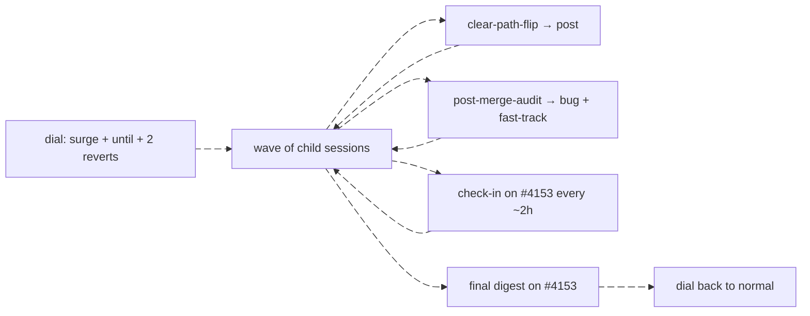

# /surge — use it or lose it, on the system

The first surge (2026-10-26, Eric: "We have 50% weekly tokens left. Invest it all in making our
systems better; use it or lose it") ran by hand: **17 issues readied, 11 shipped, 0 regrets; the
refuters stopped 4 bad calls** (#6006, #4458, #5967, #6079), 164 PRs merged, 0 reverts. This skill
is that run, with its traps written down. The dial and its numbers: `work-mode.json`,
`scripts/moneypenny/work-mode.mjs`, #3960. Compute routing for children: `docs/COMPUTE.md`.

## 1. Turn the dial — and schedule it back before you spend anything

Surge sets `work-mode:surge` on **#4153** plus a comment carrying `until <YYYY-MM-DD>`. `until` is a
whole **UTC date**, inclusive through 23:59Z, so it can never land on the reset by itself. The
reset is **midnight Central: 05:00Z under CDT, 06:00Z under CST** (CDT ends the first Sunday of
November). So:

1. **Set the dial.** One command; the comment quotes Eric's words with a UTC time, the reset in
   both clocks, and the two revert times (copy the 2026-10-26 23:12Z comment on #4153):
   `node scripts/issues.mjs update 4153 --add work-mode:surge --remove work-mode:normal --comment-file <c.md>`
   with `until <the reset's UTC date>` in the comment — the backstop if both reverts fail.
2. **Schedule the revert** ~10 min before the reset (`send_later` at 04:50Z CDT / 05:50Z CST):
   `node scripts/issues.mjs update 4153 --add work-mode:normal --remove work-mode:surge --comment-file <r.md>`.
3. **Schedule a backup** ~5 min after the reset that reads the dial (`npm run work-mode`) and
   flips it only if it still says surge. Anyone may set `normal`; the comment says so, so a
   reader after the backup time fixes it by hand.
4. Confirm with `npm run work-gate`: `position: surge`, `dispatch: true`.

## 2. Waves

A wave is 4–8 child sessions (`create_session`, tagged `issue:<n>`, cloud, `docs/COMPUTE.md`
routing — never a tier picked to save tokens; this is the one time spare quota is the point).
Sources, in pull order (`npm run rank`):

- **The Ready queue** — `/work-issues` in each child, one issue per child.
- **Triage backlogs** — Backlog `feedback` issues that might be clear: batch their numbers into
  **`.claude/workflows/clear-path-flip.js`** (`{issues: [...]}`), save the result as JSON, run
  `node scripts/clear-path-post.mjs <file> --dry-run`, then without `--dry-run`. Gate on its exit
  status, never through `| tail`. Survivors become the next wave's Ready work.
- **Debt** — `/governor` cycles (surge allows 8 dispatches a cycle).
- **Fan-out from findings** — a bug found mid-wave is filed `bug` + `fast-track` and pulled next.

After each wave merges, run **`.claude/workflows/post-merge-audit.js`** (`{prs: [...]}`) over its
PRs; each confirmed finding is filed `bug` + `fast-track` and leads the next wave.

## 3. Check in every ~2h

One `send_later` per check-in. Each posts a short footed comment on #4153 (shape: the 2026-10-26
17:54Z check-in): shipped since the last one, self-readies and refutations, stranded PRs, what is
running. Check the dial still reads surge and `main` has no reverts.

## 4. Known traps

- **A child's permission classifier may refuse GitHub writes** (a label, a comment, closing a PR
  it did not open). The child reports it; **the orchestrator relays the write** from its own
  session — never route around it inside the child.
- **The 5-hour account limit stalls children.** A stalled child is resumed with `send_message`
  after the window resets — not archived, not respawned (respawning loses its context).
- **Two sessions boarding the merge platter race.** On a rejected push: re-fetch, re-cut the item
  onto the new platter tip, re-verify. Never force-push the platter.
- **`ready` without `feedback` is never built** — no lane pulls it. `clear-path-post.mjs` adds it;
  a hand flip must too.
- **Subagent text arrives HTML-escaped** (`&lt;`) — unescape before posting
  (`clear-path-post.mjs` does).

## 5. Close

1. **Final digest on #4153** (`/secretary` shape, the 2026-10-26 22:02Z digest): a picture of what
   merged by lane, Needs Eric in order with a predicted answer each, headlines, the self-ready
   record against `docs/ISSUES.md`'s falsifier (2026-11-19).
2. **Dial back to `normal`** if the reverts have not fired yet, and cancel the ones left.
3. **One census line** in `docs/process/LEARNING-LOOP.md` → *The loop census*: which stage a
   person still did by hand this surge.
4. Archive the children whose PRs are merged or closed (the `issue:<n>` group sweep), then self.
