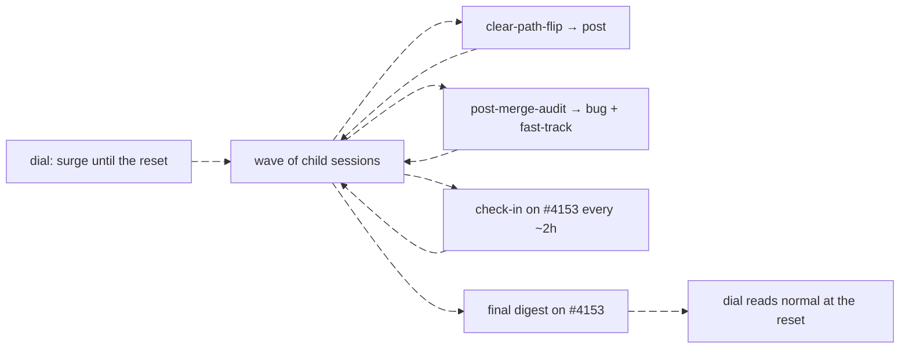

# /surge — use it or lose it, on the system

The first surge (2026-10-26, Eric: "We have 50% weekly tokens left. Invest it all in making our
systems better; use it or lose it") ran by hand: **17 issues readied, 11 shipped, 0 regrets; the
refuters stopped 4 bad calls** (#6006, #4458, #5967, #6079), 164 PRs merged, 0 reverts. This skill
is that run, with its traps written down. The dial and its numbers: `work-mode.json`,
`scripts/moneypenny/work-mode.mjs`, #3960. Compute routing for children: `docs/COMPUTE.md`.

## 1. Turn the dial until the reset

The end time comes from **`get_usage`'s `resetsAt`**, never from a clock rule: the reset read Tuesday
05:00Z on both sides of the 2026-11-01 clock change, and a date alone ran 19 hours past it on
2026-10-26. A surge's label needs no revert scheduled, because it reads `normal` at its end time by
itself, and the reader holds any surge to the next weekly reset whatever its comment says.

1. **Read the reset.** Call `get_usage` and take `resetsAt`, in UTC. If it differs from the next
   reset by `weeklyResetAnchor` in `work-mode.json`, also open a small PR correcting the anchor:
   a phone tap's surge and the reader's limit both come from that value.
2. **Set the dial.** One command; the comment quotes Eric's words with a UTC time and carries
   `surge until <resetsAt, e.g. 2026-11-03T05:00:00Z>` (the shape: the 2026-10-26 23:12Z comment on
   #4153):
   `node scripts/issues.mjs update 4153 --add work-mode:surge --remove work-mode:normal --comment-file <c.md>`.
   The comment first or within a minute: the route that follows a tap sees the end date and writes none
   of its own.
3. Confirm with `npm run work-gate`: `position: surge`, `dispatch: true`, `until` your time.

## 2. Waves — finish WIP before starting a wave (hard rule)

Eric, 2026-10-26 23:20Z: *"If churn is a concern, improve orchestration to manage WIP, complete
WIP, then resume making improvements."* **Before every new wave, count agent-owned WIP; if it is
over 6 (surge's `inFlightCap` in `work-mode.json`), start nothing — finish first.**

| Counts as WIP | How to count it | How to finish it |
|---|---|---|
| Open child sessions | `list_sessions` (yours, not archived) | resume a stalled one; archive a done one |
| Open non-held agent PRs | open PRs without `hold-merge` | drive to green; close a superseded one |
| Stranded green PRs | `node scripts/stuck-pr-scan.mjs --json` | the command the scan names |
| Unposted workflow outputs | flip results not yet through `clear-path-post.mjs`; audit findings not yet filed | post them; file them |

**Eric-held PRs are a separate count** — `hold-merge`, the platter: reported in every check-in as
*clicks owed*, never counted as WIP to finish, never "finished" by a session.

A wave is 4–8 child sessions (`create_session`, tagged `issue:<n>`, cloud, `docs/COMPUTE.md`
routing — never a tier picked to save tokens; this is the one time spare quota is the point).
Sources, in pull order (`npm run rank`):

- **The Ready queue** — `/work-issues` in each child, one issue per child.
- **Triage backlogs** — Backlog `feedback` issues that might be clear: batch their numbers into
  **`.claude/workflows/clear-path-flip.js`** (`{issues: [...]}`), save the result as JSON, run
  `node scripts/clear-path-post.mjs <file> --dry-run`, then without `--dry-run`. Gate on its exit
  status, never through `| tail`. Survivors become the next wave's Ready work.
- **Debt** — `/governor` cycles (surge allows 8 dispatches a cycle).
- **Fan-out from findings** — a bug found mid-wave is filed `bug` + `fast-track` and pulled next.

After each wave merges, run **`.claude/workflows/post-merge-audit.js`** (`{prs: [...]}`) over its
PRs; it routes money/state/auth PRs to the deep tier and skips docs-only ones by itself. Ration
`fast-track` to high-severity or member/money findings and send lane-machinery findings through the
clear-path flip instead: a 20-issue fast-track wave drew 162 Moneypenny runs in one hour and spent
the App's REST limit (#6319). File each row of the result's `prevention.proposals` as one `feedback`
issue through `/issue`: it is the spec, gate line or reviewer line for a cause seen twice, and the
workflow writes nothing itself.

**Split a big audit across child sessions.** A cloud container has 4 CPUs, so a workflow runs 2
agents at once: 37 PRs in one run is hours of deep reviews. Give each child 6–9 PRs (one
`create_session` per batch, tagged `audit`), each running the same workflow and filing its own
findings (2026-10-27: one local batch + four children).

## 3. Check in every ~2h

One `send_later` per check-in. Each posts a short footed comment on #4153 (shape: the 2026-10-26
17:54Z check-in): shipped since the last one, self-readies and refutations, stranded PRs, what is
running, WIP against the cap of 6, and clicks owed. Check the dial still reads surge and `main` has no
reverts.

## 4. Known traps

- **A child's permission classifier may refuse GitHub writes** (a label, a comment, closing a PR
  it did not open). The child reports it; **the orchestrator relays the write** from its own
  session — never route around it inside the child.
- **The 5-hour account limit stalls children.** A stalled child is resumed with `send_message`
  after the window resets — not archived, not respawned (respawning loses its context).
- **Two sessions boarding the merge platter race.** On a rejected push: re-fetch, re-cut the item
  onto the new platter tip, re-verify. Never force-push the platter.
- **A ready issue nothing builds.** The lane takes every ready non-plan issue (#6219); if one
  still sits Ready past a tick, check `pullable()` before re-flipping it.
- **Subagent text arrives HTML-escaped** (`&lt;`) — unescape before posting
  (`clear-path-post.mjs` does).

## 5. Close

1. **Final digest on #4153** (`/secretary` shape, the 2026-10-26 22:02Z digest): a picture of what
   merged by lane, Needs Eric in order with a predicted answer each, headlines, the self-ready
   record against `docs/ISSUES.md`'s falsifier (2026-11-19).
2. **Dial back to `normal`** if the reset has not come yet and the spare quota is spent. After the
   reset it already reads `normal`, and the next push to `main` replaces the label with
   `work-mode:normal` and says so on #4153, so next week's tap on surge adds the label.
3. **One census line** in `docs/process/LEARNING-LOOP.md` → *The loop census*: which stage a
   person still did by hand this surge.
4. Archive the children whose PRs are merged or closed (the `issue:<n>` group sweep), then self.
