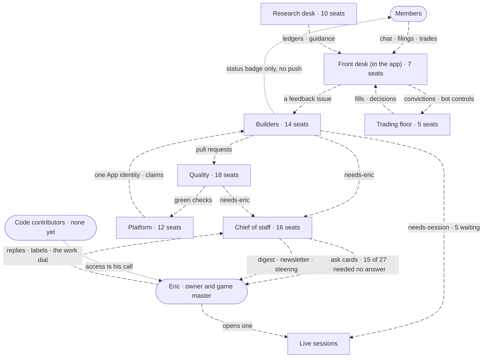

<!-- GENERATED by scripts/org-chart.mjs from docs/agents/seats.json. Edit the registry, not this page. -->
# The org chart — who talks to whom

Every seat that does work here, human or agent, and the channels between them, as of 2026-11-07 · main caf8770cc.
It is two things at once:

- **The benchmark for reverse Conway** (Eric, 2026-11-07). A system copies the communication
  structure that builds it. So the edges below carry their measured friction, and changing an edge
  on purpose is how the system gets the shape we want.
- **Compact context for a workflow.** One read gives a session or an agent every seat's job, what
  wakes it, what it says and where its code lives, without re-deriving the system by grep.

_Caption — the departments and people, from `docs/agents/seats.json`; dotted edges are paths with no push or no access yet._

## Where the talk breaks down

The friction census (2026-11-07): each row is a communication edge with a breakdown, measured where
we could, the change that would give the shape we want, and where that change is tracked.

| Edge | Channel | What goes wrong | Measured | The change | Tracked in |
|---|---|---|---|---|---|
| Members → front desk → builders | the in-app chat (the dock under every page) and coach, filed as a GitHub issue | Members almost never file from the app. One untested reading (Conway): the intake is shaped like the build team's issue capsule (app/src/live/moneypenny-filing.ts:30-34), not like play. | 2 in-app filings since 2026-10-01 (#4861, #6007), both Eric's; the last other member filing is #716 (2026-08-28). Nearly all of the 238 feedback issues since 10-01 were filed by sessions under Eric's account (#7031) | Feedback becomes a game act: a one-tap reaction and a Suggest a change that knows the quest | #7029 |
| Builders → members | the feedback status badge; the chat's work-status lookup | A member hears back about their ask only by revisiting: no push about asks reaches them (trade alerts by email are opt-in). | unmeasured (no member filings to measure against) (src/companion/companion-tools.ts:197) | 'Your ask shipped' becomes a moment on the landing page, with a Try it quest | #7029 |
| Every lane → Eric | the needs-eric label, then an assigned ask card | Lanes send questions that are not his to answer; most clear later without him, so the real ones wait. | 31 of 46 lane asks 09-26 to 10-26 were not decisions, 17 of them from conflict repair, since rerouted by #6010 (#6079); then 15 of 27 cleared without his answer, median ask 85h before #6953's fixes (#6079; #6953) | Ask 'only his?' before an edge points at Eric; a class whose predictions keep matching graduates (docs/process/ALIGNMENT.md) | docs/process/LEARNING-LOOP.md → Decisions reaching Eric (checks 11-20, 12-04) |
| Lanes and sessions → live sessions | the needs-session label | Lanes hand work to a live session, but no session is scheduled to read the label. | 8 open on 2026-11-07, the oldest waiting 12 days, 1 of them from a repair lane; 5 after a live session cleared 3 (#7036) (.github/prompts/moneypenny-conflict-repair.md:26; #4555) | Staff it: a scheduled cloud routine pulls needs-session oldest first, or lanes may edit .claude/skills/ behind the envelope check | #7032 |
| Chief of staff → Eric | a push, a comment on #7024, a private steering page | Several report pipes to one reader. The one he answered most, pictures with taps, needs a live session to publish. | steering pages drew 87 answers 2026-10-10 to 10-16, then none (#6953); #7024's reply path has carried 0 replies (first edition due 2026-11-08) (#6953) | Shipped: the digest, steering page and newsletter read one source of 'needs you' (#6953). Still untracked: publishing the tap page from a routine | docs/process/LEARNING-LOOP.md → Decisions reaching Eric |
| Builder ↔ builder | the admission gate's surface fence, which compares issue prose | Two builds of the same code run at once; one is wasted and often lands in conflict repair. | 3 of 3 closed lane PRs in the week to 2026-10-26 were superseded duplicates (#6250) (scripts/moneypenny/admission.mjs:25-32) | Fence by the files a build will touch, not by its words | #6250 |
| Every lane → GitHub | the App identity and the event router; every label and comment is an event | In a surge hour the lanes' talk exhausts the App's hourly REST budget. | 162 runs in one hour on 2026-10-27; 11 failed, 14 by 03:03Z, on the rate limit (#6319) (#6319) | Fewer, richer messages: the router skips events it will not act on; conditional reads | #6319 |
| Live session → a running workflow agent | none sanctioned | Messaging a running workflow agent starts a second copy in the same worktree. The lesson lived in one machine's private memory. | one incident (2026-10-11) (docs/DELEGATION.md rail 2 (moved from private memory, 2026-11-07)) | Workers read a file between steps; the lesson now sits in docs/DELEGATION.md rail 2, which CLAUDE.md sends every session to | docs/DELEGATION.md rail 2 (done) |
| Sessions → reviewers and coaches | an agent call, or a phrase from Eric | Seats with no reporting line don't run, so the check each one stands for doesn't happen. | review agents ran 4 times in 45 days (docs/review/README.md:10); the linguist 0 times (docs/COACHES.md:535); the debt coach only when a surge started it (7 cycles, 10-26 to 11-02, #4527) (docs/review/README.md:10; docs/COACHES.md:535; #4527) | Every seat names its invoker or is benched; this page lists the ones nothing starts | #6886 |
| Board lanes → the board | the owner's personal Projects board | Lanes cannot create or regroup views, so each view change waits for Eric's click. | 4 of 4 view creates refused with 404 (2026-11-05) (#6883) | Settle whether the API can; if not, one card with the clicks, once | #6883 |
| Learning-loop checks → owners | a comment on tracker #5724 | Loop checks sat unread on tracker #5724 until their decide step was routed (fixed 2026-10-26, scripts/loop-check.mjs); other lanes still post output only to tracker comments. | 5 checks 4 to 16 days past due before the fix (2026-10-26) (docs/LESSONS.md:200-205) | Re-run the loop census for the other tracker-comment outputs | docs/LESSONS.md side quest |

**The shape today is a star.** Every decision a lane cannot settle ends at Eric, and most lane seats
speak through one App identity and one router (the board and member filings use separate tokens).
He gets the digest, newsletter and ask-card pushes; members get no push about their asks. Nearly all
feedback is filed by sessions under his account, and no other member has filed from the app since
2026-08-28.

**The shape we are steering toward:**

- Peers decide what is reversible and in-envelope; only the irreversible class and taste calls reach Eric, once, with a prediction.
- The live-session department has staff on a schedule, so a hand-off never waits on Eric opening a laptop.
- Members speak through play (reactions, quests, Try it) and hear back where they play.
- Builds coordinate by the files they touch, and the lanes talk to GitHub in fewer, richer messages.
- Every seat names what starts it; a seat nothing starts is benched or given an invoker.

## Seats with no reporting line

- **Nothing starts these (1):** Reader-comprehension checker (linguist). Each needs an invoker, or the bench (`/charter` sunset mode).
- **Only Eric starts these (16):** Invites and claims · Owner bot controls · Ticker sweep · Reference teardown · Link intake · Design build lane · Human-directed lane · Live backlog burn-down · Screen redesign loop and its board · Render-note translator · Art direction writer · Debt head coach and drills · Steering pages · Memory review · Roster gatekeeper: hire, bench, retire · Quota surge. Each is a phrase he has to remember; a schedule or an event would take it off him.

## The crew on the deck

How the chart reads to a member, through the landing page (#7018) and the campaign (#6948). Only
seats a member deals with get a station, named by its job. The rest work below decks: a member
feels them only as honest timing on their own ask ("queued behind 2 builds"), never as a screen
(Eric, 2026-11-07, #6948: "if we have to explain implementation details, were doing something wrong").

| Station | Seat behind it |
|---|---|
| The owner's office: who joins, and whether the bots run | Owner and game master (Eric) |
| The game master's chair: steers the story, posts marked as the GM's | Game masters |
| The front desk: quick answers in chat; drafts, never acts | Companion chat (Moneypenny in the app) |
| Your trade desk: only you place orders on your own account | Desk ownership gate (only the owner fires orders) |
| The briefing desk: the day's market conditions, and what you make of them | Landing page briefing and narrator |
| The trading floor: your bots, each a character with a strategy | Bot runtime (paper) |
| The research desk: what is coming up, and what the house has written about it | Market-event calendar |

Below decks: 60 seats, every one in Builders, Quality, Chief of staff and Platform. A
member sees their own ask's status in plain words, never the lanes.

## The board's Role lanes

Each open card on the Orchestration board gets a **Role**: the seat whose queue it sits in, and
the field the seat swimlanes group by (#6886 slice 3 adds that view). The sync writes it from these
rows and the issue's labels (`scripts/moneypenny/projects-role.mjs`); a card whose labels match
more than one row takes the first. A card no row pulls gets no Role and sits in "No Role" until
someone triages it. Who must act first is the card's "Waiting on" field, not its Role.

| Order | Role | Seat | Pulls cards labelled |
|---|---|---|---|
| 1 | Live sessions | Live sessions | `needs-session` |
| 2 | Design builds | Design build lane | `handoff` `needs-design` |
| 3 | Event research | Event research lane | `event-research` |
| 4 | Plan builds | Plan build lane | `plan` |
| 5 | Feedback builds | Feedback build lane | `feedback` `bug` `fast-track` `ready` |
| 6 | Bottleneck research | Batch chore fan-out and stage runner | `bottleneck` |

## Departments

### People

Decide, play, and (one day) contribute code.

| Seat | Job | Wakes on | Speaks on | Status | Code roots |
|---|---|---|---|---|---|
| Owner and game master (Eric) | Makes the decisions only he can: needs-eric asks, merging held and platter PRs, approving ops runs, turning the work dial to surge or conserve | A GitHub assignment carrying an ask card; the digest push notification; the newsletter | A reply comment on the issue, labels, a merge click, an Environment approval, a work-mode label on #4153 | hired | `scripts/moneypenny/assignments.mjs` `scripts/moneypenny/work-mode.mjs` `src/server/auth/allowlist-store.ts` `src/server/invite-form.ts` `src/server/dashboard-auth-gate.ts` |
| League members | Invite-only friends and family who sign in, trade their own paper account, chat with Moneypenny, give views to their own bots and file feedback | the in-app chat (the dock under every page), feedback status badges, the follow-up form when an issue goes needs-info | orders on their own desk, rail messages, feedback filings, conviction card taps, follow-up answers | hired | `src/server/auth` `src/server/trade-orders-routes.ts` `src/server/feedback-service.ts` `app/src/shell/moneypenny-dock.tsx` |
| Would-be code contributors | People who may want to improve the app through code; the repo is public, but granting repo or app access is Eric's call | the public repo, the weekly newsletter archive | comments on issues and PRs (the human-directed lane answers only OWNER/MEMBER/COLLABORATOR) | planned | `.github/workflows/claude.yml` |
| Game masters | Steer the narrated campaign by posting into a scene, marked as the GM's post | the landing page scenes | GM posts on a scene | planned |  |

### Front desk (in the app)

Every surface a member touches: chat, filings, the trade desk, the landing page.

| Seat | Job | Wakes on | Speaks on | Status | Code roots |
|---|---|---|---|---|---|
| Companion chat (Moneypenny in the app) | Answers member questions with Claude using a closed list of nine read-only lookups and two draft hand-offs; has no code path that places an order | POST /api/companion/chat from the dock under every page | streamed SSE reply; draft_feedback and draft_conviction cards for the chat | hired | `src/server/companion-routes.ts` `src/companion/companion-tools.ts` `src/companion/companion-convictions.ts` `src/companion` `app/src/shell/moneypenny-dock.tsx` `app/src/live/moneypenny.ts` `app/src/live/moneypenny-script.ts` |
| Feedback intake: rail filing, coach and filer | The one place the rail files feedback: a draft the member said send to, or their own words, shaped once by the feedback coach | the member's 'send' on a drafted filing | POST /api/feedback; a system line saying filed and triaged | hired | `app/src/live/moneypenny-filing.ts` `src/server/feedback-coach.ts` `src/server/feedback-coach-model.ts` `src/server/feedback-coach-limits.ts` `src/server/feedback-service.ts` `src/server/feedback-api-routes.ts` |
| Feedback status and follow-up | Lets a member answer a needs-info question from inside the app and restarts the build | an issue going needs-info | POST /api/feedback/followup; the ready label is removed and re-applied for the restart | hired | `src/server/feedback-followup.ts` `src/server/feedback-status.ts` |
| Conviction hand-off card | Shows a market view Moneypenny drafted and acts only on the member's exact tap: hand it to my bots, save as draft, or not now | a draft_conviction card from the companion chat; the member's chip tap | /save and /hand-over posts that steer the member's own bots | hired | `app/src/live/moneypenny-conviction.ts` |
| Desk ownership gate (only the owner fires orders) | Only the account's owner places orders on it or sees which playbooks a bot runs; other members see state and verdicts with playbook ids withheld | every per-account read and order | redacted desk JSON; refused orders | hired | `src/server/desk-owner-gate.ts` `src/server/trade-orders-routes.ts` |
| Invites and claims (owner cards) | Owner-only settings cards to add members to the guest list and manage account claims | Eric | allowlist.json on the volume (encrypted) | hired | `src/server/invite-form.ts` `src/server/claim-form.ts` `src/server/admin-api-routes.ts` |
| Landing page briefing and narrator | Signed-in home: the gist of market conditions in a newspaper format, with three actions on every scene: ask and research, steer, act | campaigns, research ledgers, prices | a briefing; questions; tickets with exits | planned |  |

### Trading floor

The bots, their personas and playbooks, all on paper.

| Seat | Job | Wakes on | Speaks on | Status | Code roots |
|---|---|---|---|---|---|
| Bot runtime (paper) | Autonomous trader loop: market data and news feed momentum and sentiment; every 15s while the market is open each enabled persona assesses, guards filter, and paper orders go out only in live mode | Alpaca ticks and a 60s news poll; GET /controls every 30s | paper orders (live mode), decisions replicated to the app over POST /decisions | hired | `src/scripts/run-autonomous.ts` `src/autonomous` `src/bots` |
| Bot personas | Nine strategy characters (Sauron, News Fader, Retail Investor, Futurist, Gold Bug, Day Trader, Rumor Trader, Banker, Prospector), each with a thesis and a lore line; members pick one as a character class when they add a bot | the bot runtime's cycle | intents per cycle; display identity on the observatory | hired | `src/personas` `src/observatory/persona-lore.ts` `src/server/persona-classes.ts` |
| Playbooks and subscriptions | A playbook is a strategy run on a ticker (a pair); a subscription turns a pair on inside an account's allocation and points at the owner's dated conviction | subscriptions and convictions carried on the controls poll | what the book should hold each cycle; a failed conviction check stops new entries | hired | `src/playbooks` `docs/architecture/playbook-anatomy.md` |
| Owner bot controls | Owner toggles to suspend or resume bots and set the companion model, stored durably on the app volume and read by the bots | Eric | bot-controls.json, served on GET /controls | hired | `src/server/bot-controls-store.ts` |
| Bots deploy catch-up clock | The one repo cron: starts a stopped bots machine, deploys a stranded bot fix via force_bots_deploy, reads pace, wakes the lanes, runs fitness contracts | cron 7,22,37,52 * * * *; dispatch | A pipeline dispatch, a machine start, [fitness] issues, a scan dispatch | hired | `.github/workflows/bots-catchup.yml` `scripts/bots-start-stopped.sh` `scripts/bots-deploy-preflight.mjs` |

### Research desk

The event calendar, the research ledgers, position guidance, campaigns.

| Seat | Job | Wakes on | Speaks on | Status | Code roots |
|---|---|---|---|---|---|
| Market-event calendar | Forward calendar of dated things that move the traded names (prints, macro, launches, Treasury supply, geopolitics), one JSON file per event | research PRs that add or amend event files | query functions the app and campaigns read | hired | `src/domain/market-events.ts` `src/domain/market-events-data.ts` `src/domain/market-events/` |
| Event research lane | One Sonnet session per due event (matrix, max-parallel 8) writes the ledger and opens a research/<id> PR | scan dispatch with a non-empty due list | A research PR; a quota reading published to #4153 | hired | `.github/prompts/event-research.md` `research-dispatch-budget.json` `.github/workflows/moneypenny-events.yml` `scripts/moneypenny/events.mjs` `docs/research/events/` `scripts/event-scan.mjs` |
| Discovery research lane | One Sonnet session per member question no campaign covers (matrix, max-parallel 3) writes a research-shelf write-up and opens a discovery/<slug> PR | daily schedule, or a manual dispatch | A discovery PR; the dashboard drops the answered ask once the write-up deploys | hired | `.github/prompts/discovery-research.md` `.github/workflows/moneypenny-discovery.yml` `src/domain/discovery-pass.ts` `src/domain/discovery-queue.ts` `docs/research/discovery/` |
| Pulse screen (no model) | Screens interval-elapsed pulses without a model and opens a moneypenny/screen-* PR with the ledger rows | push or scan | A screen PR, auto-merge attempted | hired | `scripts/moneypenny/open-screen-pr.mjs` `scripts/event-material-scan.mjs` |
| Research PR sweep and stall repair | Finds an open research/<id> PR that stopped moving and frees the event it holds | Push audit | Rearm or close intents | hired | `scripts/moneypenny/research-pr-sweep.mjs` `.github/prompts/moneypenny-event-stall-repair.md` |
| Position guidance | Reads market inputs live through the member's own account, checks each one's freshness against its source, adds the nearest research ledger's summary; the stake math runs in the browser | GET /api/trade/guidance?symbol= | market half of guidance plus freshness rows | hired | `src/server/guidance-route.ts` `src/server/guidance-pulse.ts` `src/server/guidance-market.ts` |
| Campaigns | A market or sector people want to play, held as a record (storyline, sector, cast of symbols, forces, open questions) that links calendar events and news; three house campaigns plus members' own, each answering one landscape read (what moved, what is scheduled, what is reported, what the house has tested) | A PR adding or editing src/domain/campaigns/<id>.json, a member's saved form, or `npm run campaign:landscape` | the landscape read, every line marked measured, reported or estimated; the explore and find-names encounters it generates, each question before its answer, and build a strategy's names handed to the conviction, authored-play or chain form, left only with a view or a shadow test (`--encounters`); event-scan --due rows name the campaigns that link them, and research dispatch ranks those first | on trial | `src/domain/campaigns.ts` `src/domain/campaigns/` `src/domain/campaign-landscape.ts` `src/domain/campaign-encounters.ts` `src/domain/campaign-strategy.ts` `scripts/campaign-links.mjs` |
| Ticker sweep (symbol-sweep) | Runs earnings-cycle + intraday-edges instruments per ticker, red-teams each, judges playbook fit | 'research X, Y, Z', 'run the sweep on' | research docs under docs/research/ | hired | `.claude/workflows/symbol-sweep.js` `docs/research/multi-symbol-sweep.md` |
| Reference teardown (teardown) | Redacts and decomposes another app's screens into named patterns with a borrow/adapt/skip call sheet | screenshots of someone else's app | comment on the plan issue; images in a private artifact | hired | `.claude/skills/teardown/SKILL.md` `scripts/teardown/redact.mjs` |
| Link intake (intake) | Reads a dropped post/video/talk without an account, finds the primary source, records what it changes | Eric pastes a link 'to scan' | findings applied to process docs | hired | `.claude/skills/intake/SKILL.md` |

### Builders

Turn ready issues and plans into merged pull requests.

| Seat | Job | Wakes on | Speaks on | Status | Code roots |
|---|---|---|---|---|---|
| Feedback triage | On a fresh feedback or fast-track label, self-readies a curated filing or a bug+fast-track; everything else waits in Backlog | issues labeled feedback or fast-track | The ready label, or nothing | hired | `scripts/moneypenny/index.mjs` |
| Feedback build lane (with reply resume) | Builds a ready feedback/bug issue end to end on a feedback/<n> branch and opens a PR; model picked from the issue's skynet-spec block: Haiku for one criterion and no assumptions, Sonnet for up to 3 criteria, Opus otherwise, including any issue with no spec block | ready label, an unpark (needs-* or hold-merge removed), the retry sweep | A PR, a receipt comment, one of four endings; needs-session via the guard | hired | `.github/workflows/moneypenny-events.yml` `.github/prompts/feedback-build.md` `scripts/moneypenny/model-tier.mjs` `scripts/moneypenny/feedback-guard.mjs` `scripts/moneypenny/reply-resume.mjs` `scripts/moneypenny/index.mjs` |
| Plan build lane (with continuation and relay) | Builds the slice a ready plan issue's state block names, on a plan/<n> branch | A ready comment from OWNER/MEMBER/COLLABORATOR, the ready label, an unpark, the retry or continuation sweep | A slice PR, a state-block edit, needs-eric when stuck | hired | `.github/prompts/plan-build.md` `scripts/moneypenny/plan-claim.mjs` `scripts/moneypenny/continuation.mjs` `scripts/moneypenny/state-block.mjs` `scripts/moneypenny/relay.mjs` |
| Retry sweep (claims the next ready issue) | Claims the top-ranked admissible ready issue in either lane; on a push it only peeks, then re-dispatches itself as scan | workflow_dispatch scan (from the push re-dispatch, the wake, or the clock) | A lease and a build job | hired | `scripts/moneypenny/index.mjs` `scripts/moneypenny/labels.mjs` |
| Design build lane | Builds the artboards marked build on a design canvas and leaves the receipt on the canvas | A one-tap POST of the canvas URL to the routine's API trigger | A PR and a canvas receipt | hired | `.github/prompts/design-build.md` |
| Human-directed lane (@claude on an issue) | Any comment from OWNER/MEMBER/COLLABORATOR on an issue or PR thread, or a new issue with @claude, starts or steers an Opus session | issues opened/labeled with @claude, issue_comment, PR review comment | Comments, PRs | hired | `.github/workflows/claude.yml` `.github/prompts/interactive.md` |
| Issue shaper (issue) | Files or rewrites a GitHub issue as a capsule for a human and a zero-context build session | 'file this as an issue'; any fan-out route; bottleneck capture | a GitHub issue, linted by issue-lint.mjs | hired | `.claude/skills/issue/SKILL.md` `scripts/issue-lint.mjs` `docs/ISSUES.md` |
| Requirements writer (ears) | Turns a raw request into EARS-format requirements and scaffolds matching BDD specs | /fitness step 1 (an outcome or incident becomes one EARS line); writing acceptance criteria | acceptance criteria and spec scaffolds | hired | `.claude/skills/ears/SKILL.md` |
| Live backlog burn-down (work-issues) | Pulls the next Ready issue the admission gate admits, echoes the ask, builds in a worktree, ships, repeats | 'work through the backlog', 'burn down issues'; needs-session issues | echo comment on the issue, PRs | hired | `.claude/skills/work-issues/SKILL.md` `scripts/moneypenny/admission.mjs` |
| Screen redesign loop and its board (redesign) | Align, scope, design rounds (1-5 shapes), learn-forward retro for one screen | 'redesign the trade form'; a 'Start redesign: <id> (<route>)' comment from the feedback board | round pages (steer machinery), a filed build issue, docs/PATTERNS.md rows | hired | `.claude/skills/redesign/SKILL.md` `scripts/redesign/` `docs/process/REDESIGN.md` `scripts/redesign/board.mjs` |
| Render-note translator (telestrator) | Turns 'this looks terrible / a 30/100' into a named technical cause and fix | any reaction to a rendered frame | cause -> fix table in session | hired | `.claude/skills/telestrator/SKILL.md` |
| Art direction writer (vision) | Writes forged-epic art direction and compiles it into buildable contracts and generator prompts | 'make it feel alive', a new 3D piece brief | prose -> mechanics table, bounded prompts (e.g. docs/art/EYE.md) | hired | `.claude/skills/vision/SKILL.md` `docs/art/` |
| Diagram expert (mermaid) | Picks the Mermaid type by story and proves it renders on GitHub; loads one reference card on demand | any mermaid block being written or reviewed | diagrams in PRs, issues, architecture pages | hired | `.claude/skills/mermaid/` `scripts/mermaid-skill-scan.mjs` |
| Motion skills (vendored from Emil Kowalski) | Nine DOM and CSS motion skills: build one animation (animate), several together (choreograph), find, remove, audit and speed up motion, and name an effect; house tokens and rules win where they meet | motion work on a member surface; a named motion effect; Eric running review-animations | the animation in the diff; a plan as a GitHub issue | hired | `.claude/skills/animate/` `.claude/skills/choreograph/` `.claude/skills/review-animations/` `.claude/skills/improve-animations/` `.claude/skills/find-animation-opportunities/` `.claude/skills/remove-animations/` `.claude/skills/animation-performance/` `.claude/skills/animation-vocabulary/` `.claude/skills/emil-design-eng/` `docs/vendor/emil-kowalski-skills.md` |

### Quality

Gates, repair lanes, reviewers and the debt coach.

| Seat | Job | Wakes on | Speaks on | Status | Code roots |
|---|---|---|---|---|---|
| Pipeline checks: verify, integration tests, stability budget | PR checks: commitlint, typecheck, lint, tests; Playwright against an offline build; memory budget in a 512 MB container | pull_request opened/synchronize/reopened/ready_for_review/edited; e2e also on push main | Required checks | hired | `.github/workflows/pipeline.yml` `e2e/` |
| Envelope gate (the irreversible class) | Mechanical answer to 'is this the irreversible class?': protected path globs plus a no-new-runtime-dependency rule; red on feedback/, research/, design/ branches | Every arm attempt; ship.sh checkarm; a lane's verify | Refuses to arm; red check on lane branches | hired | `envelope.json` `scripts/envelope-scan.mjs` |
| Fitness contracts and their writer (fitness) | Runs the must-stay-true contracts and keeps one [fitness] <id> issue per failing contract | The 15-minute clock | [fitness] issues, assigned once the fix budget is spent | hired | `scripts/fitness.mjs` `.claude/skills/fitness/SKILL.md` `scripts/fitness-audit.mjs` |
| CI repair lane | A failed run on main of five watched workflows files or reopens one ci-failure capsule per signature and dispatches an Opus repair session; four loop guards | workflow_run completed for Events, Pipeline, Autonomy ops, Fly logs, Companion eval | A ci-failure issue, a repair PR | hired | `.github/workflows/moneypenny-repair.yml` `scripts/moneypenny/repair.mjs` `.github/prompts/moneypenny-ci-repair.md` `scripts/moneypenny/red-session-pr.mjs` `scripts/moneypenny/red-lane-pr.mjs` |
| Conflict repair | Resolves a PR conflicted against main with a merge commit | workflow_dispatch pr_number from the stall audit | A pushed merge commit for a disjoint conflict; a needs-session hand-off on an issue (or a closed machine-lane PR) for a same-logic one; needs-eric only for the irreversible class. The stall audit stops re-dispatching after 3 repairs and labels needs-eric. | hired | `.github/prompts/moneypenny-conflict-repair.md` |
| Stall audit and watchdogs | Flags stalled receipts, silent feedback, unclaimed plan flips and conflicted PRs; clears stale in-progress; hands conflicts and stalls to repair | push to main (--audit) | Comments, labels, repair dispatches | hired | `scripts/moneypenny/audit.mjs` `scripts/moneypenny/capsule-stall.mjs` `scripts/moneypenny/burst-alarm.mjs` `scripts/moneypenny/clock-watch.mjs` |
| Lessons: drafter and blameless retro (retro) | When a repair capsule closes, drafts its docs/LESSONS.md entry and opens it as a PR | issues closed on a ci-failure capsule | A LESSONS PR | hired | `scripts/moneypenny/lesson-draft.mjs` `.claude/skills/retro/SKILL.md` `scripts/incident-scan.mjs` `docs/LESSONS.md` |
| Dependency PR reviewer (dep-warden) | Reads changelogs on dependabot PRs, verifies, merges patch/minor on green, escalates majors | dependabot opening a PR | auto-merge via ship.sh automerge, or escalation | hired | `.claude/agents/dep-warden.md` `.github/workflows/moneypenny-events.yml` |
| House-standards reviewer (reviewer) | Reads a diff against this repo's standards; process-file lens reads a rule diff as the next session will | /ship when CLAUDE.md, .claude/** or .github/prompts/*.md is in the diff; secretary Blue team; 'review this' | findings returned to the session; 'Process-file lens: <n> findings' in the PR body | hired | `.claude/agents/reviewer.md` |
| Security attacker (red-team) | Adversarially attacks a bounded diff on auth, invite gate, input parsing; returns an attack/defense matrix | diffs touching auth/credentials/parsing; secretary Red team; reviewer's recommendation | attack/defense matrix to the caller | hired | `.claude/agents/red-team.md` |
| Reader-comprehension checker (linguist) | Checks whether persona copy or an issue/PR fold lands for its cold reader | named by orient.md, reviewer boundary, issue-lint hint | comprehension findings | hired | `.claude/agents/linguist.md` |
| Evals expert (evals-expert) | Author mode writes a check; blind grader mode writes deliberate bugs without reading the spec | /fitness steps 7 and 10; 'how would we know if this broke' | bug list + attack returned to the caller | hired | `.claude/agents/evals-expert.md` |
| Post-merge correctness audit | Reviews merged PRs against main per lens, refutes each high/medium finding twice | after a surge wave, governor cycle or burn-down | confirmed findings for a session to file as bug + fast-track; receipts in post-merge-audit.jsonl | hired | `.claude/workflows/post-merge-audit.js` `docs/review/` |
| Review lenses and their replay | Replays one review lens over labelled PRs and scores it before it runs for real | a lens under docs/review/lenses changes | results scored by scripts/review-replay.mjs | on trial | `.claude/workflows/review-replay.js` `scripts/review-replay.mjs` `docs/review/lenses/` |
| Information-architecture reviewer (IA lens) | Reads a route, nav or docs/IA.md change for a page a member can no longer reach, data placed at a key it is not fetched by, or a home that contradicts the written IA decision | a review-replay run of the information-architecture lens; joins post-merge-audit only once its replay keeps it | findings scored by scripts/review-replay.mjs, never filed while on trial | on trial | `docs/review/lenses/information-architecture.md` |
| How-Eric-writes replay (intent-replay) | Replays real messages with and without the how-he-writes page, one blind judge | docs/READERS.md page or the eval set changes; dated check in LEARNING-LOOP | results scored by scripts/intent-replay.mjs | hired | `.claude/workflows/intent-replay.js` `docs/evals/how-he-writes-set.json` |
| Debt head coach and drills (governor) | One dispatch cycle per coach: WIP check, gate-named target, collision check, cheap athlete via the governor chore, one cycle PR; also owns the merge-policy table | 'run the coaches', 'clean up the code', 'burn down debt' | a cycle PR; ratcheted *-budget.json | hired | `.claude/skills/governor/SKILL.md` `docs/grind/governor.instructions.md` `.claude/skills/decompose/SKILL.md` `.claude/skills/dedupe/SKILL.md` `.claude/skills/bury/SKILL.md` `.claude/skills/backfill/SKILL.md` |
| Unused-capability check (config-audit) | Reference-counts .claude capabilities nothing routes to, owner-claim contradictions, recurring corrections | daily digest Routine ride-along | digest Needs-you tier | hired | `scripts/config-audit.mjs` |

### Chief of staff

Pace the work, route decisions to Eric, report at altitude.

| Seat | Job | Wakes on | Speaks on | Status | Code roots |
|---|---|---|---|---|---|
| Admission gate | Between ready and a build start: refuses on halt; on conserve unless fast-track; at the in-flight cap (one fast-track may go over it at a time); at the started-plan cap for a fresh plan; and on the surface fence (another build on the same Surface), which fast-track does not bypass. A refused issue keeps ready and holds no lease | Every claim attempt (feedback, plan, retry sweep, continuation) | admit / one queue note on the issue | hired | `scripts/moneypenny/admission.mjs` |
| Work dial and spend breaker | One work-mode:<halt\|conserve\|normal\|surge> label on #4153 sets every lane's caps; a tap clears the other label and writes an end date | A work-mode label added to #4153: halt or normal by anyone, conserve by a session after Eric's phrase, surge by Eric alone; the spend breaker trips itself when 4h spend crosses research-circuit-breaker.json's line | Caps every lane reads; #4153's title | hired | `work-mode.json` `scripts/moneypenny/work-mode.mjs` `scripts/moneypenny/dial-tap.mjs` `scripts/moneypenny/work-mode-title.mjs` `research-circuit-breaker.json` `scripts/moneypenny/circuit-breaker.mjs` `scripts/moneypenny/work-gate.mjs` |
| Decisions for Eric: ask cards, assignment, read-back | needs-eric plus a Needs-from-you callout becomes a GitHub assignment to ejclark with a card of options, prediction and what silence does; at most 3 new a tick | Push sweep | An assignment and one comment; unassign when the label goes | hired | `scripts/moneypenny/assignments.mjs` `scripts/moneypenny/ask-card.mjs` `scripts/moneypenny/answer-readback.mjs` `scripts/moneypenny/decision-callout.mjs` |
| Shipped and plan closers | Close feedback and research issues whose work merged, and plans whose sub-issues are all done | Push sweep | Issue closes | hired | `scripts/moneypenny/shipped.mjs` `scripts/moneypenny/plan-close.mjs` |
| Daily digest (secretary) | When digest-scan says due, writes the three-tier digest with ride-along audits and ships it; push-notifies the needs-you count | claude.ai Routine daily 12:00 | docs/digests/<date>.md via /ship; a push notification | hired | `.claude/skills/secretary/SKILL.md` `scripts/digest-scan.mjs` `scripts/newsletter.mjs` `docs/digests/` |
| Weekly newsletter | Writes the closed ISO week's edition, or posts the week so far | claude.ai Routine Monday 00:05 UTC, or Run now | docs/newsletters/<week>.md, one comment on #7024, a push line | hired | `scripts/newsletter.mjs` |
| Steering pages (steer) | Gathers shipped / needs-Eric / queued, builds one page of pictures, publishes, reads his taps back into issue comments and label moves | 'steer', 'the morning page', 'what needs me', 'steered' | a published steering page; footed issue comments and label moves | hired | `.claude/skills/steer/SKILL.md` `scripts/steer/` |
| Orchestration board sync and setup | Keeps the 'Skynet Capital — Orchestration' project's Status, Priority and card fields matching each issue's labels and state | Every issues event | Board cards (PROJECTS_PAT, not the App token) | hired | `scripts/moneypenny/projects-sync.mjs` `scripts/moneypenny/projects.mjs` `scripts/moneypenny/projects-priority.mjs` `scripts/moneypenny/projects-fields.mjs` `.github/workflows/board-sync.yml` `scripts/moneypenny/pr-in-progress.mjs` `scripts/moneypenny/projects-reconcile.mjs` `.github/workflows/projects-setup.yml` `scripts/moneypenny/projects-setup.mjs` `scripts/moneypenny/projects-views.mjs` `scripts/moneypenny/projects-backfill.mjs` |
| Weekly pace reading | Report-only reading of the week's quota use, kept on #4153's title and body | The 15-minute clock; build legs publishing usage | #4153 title (e.g. 'pace: week 43% used') | hired | `scripts/moneypenny/quota.mjs` `scripts/moneypenny/pace-reading.mjs` |
| Opening-move router (Orient output style) | Loads on every prompt: names the situation, interrogates compounding directives, routes to the skill/agent whose 'Use when' matches | every user prompt (default output style) | the response shape; routes to /grind interrogate chore, /journey, /code-review, /security-review | hired | `.claude/output-styles/orient.md` |
| Directive interrogation chore | Red/blue/tiger/yellow pass on a compounding directive; one call sheet on the issue plus a routing label | Orient step 2 when an objection survives; the plan build lane | call sheet comment + routing label on the issue | hired | `docs/grind/interrogate.instructions.md` |
| Clear-path readiness judge | Judges issues against four clear-path checks, refutes each positive twice, returns survivors; posts nothing | surge pass over the triage backlog, or a session batch | a JSON result a session feeds to scripts/clear-path-post.mjs (ready label + footed comment) | hired | `.claude/workflows/clear-path-flip.js` |
| Memory review (dream) | Reviews auto-memory against recent sessions, hands back at most 5 evidence-backed changes; changes nothing itself | 'dream', 'review memory', 'the same correction keeps coming back' | a take/discard page; promoted changes via run-memory.mjs and a PR | hired | `.claude/skills/dream/SKILL.md` `.claude/workflows/dream.js` `scripts/dream-digest.mjs` `scripts/run-memory.mjs` |
| Roster gatekeeper: hire, bench, retire (charter) | Researches and specifies a new agent or re-scopes/sunsets one; REJECT is a normal verdict | 'we need an agent for X'; sunset passes | an agent file or a recorded reject in docs/COACHES.md | hired | `.claude/skills/charter/SKILL.md` `docs/COACHES.md` |
| Reasoning record (journey) | Banks a long code-free reasoning exchange as a human-readable record | Orient's wind-down check; 'capture our journey' | docs/JOURNEYS/<slug>.md, validated by journey-scan | hired | `.claude/skills/journey/SKILL.md` `scripts/journey-scan.mjs` `docs/JOURNEYS/` |
| Quota surge (surge) | Turns the work-mode dial to surge until the reset, runs waves of child sessions, flips clear-path issues and audits what merged | Eric's own words only: 'use it or lose it', 'surge' | child sessions, flips via clear-path-post.mjs, bug + fast-track issues, one digest on #4153 | hired | `.claude/skills/surge/SKILL.md` |

### Platform

The router, the App identity, merge, deploy, sessions and their hooks.

| Seat | Job | Wakes on | Speaks on | Status | Code roots |
|---|---|---|---|---|---|
| Event router and its wakes (Moneypenny Events) | One router for every issue-driven automation: decides intents purely, then executes them with the App token | Every push to main, issue labeled/unlabeled/closed/reopened, new issue comments, dependabot PR opened, scan/audit/release-claim dispatch | Issues, labels, comments, claim leases, a re-dispatch of itself as scan | hired | `.github/workflows/moneypenny-events.yml` `scripts/moneypenny/index.mjs` `scripts/moneypenny/wake.mjs` `scripts/moneypenny/clock-wake.mjs` |
| Claim lease (one builder per issue) | A 2h compare-and-set lease under refs/tags/claim/<slug> so one issue is built by one run | A claim step or a live session's --hold | A tag ref; release on failure; --release-claim dispatch button | hired | `scripts/moneypenny/index.mjs` `scripts/moneypenny/claim-lease.mjs` |
| GitHub App identity (Moneypenny) | The token every lane writes with; its writes start further workflow runs where GITHUB_TOKEN's do not | Minted per job | Every lane comment, label, PR and arm | hired | `.github/actions/app-token/action.yml` `docs/MONEYPENNY.md` |
| Auto-merge arm and stranded-PR rearm | The only arming path: after verify and integration tests (and stability) pass, re-reads live hold-merge, runs the envelope check, arms squash with the App token | Pipeline PR events | Native auto-merge armed | hired | `.github/workflows/pipeline.yml` `scripts/arm-merge.mjs` `scripts/moneypenny/stranded-pr.mjs` `scripts/moneypenny/stuck-branch-update.mjs` `scripts/moneypenny/headless-pr.mjs` |
| Release and deploy | On push to main: semantic-release, deploy the dashboard when the image changed, smoke, roll back; deploy the bots app when bot-relevant, reusing the image | push main; force_bots_deploy dispatch | A release tag, Fly deploys | hired | `.github/workflows/pipeline.yml` `scripts/bots-deploy-preflight.mjs` `scripts/fly-deploy.mjs` |
| Ops buttons (autonomy ops, Fly logs, companion eval) | Phone-operable ops: status, machine-status, logs, bootstrap, flip-mode observe/live, set-bridge-secret; filtered log pull; companion replay eval | workflow_dispatch from a session; autonomy-ops and companion-eval then wait on Eric's autonomy-ops Environment approval | Fly secrets and status, job logs | hired | `.github/workflows/autonomy-ops.yml` `.github/workflows/fly-logs.yml` `.github/workflows/companion-eval.yml` |
| Live sessions (interactive Claude Code) | Does what unattended lanes cannot: edits under .claude/, taste rounds, the held batch of protected changes, needs-session hand-offs | Eric opening a session, or a session another one started | Pull requests, issue comments, private pages | hired | `.claude/settings.json` `docs/DELEGATION.md` |
| Held batch of protected changes (the platter) | Collects every green change to protected paths onto one held PR with a ledger, merged by Eric with one commit per item | a protected-path change that is green on its own branch | one held PR per cadence | hired | `scripts/ship.sh` `envelope.json` |
| PR lander (ship) | Local verify + integration tests -> push -> REST PR open -> stop; pipeline arms auto-merge | any session opening a PR | a PR | hired | `.claude/skills/ship/SKILL.md` `scripts/ship.sh` |
| Batch chore fan-out and stage runner (grind, worker) | Fans a check -> fix -> re-check chain across many items, gated by the work spigot | 'grind through a batch'; governor dispatch; interrogate route | per-item branches/results | hired | `.claude/workflows/grind.js` `docs/grind/` `.claude/agents/worker.md` |
| Session hooks: setup, guard, intent log, memory history | Prepares each session (signing key, pinned toolchain, fresh origin/main), refuses banned Bash commands before they run, logs prompts and agent fan-outs for config-audit, and versions the shared memory folder on every edit | SessionStart; every Bash call; every agent call; every prompt; every Write/Edit | git config; a refused command (exit 2); duel-log lines; a memory-history commit | hired | `scripts/setup-commit-signing.sh` `.claude/hooks/session-start.sh` `scripts/hooks/guard-bash.mjs` `scripts/duel-log.mjs` `scripts/hooks/memory-history.mjs` |
| Skip-orientation style (Focus) | Same response shape as Orient minus the orient-and-route step, for fully decided execution | a person switching output style by hand | response shape only | hired | `.claude/output-styles/focus.md` |

## Changing this page

Edit `docs/agents/seats.json`, then run `node scripts/org-chart.mjs`. `tests/arch/org-chart.spec.ts` fails when
the page drifts from the registry, a code root is gone, or an agent, skill, workflow, lane prompt or
output style has no seat. What starts a seat (`invoker`): `event` a GitHub event · `schedule` a schedule · `lane` another lane · `session` a session · `member` a member · `eric` Eric · `self` themselves · `none` nothing.
