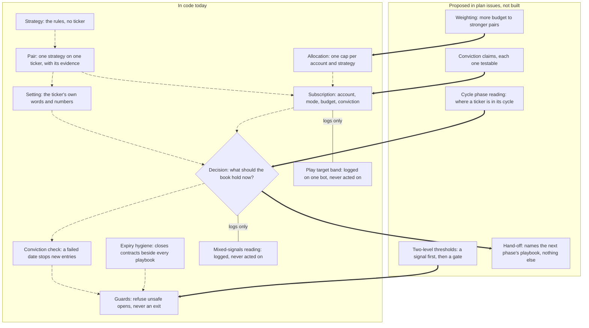

# Playbook anatomy

_Caption — the layers of a playbook. Moving edges run today; thick edges are proposed (#5482, #5483). Cited line by line in the builder appendix, checked against `origin/main` at c6f96db, 2026-10-16._

- **Today** a playbook is a strategy run on one ticker. Each ticker-strategy combination is called a pair. A subscription turns a pair on inside an account's allocation. Each cycle the playbook answers one question: what should the book hold now? The conviction check, expiry hygiene and the guards all sit outside it.
- **Proposed:** testable claims, a reading of where a ticker is in its cycle, and two-level thresholds would feed a playbook. A hand-off would link one playbook to the next. None of them ever places an order.
- **Seven invariants** hold across all of it, starting with: nothing ever blocks an exit.

<strong>Why this page exists</strong> — playbooks are now being chained into cycles

Eric, 2026-10-16: _"Given we are folding playbooks into plays within other playbooks, we may need to
outline the anatomy and structure of playbooks to codify the architecture design."_ And: _"Detecting
cycles is another playbook we should develop to integrate into playbooks."_

Three plans meet here. #4469 split a playbook into a strategy and its tickers. #5482 lets a member
state a market view as claims that steer pairs. #5483 moves capital between playbooks and names the
pattern behind it: **a cycle is phases, and each phase is a playbook.** Without one page that says
what a playbook is made of, each slice would answer that question on its own. This page separates
what the code does **today** (cited to the line) from what the plans **propose** (cited to the issue
and its criterion).

## 1. The five layers, from rules to money

| Layer | What it does | Today | Proposed |
|---|---|---|---|
| **Strategy** | The rules, with no ticker: what it does, what it buys (shares or options), whether its window counts toward a print, and whether an owner's conviction may run it where a study says stand aside | Yes. Eight strategies in a fixed list. The template functions (`wheel`, `callSpread`, `longCall`, `prePrintRunUp`, `eventPlay`) build one playbook per ticker | A strategy declares the traits a ticker must have to fit it (#4469 decision 2) |
| **Pair** | One strategy on one ticker, plus the evidence row that says whether the ticker fits: ✓ researched · ◆ conviction · ~ screened · ✗ stand aside · ? not studied · – can't run | Yes. Every house playbook id names a pair (`CRWV-WHEEL` is the wheel on CRWV). An id is looked up, never built or split. A template refuses to build a pair with no row | Adding a ticker runs the strategy's fit check once, shared by every subscriber (#4469 criterion 1) |
| **Setting** | The ticker's own words and numbers inside the strategy | **Partly.** Today a setting carries the ticker, its copy and, for date-keyed plays, its window. The wheel's setting has no field that could loosen a bound: its deltas and days to expiry are the strategy's own constants, capped at the house ceiling on a sold option. The call spread's type cannot say "hold to the print". **But** the run-up and call-spread window numbers are not checked against any bound | A setting may only **narrow** its strategy's bounds, and a value outside them is refused (#4469 criterion 6; #5482 criterion 3) |
| **Subscription** | One account runs one pair: mode, budget, a symbol filter, compounding, pause, the owner's dated conviction, and an optional play target (weight, lean range, band) | Yes. A failed conviction check stops new entries, exits still run. A paused subscription opens nothing new and keeps its exits. **Migrating (#5482 slice 2):** a subscription may also point at a conviction record; when the record steers its pair, the record's date is the one checked, and the pairs a record steers are judged together (their net P/L added up), so a failed record stops all of them. The app now writes the pointer when a conviction states the record's day, migrates the two live CRWV subscriptions on the poll, and sends `subscriptions.v3`; the inline conviction stays until the contract step. **Play target (#5483 slice 3):** a subscription may carry a target weight, lean range and band; it may only narrow its playbook's bounds, and a bot reads it observe-only (section 5). Nothing writes one yet, so the only target in force is the first-run default on Sauron's CRWV wheel | The pointer replaces the one sentence and a date (#5482 shape B, contract slice) |
| **Allocation** | One cap per account and strategy; ticker budgets add up to no more than it | Yes. Only a write that raises a budget, uncaps it, or adds a ticker is checked. Lowering, pausing and unsubscribing are never refused | A holding place with its own allocation, and money moving between allocations (#5483 criteria 1–3) |

## 2. The decision: one question per cycle, guards after, hygiene beside

A playbook answers through one of two entry points, checked in this order by `playbookIntents`:

1. **`decide`**: whole order intents (the option plays). The engine keeps only intents on the playbook's own tickers and stamps them with its id and mode, so a playbook cannot attribute an order to anyone else.
2. **`desiredState`**: the simplest form, returning `long`, `flat` or `no-window`. The engine turns the gap between that answer and what is held into a buy or a sell. Option plays still return one, and the roll call records it as their verdict.

A ranked chain of rules per ticker (`tactics`) was a third entry point until 2026-10-16, when it
left with its only user, HC-SAURON (`docs/BOTS-SAURON.md` → adaptation ledger).

A third form, **`rulesOf`** (SAURON), names a persona whose own rules the playbook is. On that
persona's own bot, `withPlaybooks` runs the persona as it always has and only stamps its orders; on
any other bot it is an ordinary playbook. `optionDemand` sits beside all of these: it names which
option chains to price this cycle, and is never an order. Exit-safety trips (a drawdown dial, opt-in
per mode) run **first** and claim their tickers before any of them.

Around the playbook, in order of wrapping: the conviction check filters new entries; expiry hygiene
adds its closes **beside** the playbook's intents (outside the conviction check, so it is never
filtered); then every intent passes the guards. The guards refuse opens and never refuse a close.

## 3. Phases and cycles

**The pattern (#5483, amendment 1):** a recurring event has phases, and each phase is one playbook.
**A hand-off names a destination and nothing else.** The receiving playbook's own entry rule decides
when the capital is used. A hand-off carries no condition of its own (#5483 criterion 9).

| Cycle | Phases | What moves it to the next phase | Today |
|---|---|---|---|
| **The wheel** | sell a put → assigned → sell a covered call → called away | the broker's assignment | **In one playbook.** `wheelPhase` reads the phase from positions alone, so a restart reads it correctly |
| **Parking profits** (#5483, "dry powder") | active → holding place → cash-secured puts at the trough → active | a rebalancing band, then a tilt from a conviction's swing model that has passed its scorecard | Proposed, not built |
| **Earnings volatility** (#5483, amendment 1) | sell puts that expire before the print → stand aside through it → buy calls once the post-print bleed ends | days to the print, then implied vol and the post-print drift | Proposed. The house data already pushes back: the rich premium sits in expiries that span the print, which the house refuses to hold, and CRWV has bled −12.95% from D+1 to D+6 |

The wheel shows the shape works inside one playbook. The other two cycles need the hand-off field
(#5483 slice 4) because their phases are separate playbooks with separate evidence. The pattern is
also a guard against a strategy language: `docs/plans/trade-playbooks.md` settled "not a full
strategy DSL", and a hand-off without conditions keeps every phase measurable on its own.

## 4. Signals that feed playbooks

A signal source **reads** the market and publishes a reading. It never trades. A playbook's own rule
decides what a reading means for it.

| Source | What it reads | Status |
|---|---|---|
| **Mixed signals** | price momentum and news sentiment pointing opposite ways past their floors | **Today, observe-only.** One playbook opts in (S1-NVDA). The reading is logged and never reaches an intent. It can be promoted to act after 30 observations or by 2026-11-30, whichever comes first |
| **Conviction claims** (#5482) | a member's view, split into claims tagged missing, underrated or overrated, each tested now, forward-tested on a date, or marked untestable at size zero | **Partly.** The record exists (#5482 slice 2): owner, stated and check dates, claims, and the ◆ pairs it steers, read at `GET /api/convictions`. One is seeded, the AI-dip view, steering CRWV-WHEEL and CRWV-LONG-CALL, and both live subscriptions point at it. Its check is read over the pairs together. Running a claim's study, narrowing a pair and scoring are later slices |
| **Cycle phase reading** (new) | where a ticker is in its cycle: drawdown from its high, implied-vol percentile, days to or after its print, post-print drift | **Proposed**, see below |

### The cycle phase reading — a signal source, not a playbook

Eric asked for "detecting cycles" as a playbook to integrate into playbooks. The quick test:

- **Steelman.** He wants cycle detection built once and reused by every playbook that has phases, rather than rebuilt inside each one, the way `wheelPhase` is today.
- **Strongest objection.** If it were a playbook it would own tickers and place orders. Two decision-makers on one ticker is exactly what the ownership rule prevents (`option-ownership.ts`). #5483 criterion 9 also says the receiving playbook's entry rule decides timing, so a detector that trades would take that job.
- **What settles it.** Build it the way mixed signals is built: a pure reader of the shared market feed and the calendar that publishes a reading per ticker. Playbooks read it, and it never trades. That keeps the reuse and drops the second decision-maker. **The objection survives as the shape, not as a veto.**

What it would publish per ticker and cycle: a **phase** (for an earnings cycle: run-up, blackout,
post-print bleed, settled; for a selloff: falling, floor, recovering), **the readings behind it**
(drawdown from high, implied-vol percentile, days to/after the print, post-print drift), and **how
sure** it is.

Open questions (nobody is blocked; each names the data that answers it):

1. **Where do the phase boundaries sit?** #5482 slice 1's swing study (floor, depth and recovery-time bands) and #5483 slice 1's post-print entry test (D+1 vs D+6 vs bleed-ended, scored at CRWV ~11-09 and NVDA 11-18).
2. **Implied-vol percentile has no history yet.** `premium-fit` reports `no-recorded-history`; the size of the post-print drop in implied vol is measured live from this cycle's prints onward.
3. **Signal or gate?** It starts signal-only, like mixed signals, with a dated promotion test (section 5).
4. **Per ticker or per sector?** #5482 open question 3: wait until two convictions overlap.
5. **Who supplies the readings?** The calendar already answers days to the print (`printWindow`). Drawdown from high needs price history the engine does not keep per position today; exit-safety measures drawdown from cost basis for exactly that reason.

## 5. Thresholds: a signal level before a gate level

#5483 amendment 3 (criterion 10): every capital-moving threshold gets **two levels**. A **signal**
records and tells the owner while capital keeps flowing. A **gate** stops new entries or moves
until the reading recovers or the owner resets it. **A gate never stops an exit.** Recording both
per playbook and per chain shows whether each gate sits in the right place: every signal that fires
without its gate following is evidence for where the gate belongs.

| Threshold today | Levels it has | Under the proposal |
|---|---|---|
| Mixed signals | signal only (log, never act) | the prior art: a signal with a dated promotion test |
| Exit-safety dial | one level per mode: `alert-only` (signal) **or** `enforce` (a closing exit, which is allowed) | could carry both at once |
| Conviction check | gate only: a failed check stops new entries | gains a signal halfway to its check date (#5483 amendment 3) |
| Subscription budget, allocation | gate only: the guard or the Store refuses the open or the write | signal as the budget nears full |
| Play target band (#5483 slice 3) | **both levels, observe-only.** Signal at 5 points of drift, gate at 10 (the backtest's default; outer bounds 15 and 20). A reading says what it would do and nothing acts: capital keeps flowing at a signal, a gate would stop new entries or moves and never an exit | acting on it is a later slice, behind its own kind on the wire |

### The play target band, observe-only (#5483 slice 3)

A play's budget is its ceiling. Its **target weight** is the share of that ceiling it keeps deployed
at center, its **lean range** is how far that may shift, and its **band** is how far the actual share
may drift before a signal and then a gate. A subscription's setting may only narrow its playbook's
bounds; a wider value is refused whole and said once. The reading is the backtest's own
(`rebalance-band-math.mjs`): the share is active over active plus holding, and a move trips an edge
on `|drift| > edge`. Deployed counts shares at their marks, the cash a sold put sets aside and long
contracts at their marks, the engine's own commitment, so a wheel with puts out reads as deployed.

One bot runs it today: Sauron's CRWV wheel, with the default 70% weight and a 5/10-point band (the
backtest's call: run it first on the CRWV books). It logs when the play is first read and on each
change of level, labelled `SIM`, and the decision it wraps comes back as the same array. **Lean has no
source yet**, so every reading leans by 0 points; criterion 13 lets it come only from a recorded
signal. The owner is not notified yet (a signal only logs), and nothing moves capital.

## 6. Capital weighting (proposed)

Eric, 2026-10-16: _"high conviction and or opportunities today also yield high returns, we want to
weight/funnel more capital towards those opportunities."_

**Today** the owner sets each pair's budget by hand inside the strategy's allocation. The only
automatic tilt is compounding: a subscription's own realized P/L grows or shrinks its own budget.
A winner can grow its own risk, but it can never pass money to another pair.

**Proposed shape**, to be written into a plan before any build: inside the account's allocation, budget
tilts toward the pairs with the higher conviction or the better phase reading, within a range the owner
sets. It never raises the allocation, because that cap is the owner's. Every move is recorded with its
reason, as #5483 criterion 7 requires.

Open questions:

1. **What does "opportunity" measure?** The phase reading (section 4) is the candidate.
2. **Confidence drives size:** the house research rule says a low-confidence call is a stand-aside, never a small bet. CRWV-LONG-CALL's pair row is a ◆ conviction at **low** confidence, so weighting by confidence would give it zero budget. Should a conviction's owner override that? The answer belongs with #5482's scorecard.
3. **Where weighting sits relative to #5483's band:** the band decides how much is active, and weighting decides which pairs get it. They need one shared record.

## 7. Invariants

| # | Invariant | Holds today? |
|---|---|---|
| 1 | **Exits are never blocked.** Pause, a failed conviction check and every guard let closes through. A covered call is the one risk-reducing open that also passes, so assigned shares are never stranded | Yes, in four places (appendix) |
| 2 | **Settings only narrow** a strategy's bounds | **Partly.** By type shape for the wheel and the spread's hold rule. Window numbers are unchecked. #4469 criterion 6 closes it |
| 3 | **One option playbook per ticker per bot.** A second is refused, and a share playbook hands the ticker over | Yes |
| 4 | **Paper only.** The bots dial the paper broker. Live money is Eric's call and outside the envelope | Yes, by default and by policy. No code path to a live broker exists |
| 5 | **No sold option is held across a print; a bought call may be** (#5484). A sold option's loss on a print gap has no floor; a bought call's worst case is the premium already reserved in its budget. No option opens inside a blackout | Yes |
| 6 | **An id is looked up, never built** from a strategy and a ticker | Yes |
| 7 | **A playbook trades and claims only its own tickers**, stamped with its own id | Yes |

---

## Builder appendix

Every row was read against the code on 2026-10-16, at `origin/main` `c6f96db` (#5484, the long
call, merged that day). A `src/…:line` citation is held by `tests/arch/architecture-pages.spec.ts`:
a cited file that disappears or shrinks below the cited line fails the build. A line that moves
inside a file that did not shrink is not caught, so a PR that edits a cited file re-reads its rows.

### Layers

| Claim | Cited at | Verdict |
|---|---|---|
| A strategy is the playbook with its ticker taken out; seven ids | `src/playbooks/pair-table.ts:24-32`, `src/playbooks/pair-table.ts:34-56` | grounded |
| `runsOnConviction`: a conviction may run it where the study says stand aside | `src/playbooks/pair-table.ts:52-55` | grounded (the wheel and the long call) |
| A pair row: status glyph + word, call, confidence, measured exit, shelf or check date, study | `src/playbooks/pair-table.ts:144-178` | grounded |
| An id is looked up, never built; `findPair` / `pairFor` | `src/playbooks/pair-table.ts:13-16`, `src/playbooks/pair-table.ts:300-309` | grounded |
| A ✓ past its shelf date takes no new entries; a conviction is never stale | `src/playbooks/pair-table.ts:316-322` | grounded |
| A template refuses a ticker with no row or no dated verdict | `src/playbooks/wheel.ts:309-323`, `src/playbooks/call-spread.ts:433-439` | grounded |
| The roster: eight house playbooks | `src/playbooks/registry.ts:200-209` | grounded |
| The wheel's setting is words only; bounds are strategy constants capped at `MAX_SHORT_DELTA` | `src/playbooks/wheel.ts:65-82`, `src/playbooks/wheel.ts:121-125`, `src/playbooks/wheel.ts:262-266` | grounded |
| The spread's setting cannot say "hold to the print" | `src/playbooks/call-spread.ts:55-60` | grounded |
| **Not enforced:** window numbers carry no bound check | `src/playbooks/call-spread.ts:93-105`, `src/playbooks/templates.ts:48-53` | grounded — the gap #4469 criterion 6 closes |
| Subscription: mode, budget, symbol filter, compounding, conviction, a pointer at a conviction record | `src/domain/types.ts:310-372` | grounded |
| A conviction record: at least one claim, each tagged, bucketed and dated; checked after it was stated; steers only ◆ pairs | `src/playbooks/conviction-record.ts:115-141`, `src/playbooks/conviction-store.ts:6-53` | grounded |
| A pointer at a record that steers the pair takes the record's check date; any other falls back to the subscription's own, said | `src/playbooks/conviction-store.ts:63-97` | grounded |
| A conviction matches a record when the record steers its pair and states the same check day; a pointer is written on a subscribe or edit, migrated on the poll, and never replaces one already there | `src/subscriptions/conviction-pointer.ts:34-98`, `src/server/subscription-seed-store.ts:168-178` | grounded |
| A record's check adds its steered pairs' net P/L (a paused pair still counts); below $0 stops new entries on every one; a strategy's retire test stops only its own pair | `src/playbooks/conviction-check.ts:134-175`, `src/playbooks/with-conviction-gate.ts:83-244` | grounded |
| Ticker budgets fit inside the strategy allocation; lowering is never refused | `src/subscriptions/strategy-budgets.ts:12-30`, `src/subscriptions/strategy-budgets.ts:85-108` | grounded |
| A conviction's check day is a future market day within a year | `src/subscriptions/strategy-budgets.ts:130-139` | grounded |

### Decision surface

| Claim | Cited at | Verdict |
|---|---|---|
| The `Playbook` interface: `desiredState`, `rulesOf`, `optionDemand`, `decide`, `options`, `exitSafety`, `derivesFrom`, `mixedSignals` | `src/playbooks/playbook.ts:135-218` | grounded |
| Order: `decide`, then `desiredState`; exit-safety first | `src/playbooks/playbook.ts:445-484` | grounded |
| `decide` intents kept only on own tickers, stamped here | `src/playbooks/playbook.ts:386-400` | grounded |
| A `rulesOf` playbook runs the persona itself, never `decide` | `src/playbooks/playbook.ts:182-189`, `src/playbooks/playbook.ts:441-443` | grounded |
| Option traits: underlyings, shorts held to expiry, options level | `src/playbooks/playbook.ts:125-133` | grounded |
| Wrapping order: hygiene around the conviction gate around the playbooks | `src/scripts/autonomous-live-wiring.ts:373-394`, `src/playbooks/with-option-safety.ts:34-42` | grounded |
| Guards run after: options through `clampOption`, shares through `clampBuy`/`clampSell` | `src/engine/guards.ts:408-419`, `src/engine/option-guards.ts:269-282` | grounded |
| Expiry hygiene closes every contract at T-2 unless its owner holds that short on purpose; a short spanning a print is closed | `src/playbooks/option-hygiene.ts:18-35`, `src/playbooks/option-hygiene.ts:66-69` | grounded |

### Cycles, signals, thresholds

| Claim | Cited at | Verdict |
|---|---|---|
| The wheel's phase is read from positions alone | `src/playbooks/wheel.ts:132-154` | grounded |
| `derivesFrom`: the spread declares its run-up pair; unaudited | `src/playbooks/playbook.ts:169-172`, `src/playbooks/call-spread.ts:454` | grounded |
| Mixed signals: observe-only, opt-in, falsifier 30 observations or 2026-11-30 | `src/playbooks/mixed-signals.ts:1-31`, `src/playbooks/mixed-signals.ts:44-48`, `src/playbooks/registry.ts:34-39` | grounded |
| Exit-safety: one level per mode, `enforce` or `alert-only`; drawdown from cost basis, not peak | `src/playbooks/playbook.ts:102-105`, `src/playbooks/playbook.ts:264-278` | grounded |
| Conviction check: gate only; net P/L and the retire test; latched | `src/playbooks/with-conviction-gate.ts:24-62`, `src/playbooks/conviction-check.ts:95-125` | grounded |
| A non-✓ pair with no conviction keeps trading, labelled | `src/playbooks/conviction-check.ts:39-46` | grounded |
| Compounding is the only automatic budget tilt | `src/domain/types.ts:336-346` | grounded |
| The play target band as two-level thresholds, observe-only on one bot | `src/playbooks/play-target.ts:49`, `src/playbooks/play-target.ts:86`, `src/playbooks/play-target.ts:188`, `src/playbooks/with-target-observation.ts:82`, `src/playbooks/with-target-observation.ts:187`, `src/scripts/autonomous-live-wiring.ts:389`, `src/domain/types.ts:371` | grounded (observe-only; lean has no source) |
| The hand-off, holding place, tilt, phase reading, weighting, and acting on a band | #5483 criteria 1–4, 9, 10 and amendments 1 and 3; #5482 criteria 1–4 and its amendment; this page §4 and §6 | proposed, not in code |

### Invariants

| # | Cited at | Verdict |
|---|---|---|
| 1 | `src/engine/option-guards.ts:46-47`, `src/engine/guards.ts:278-286`, `src/playbooks/with-conviction-gate.ts:232-242`, `src/playbooks/playbook.ts:237-251`, `src/subscriptions/strategy-budgets.ts:91-95` | grounded |
| 2 | see Layers: wheel and spread by type shape; windows unchecked | partly grounded |
| 3 | `src/playbooks/option-ownership.ts:3-47`, `src/playbooks/option-ownership.ts:58-76` | grounded |
| 4 | `src/bots/bot.ts:14`; `envelope.json` → `$openOnPurpose` (paper-only is a judgment stop, not a path) | grounded as default and policy; there is no code-level refusal of a live URL |
| 5 | `src/engine/option-guards.ts:169-191` (rule 6; line 185 exempts `long-call`), `src/playbooks/long-call.ts:29-51`, `src/playbooks/long-call.ts:263-280`, `src/playbooks/option-hygiene.ts:28-29` | grounded |
| 6 | `src/playbooks/pair-table.ts:13-16` | grounded |
| 7 | `src/playbooks/playbook.ts:381-400`, `src/playbooks/option-ownership.ts:78-106` | grounded |
