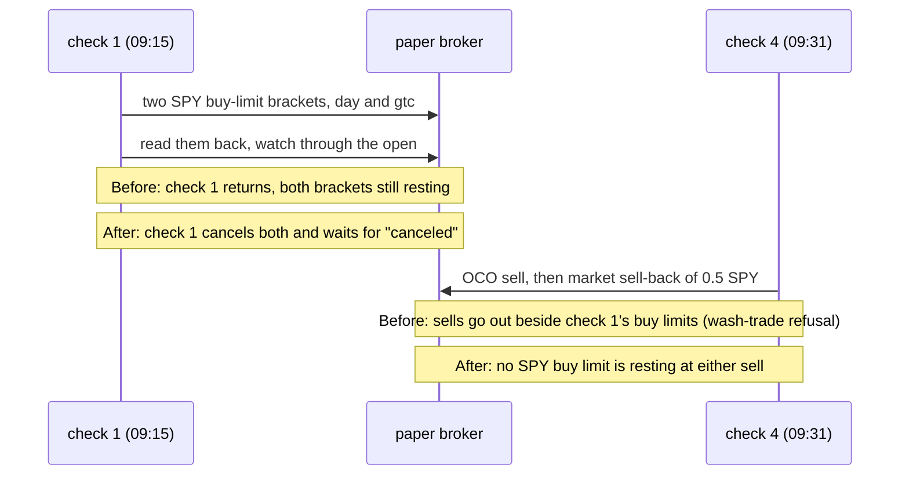
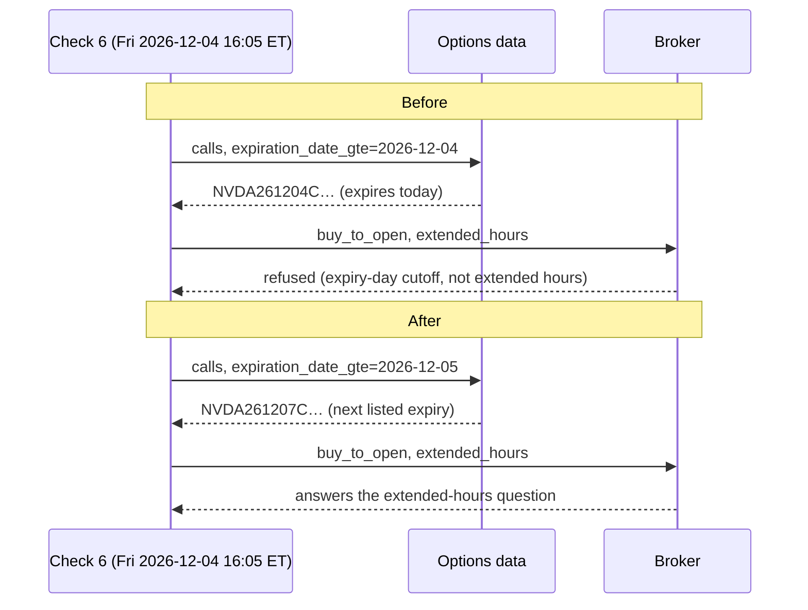

# Digest — 2026-11-24

**Period:** 2026-11-23 → 2026-11-24 · **Landed:** 217 commits on main after the 2026-11-23 digest (5dadb492..eb8b494b) · **Trigger:** threshold

> [!WARNING]
> **Missed interrupt, day 12: the three campaign slices are still not on main, and the gap more than doubled overnight.**
> #7499 (the Eye's beam), #7500 (the Trade window) and #7501 (a member's first visit) merged on
> 2026-11-13 into the `feat/campaign-*` stack, not main. A REST compare of
> `main...feat/campaign-tower-right` reads `diverged`, 48 ahead and **648 behind** (430 yesterday).
> #7487 has carried `needs-session` since 2026-11-22 16:00Z, and no session has touched it since.
> Tonight's surge also moved Campaign to `/app/campaign` (#8267), so landing the stack now means
> reworking it against the new routes. If you have been showing those three features, they are not live.

## Needs you

1. **Answer the Decisions page, #7944, in one reply** like `1 no 2 not now 5B 6A …`. It holds 10 asks with Claude's predicted pick marked: #8236, #8211, #8209, #8183, #8150, #8037, #6959, #6886, #5730, #5452 (39 days).
   - New since yesterday: #8209, the first spend pitch (5 builds at once instead of 3, for stage 2's four weeks), plus #8236, #8211, #8183, #8150 and #8037. #8183 (pick the diagram face on your phone) has no options or prediction on its card yet.
   - Gone from it: the four Trade placements (#7669–#7673) moved to sessions, and #1211 left.
2. **Merge PR [#8181](https://github.com/ejclark/skynet-capital/pull/8181), or close it.** It records the failure of AI-dip claim 7 as a second hold on CRWV-WHEEL. CRWV closed at $39.51 on 11-20, below the $41.00 floor band. It has been held and green for 9h.
   - Either button changes no trade. CRWV-WHEEL already opens nothing new under the 2026-11-09 hold, and every exit still runs.

Gist: one reply and one button clear today's list (`digest-scan --needs-you`, exit 0).

## Headlines

- **The redesign surge on #8161 is running on your shape 5, and it has spent 54% of the week's quota in 8h.** Since 05:00Z: a home screen at `/app/` with Campaign moved to `/app/campaign` (#8267); a Bots screen that shows why each house bot skipped and lets you follow one (#8326, #8341); the scoreboard opening on the party's table, where a first fill seats you (#8328); and apps named by their job (#8291). You set the burn: "can afford burning hot early this week" (07:10Z, #4153). At the 85% floor the dial drops to normal, which #4153 projects for about 18:40Z today. That leaves about 15% for the remaining 6 days.
- **The trade core gained exits and a market clock.** Stop-limit orders and a bracket exit at entry are on the server and the stock form, behind a setting (#8281, #8300, #8313). Market hours now come from Alpaca's calendar (#8284, #8298). The fill stream reopens after a drop (#8282), a fill can send a one-tap email (#8301), and an end-to-end spec guards a placed stock order and a placed option order (#8233). Alpaca paper sign-in over OAuth shipped dark (#8279). It switches on only when your app secrets are set and platter #8275 lands.
- **A failed read no longer shows as empty.** About a dozen fixes now say "couldn't read" where the app used to show $0 cash, "no accounts linked", "you hold nothing" or an all-clear (#8324, #8325, #8345–#8348, #8346, #8360, #8378, #8380). An architecture test now fails new code that does this (#8340).
- **Research: VIX fell from 35.9 to 26.6 as the S&P bounced 4.7%. Every pulse held stand aside.** AI-dip claim 7 failed on CRWV's close (#8166), which is the held PR above. The 2y-note rally test was killed (#8097), both flash-PMI forward tests passed (#8088), and TIC's drift test was killed (#8101). 40 research PRs merged.
- This week so far (2026-W48, partial): 251 PRs merged (154 code · 74 research · 23 other) · unknown defects per audited PR · 10 open asks for Eric, oldest #5452 at 39 days · Claude quota 54% used, 4% of its week gone (resets 12-01 05:00Z; surge).

## The picture

### #8386 fix(audit): a quoted closing keyword in a slice PR no longer closes its parent unseen

| #8310's real body, replayed | before (origin/main) | after |
|---|---|---|
| `ship.sh checkbody` (Follow-ups line quotes a closing keyword + the parent's number in code) | exit 0, passes | exit 1, names line 85 |
| `finalSliceBy` on #8256 (PR says `Part of` and a stray keyword) | 8310, so `next-slice` cleared | null, so the remainder is re-filed |

_Caption — both rows replayed in this run against #8310's body fetched
from GitHub; the before column is origin/main's code._

### #8387 fix(alpaca): check 1 cancels its brackets before the next check sells spy

_Caption — the order of broker calls in a default `npm run paper:checks`
run started 09:15 ET, before and after this change._

### #8385 fix(alpaca): check 6 bids on an expiry after today, never one expiring that day (#8374)

_Caption — check 6's contract query on an expiry day, before and after;
replayed in `tests/alpaca/paper-checks.spec.ts`._

### #8383 docs(surge): leave a fresh fast-track bug to the lane, not to a child

| A `fast-track` bug an audit files | Before | After |
|---|---|---|
| Who builds it | a surge child, dispatched the same minute | the lane, which self-readies and claims it within ~1 min |
| 2026-11-24, 11:11–11:39Z | #8352, #8353, #8355 each built twice; 3 PRs closed as superseded | a child takes it only if it is still unclaimed after a tick |

_Caption — what `.claude/skills/surge/SKILL.md` §2 and §4 tell the
orchestrator to do with an audit's fast-track filing; the Before row is
tonight's #8161 surge._

### #8381 fix(companion): her place list sends Campaign to /campaign and names / as Home (#8369)

_Caption — Moneypenny's place list before/after, from `PLACES` in
`src/companion/places.ts` as her prompt prints it_

| Path | Before | After |
| --- | --- | --- |
| `/` | **Campaign** — the landing page: the day's market news… | **Home** — the home screen: the tower, what needs them, and a tile for each app |
| `/campaign` | *(missing: a link here rendered as plain text)* | **Campaign** — the day's market news, the calendar, quests and the party |

_103 older picture(s) not shown — the 5 newest only._

## Noise absorbed

- 217 commits merged: 73 fix · 68 feat · 55 docs · 8 chore · 7 test · 5 refactor · 1 merge. Inside those: 40 research pulses and close-outs, 30 #8005 area-study PRs, 4 governor cycles (14–17), 5 dependabot bumps and platter #8055.
- Envelope audit: 1041 files changed on main, 5 of them protected. Four came in through platter #8055, which you merged (8f194ac2). The fifth, `work-mode.json`, is your own surge-cap change to 10 (#8051, "Yes, raise to 10").
- Failed runs on main since the last digest: 90. 72 were Moneypenny Events, almost all `route: List due events` between 22Z and 01Z while the surge drained the API budget. #8159, #8238 and #8276 (repair capsule #6942) made it skip instead of fail, and failures are down to about 1 an hour. 17 were Moneypenny Repair and 1 was Earnings calendar refresh. Pipeline and deploy had none.
- Learning: 135 failed run(s) on main in 14d not yet in LESSONS · 164 aged out of the window unlearned — capsule closes draft their own entries (#4212). `incident-scan` exits 1. The oldest unlearned run is Moneypenny Events 5c57237 (2026-11-10).
- Comment bloat: `comment-bloat-scan` exits 1 at **2052** flagged, against a budget of 44 (+236 since yesterday, eighth day over). The worst file is `src/server/dashboard-server-config.ts` (43×). The open question (scanner bug or real drift?) sits with `feedback` issue #7950. The routine's prompt still says to fold this into Needs you, which conflicts with the skill's rule that Needs you is `--needs-you` only. The prompt is yours to edit, so this is flagged here, not changed.
- Needs a session: 14 asks are waiting on a session, not on you: #8192, #8005, #7673, #7671, #7670, #7669, #7569, #7487, #7310, #6722, #6719, #6703, #6679, #6033.
- Callout incomplete: #8183 has no options or prediction. Unseen: unread, because the search read failed with a proxy error.
- Open PRs not listed above: platter #8275 (4 protected items, Alpaca paper scope among them, held; its verify run was cancelled, so it is not on your list yet), #8286 (`conflict-flagged`), #8288, #8349, #8168, #8044, and dependabot #8176, #8175, #8172, #6314, #4020.
- Config audit: no orphaned capabilities, routing contradictions, recurring intent themes or compute-floor gaps. CLAUDE.md is at 50110 of 47500 bytes, up from 48745. UX loop: the crawl last ran 59 days ago, 54 ledger rows are ungraded, 8 phone coverage gaps are open (up from 5), and 1 journey member (invited-friend) has no crawl (lane work).
- White-team spot-checks against the diffs: #8181's $39.51-under-$41.00 claim and its one-file diff (not protected); #8279 ships dark behind client secrets plus platter #8275; #8051 authored by you; the 648-behind compare (REST); and the 54%/4% quota from `newsletter.mjs`, which matches #4153 check-in 5. All match.
- Rank since 2026-11-23: 75 moved up · 36 retired · 51 new.
- Not read, because they need GraphQL: the thrash, comms and member-filings scans. The thrash marker is still missing.

<!-- rank-snapshot: 8392,8393,4479,4563,5204,8014,5093,6501,6613,6668,6719,6722,6723,7115,7332,7334,7335,7338,7340,7342,7440,7963,8017,8018,8057,8058,8059,8060,8061,8063,8081,8082,8260,8283,8354,8389,8390,8391,8189,8295,4254,4298,4322,4323,4952,6703,6725,8289,4357,4527,4555,6079,6250,6319,6883,6965,7032,7168,7314,7315,7561,7733,7896,8006,8034,8154,8333,4420,7542,4286,8250,8252,8256,8297,7031,1442,1728,1977,3965,4222,4225,4256,4257,4258,4259,4260,4263,4269,4270,4273,4275,4278,4280,4311,4316,4324,4339,4342,4606,4832,5070,5412,5439,5443,5457,5462,5496,5721,5850,5912,5967,5992,6330,6340,6349,6581,6601,6609,6615,6616,6724,6726,6771,6870,6871,6872,6960,7118,7310,7344,7345,7448,7564,7669,7670,7671,7673,7731,7732,7939,7950,8062,8084,8184,8185,8187,8192,8227,8263,8285,8322,8323,8356,8357,8375,8394,8395,4808,4943,5056,5250,5365,5482,5483,5489,5493,5717,7029,7203,7286,7330,7487,8008 -->
