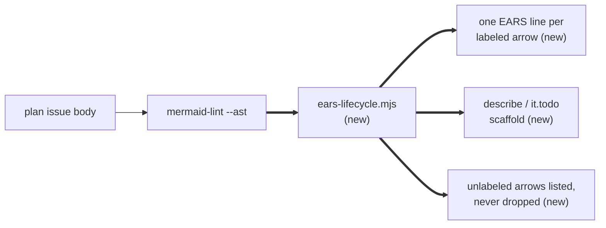
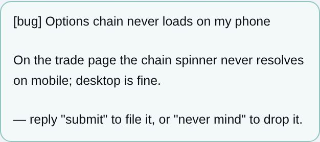
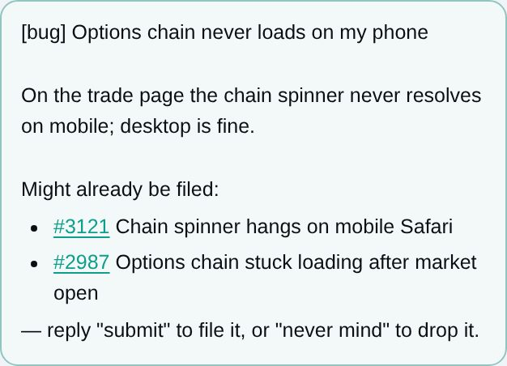

# Digest — 2026-11-25

**Period:** 2026-11-24 → 2026-11-25 · **Landed:** 42 commits on main after the 2026-11-24 digest (366fdd05..b7a810f9) · **Trigger:** threshold

> [!WARNING]
> **Missed interrupt, day 13: the three campaign slices are still not on main.**
> #7499 (the Eye's beam), #7500 (the Trade window) and #7501 (a member's first visit) merged on
> 2026-11-13 into the `feat/campaign-*` stack, not main. A REST compare of
> `main...feat/campaign-tower-right` reads `diverged`, 48 ahead and **691 behind** (648 yesterday,
> 430 the day before). #7487 has carried `needs-session` since 2026-11-22 16:00Z, and nothing has
> touched it since. The surge's redesign hold lapsed at 06:00Z today, so the lanes are free to pull
> again, but #7487 is parked by `needs-session`, which no lane pulls. If you have been showing
> those three features, they are not live.

## Needs you

1. **Answer the Decisions page, #7944, in one reply** like `1 no 2 not now 5B 6A …`. It holds 11 asks with Claude's predicted pick marked: #8423, #8236, #8211, #8209, #8183, #8150, #8037, #6959, #6886, #5730, #5452.
   - New since yesterday: #8423 (a `fast-track` bug: the member-feedback reader takes "the row is fixed now" to mean fixed since the member asked). Nothing left the page.
   - #8183 (pick the diagram face on your phone) still has no options or prediction on its card, so it is the one ask you cannot answer by letter.
2. **Merge platter PR [#8275](https://github.com/ejclark/skynet-capital/pull/8275).** It holds the 2026-11-24 protected-path changes, Alpaca paper sign-in's scope among them, and has been held and green for 23h.
   - The surge log on #4153 names it as one of the clicks that unblocks the rest of the redesign (#8161): nothing there is buildable until it or the items below move.
3. **Merge PR [#8181](https://github.com/ejclark/skynet-capital/pull/8181), or close it.** It records the failure of AI-dip claim 7 as a second hold on CRWV-WHEEL. Held and green for 33h.
   - Either button changes no trade. CRWV-WHEEL already opens nothing new under the 2026-11-09 hold, and every exit still runs.
4. Look at the feedback burst on 2026-11-24 — 109 feedback filings vs trailing 7d median 1; a bottleneck issue files if it persists.
5. Look at the fitness burst on 2026-11-24 — 14 fitness filings vs trailing 7d median 1; a bottleneck issue files if it persists.
   - Both fall on the surge's busiest day. Of the `feedback` issues opened on 2026-11-24, 111 came from your account's token (the one the surge sessions post #4153's check-ins under) and 10 from the bot. The scan cannot tell a planned burst from a runaway, so it shows them here; with no repeat tomorrow, nothing is owed.

Gist: one reply and two buttons clear today's list (`digest-scan --needs-you`, exit 0); the two burst lines are the thrash scan's and need only a look.

## Headlines

- **The comment-bloat gate was a scanner bug, and it is fixed.** It counted any comment *line* citing an issue; it now flags only a whole comment that is nothing but a citation. The count went from 2065 against a budget of 44 to 0 against 0, and a hand-read of 60 old flags found no real narration (#8468). That ends eight days of a red ride-along line.
- **Surge repair wave: 7 member-facing fixes landed.** The option review says "couldn't read your account" instead of $0 cash (#8410); the trade ticket stays open when a re-read fails with accounts cached (#8408); a degraded desk with no option rows says the read failed (b065b4cf), and the failed-read card clears once the account reads fine (#8416); a restart retries a watched fill's alert (#8409); a bot order remembers its playbook (#8411), and its tag opens the bot's playbooks page (#8412). On the build side, the Decisions page keeps an answered card until its reply is receipted (#8420).
- **Process tooling:** a plan's state diagram now prints as EARS acceptance lines and spec scaffolds (#8467); the reviewer asks every caller of a loosened shared rule what it now returns (#8465); and Moneypenny's draft card lists similar open issues before you file (#8464).
- **Research: VIX holds near 26.4, and every pulse held stand aside.** Close-outs: FHFA HPI +2.5% y/y, two tests pass and the ITB ceiling killed (#8442); Treasury 2y FRN 3 of 3 pass (#8436); Treasury 5y FT-1 pass (#8447); CRWV FT-3 pass (#8443); JPX FT-1 kill (#8452); industrial-production revision 1 pass, 1 kill (#8438). Tokyo CPI's regime kill fired (#8461). 24 research PRs merged.
- **The surge slowed to a crawl and ends 2026-11-26 06:00Z.** The week is 75% used at 12:00Z, rising about 0.2 points an hour, so the 85% floor will not arrive first (#4153 check-in 11). The redesign-focus hold lapsed, and `ready` is back on the 15 issues it held.
- This week so far (2026-W48, partial): 294 PRs merged (172 code · 98 research · 24 other) · unknown defects per audited PR · 13 open asks for Eric, oldest #5452 at 40 days · Claude quota 75% used, 15% of its week gone (resets 12-01 05:00Z; surge).

## The picture

### #8468 fix(gates): comment-bloat reads whole comments, flags only bare citations

| | Before | After |
|---|---|---|
| What the scan counts | any comment **line** holding `(#N)`, `PR #N`, `issue N`, or the words added / removed / used by | a whole **comment** whose only content is a citation, a caller or an "added for" phrase |
| Count vs budget | **2065** vs 44 (red, growing daily) | **0** vs 0 (the one real hit is trimmed) |
| Sample of 60 old flags | 0 narration, 2 with a trimmable history fragment, 58 a WHY or a field description citing its source | n/a |

_Caption — before/after of the comment-bloat gate, from `node
scripts/comment-bloat-scan.mjs` on main 792048a7d and on this branch._

### #8467 feat(ears): read a plan's state diagram as ears lines and spec scaffolds

_Caption — thick = new in this PR. The diagram a plan already draws
becomes its acceptance criteria._

### #8464 feat(moneypenny): list similar open issues on the dock's draft card (#4286)

| Before / no match (unchanged) | After, with matches |
|---|---|
|  |  |

_Caption — the dock's draft card at 390px, offline server with a stubbed
chat stream (scratch Playwright script); the issue numbers are sample
data._

## Noise absorbed

- 42 commits merged: 14 fix · 3 feat · 1 test · 24 docs (all research pulses and close-outs, one of them the deterministic screen #8435).
- Envelope audit: 106 files changed on main, none protected (`envelope-scan --check`).
- Failed runs on main since the last digest: **1** (Earnings calendar refresh), down from 90 the day before. The Moneypenny Events skip-instead-of-fail fixes (#8159, #8238, #8276) held.
- Learning: 112 failed run(s) on main in 14d not yet in LESSONS · 148 aged out of the window unlearned — capsule closes draft their own entries (#4212). `incident-scan` exits 1 (135 yesterday, so the count is draining); its oldest candidate is Pipeline 50b313c (2026-11-11). The routine's prompt still says to fold this into Needs you, which conflicts with the skill's #4212 rule; the prompt is yours to edit, so this is flagged here, not changed.
- Comment bloat: `comment-bloat-scan` exits 0, 0 flagged against a budget of 0 (headline above).
- Config audit: no orphaned capabilities, routing contradictions, recurring intent themes or compute-floor gaps. UX loop: the crawl last ran 2026-09-26, 60 days ago, and 1 journey member has no crawl (lane work).
- Needs a session: 18 asks are waiting on a session, not on you: #8256, #8192, #8005, #7673, #7671, #7670, #7669, #7569, #7487, #7310, #6871, #6722, #6719, #6703, #6679, #4342, #3748, plus #6033 (closed, handed on).
- Callout incomplete: #8183 has no options or prediction. Unseen: unread, because the search read failed with a proxy error. The surge log on #4153 also names #8257 (`needs-eric`, "your one-time setup for the redesign: three dashboard forms and the held-batch merges") as a click owed, and #8257 is not on #7944's list; a session should move its ask onto the page, so it reaches you through the one reply.
- Picture channel (`comms-scan`, 29 PRs): 25 waived (research pulses), 1 table, 1 mermaid, 1 screenshot, 1 none (#8435). Zero comments or reactions from you on any of them.
- White-team spot-checks against the diffs: #8468's budget moved 44 → 0 in `comment-bloat-budget.json`; #8410, #8409, #8420 and #8419 each touch the files their titles name, with specs; the 691-behind compare (REST); 0 protected paths; the single failed run (REST, `created>` the last digest's commit). All match.
- Member filings: unread (`digest-scan --member-filings` needs GraphQL, which cloud sessions are refused).
- Rank since 2026-11-24: 8 moved up (#6719, #6722, #6703, #5070, #6871, #7310, #7939, #5482) · 11 retired (#8392, #8393, #8057, #8058, #8059, #8060, #8389, #4286, #7448, #7732, #7950) · 16 new.
- Thrash scan 2026-10-26 → 2026-11-25: 57 hit(s), 15 new since 2026-11-24.
  - T2 2026-11-24 lane:fitness — 2 title(s) re-filed in lane `fitness`, 38 extra issue(s)
  - T1 2026-11-24 #6604 — skynet-envoy[bot] posted 29 near-identical comments (2026-11-01 → 2026-11-24)
  - T1 2026-11-24 #6604 — skynet-envoy[bot] posted 5 near-identical comments (2026-11-01 → 2026-11-24)
  - T1 2026-11-24 #6604 — skynet-envoy[bot] posted 24 near-identical comments (2026-11-03 → 2026-11-24)
  - T1 2026-11-24 #6942 — github-actions[bot] posted 5 near-identical comments (2026-11-07 → 2026-11-24)
  - T1 2026-11-24 #6942 — github-actions[bot] posted 5 near-identical comments (2026-11-07 → 2026-11-24)
  - T1 2026-11-24 #6942 — skynet-envoy[bot] posted 24 near-identical comments (2026-11-07 → 2026-11-24)
  - T1 2026-11-24 #6942 — skynet-envoy[bot] posted 25 near-identical comments (2026-11-07 → 2026-11-24)
  - +5 more — `npm run thrash:scan`
- Thrash snapshot: baseline set; the next digest can auto-file repeats.
- Thrash ran as a draft (`--digest`, no `--file`): this routine is report-only, so no `bottleneck` issue was filed.

<!-- rank-snapshot: 4479,4563,5204,8014,6719,6722,5093,6501,6613,6668,6723,7115,7332,7334,7335,7338,7340,7342,7440,7963,8017,8018,8061,8063,8081,8082,8260,8283,8354,8390,8391,8401,8421,8422,8424,8425,8426,8427,8428,8429,8430,8189,8295,6703,4254,4298,4322,4323,4952,6725,8289,4357,4527,4555,6079,6250,6319,6883,6965,7032,7168,7314,7315,7561,7733,7896,8006,8034,8154,8333,4420,7542,8250,8252,8256,8297,5070,6871,7310,7939,5482,7031,1442,1728,1977,3965,4222,4225,4256,4257,4258,4259,4260,4263,4269,4270,4273,4275,4278,4280,4311,4316,4324,4339,4342,4606,4832,5412,5439,5443,5457,5462,5496,5721,5850,5912,5967,5992,6330,6340,6349,6581,6601,6609,6615,6616,6724,6726,6771,6870,6872,6960,7118,7344,7345,7564,7669,7670,7671,7673,7731,8062,8084,8184,8185,8187,8192,8227,8263,8285,8322,8323,8356,8357,8375,8394,8395,8402,8403,8431,8432,8433,8434,4808,4943,5056,5250,5365,5483,5489,5493,5717,7029,7203,7286,7330,7487,8008 -->
<!--thrash-snapshot: 06f155697d,0ddb53e9f4,13e3cdafd8,1e1534012c,2405209ef3,24f6b7b74e,2685713052,2ba0bc821d,40a7a904d3,415be76250,4e352ed877,4e4cc6935e,573428df44,577934d09f,5f0949f45e,66bdf24ebc,6aeda7b974,7a0a93eb7a,82b4aabd20,858dc6314f,8b44ecd381,9170902834,93a7c29b25,98a1b8aa4a,9d1017997e,9fe171ab42,a908747831,b29cefb3d3,b837c7293e,ba50eb0c78,cb0888ad22,ccb1e0d64b,d0aef1eaba,d4b4b89506,dfc237b705,e5e21824dd,ef45c1b850,facb0de15a -->
