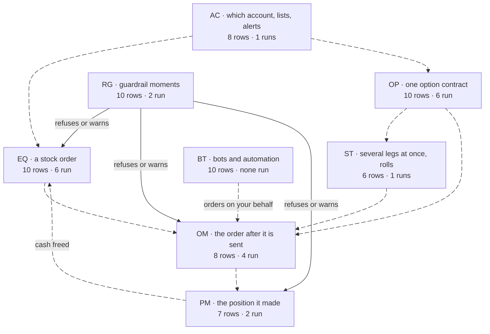

# Change scenarios — can a member change their paper account, and does it land as meant?

_A journey (`e2e/journeys/`) checks that a member can **reach** a screen, and a study
(`study/`) checks that they can **read** it. A market scenario ([`scenarios.md`](scenarios.md))
checks that the app **says** the right thing. A change scenario checks the fourth thing: a member
tries to **change** their paper account through the screens (buy, sell, pull an offer, protect a
holding, hand money to a bot). An oracle then reads the account before the member's first tap and
after their last, and grades the difference (`scripts/faculty/oracle.mjs`). The member is a blind
model actor that sees only screenshots. It hears the situation below in the second person and is
never told a route or a button's name. The account belongs to the faculty world
(`scripts/faculty/world.mjs`), the one offline boot whose writes land._

_Caption: how a change moves through the eight categories. The member picks an account, enters an
order, manages it after it is sent, and then manages the position it made. The guardrail moments
sit across all of it. Counts come from the tables below._

- **69 change scenarios, 22 runnable today** (`scripts/faculty/scenarios/<id>.json`). 10 of the 22
  run on a phone, where the last study's members got 21 of 45 tasks right against 36 of 42 on
  desktop (`study/profile-2026-10/readout.md:23`).
- **28 rows are gaps, where the change cannot be made at all.** The app has no stop-limit, trailing
  stop, bracket, cancel-all, sell-all, stop on an option, exercise or dollar amount. A change to a
  waiting order also skips every check a new order gets (`src/server/trade-orders-routes.ts:220-279`).
- **The oracle grades the account, never what the member reports.** It also fails any write nobody
  asked for, because a sell entered as a buy "completes" a task and still harms the book.

<strong>How a row is written, what the world holds, and how a row becomes runnable</strong>

**Columns.**
- **id**: the category, then a number. Rows are ranked within each category by frequency × harm.
  The 22 runnable ids were fixed first, so the numbers in a table are not in order.
- **member · device**: the `docs/members/<member>.md` stem. Phone is 390×844 touch; desktop is 1280×900.
- **the situation**: written to `study/roles/task-author.md`. It gives the member's reason and goal
  in plain words. It never names a route, and never uses the app's own labels: "at whatever price
  the market gives", not "market order".
- **what must land**: the oracle's end spec in words. "Nothing else" is the default
  (`noOtherWrites`): an unasked order, an order cancelled that nobody named, or a position that
  moved without being named all fail the run.
- **today**:
  - **runs**: a runnable JSON exists.
  - **gap**: the capability is missing (file:line from the write census).
  - **gated**: a rung, fog or ownership gate stops this member, by design.
  - **not yet run**: the app can do it, but no JSON exists yet. Usually the oracle cannot see the
    result: it reads orders and positions only (`scripts/faculty/drive.mjs:113-124`), so a
    watchlist, an alert or a bot switch has no diff to grade.

**The world.**
- Eric's account (`human-eric`, signed in as the owner) holds:
  - cash $40,000;
  - EEM 950 shares @ $42.20 (mark $43.50);
  - AAPL 100 @ $205 (mark $230);
  - 2 NVDA 18 Dec 2026 $180 calls @ $6.40 (worth about $10.90 each);
  - one working order: BUY 10 MSFT LIMIT $400 GTC, id `faculty-msft-limit` (MSFT marks $420).
- The invited friend (`human-friend`, a plain member) holds cash $18,400 and XLE 130 @ $86.40
  (mark $90). They also own the Day Trader bot's account.
- Simulated quotes and chains exist for AAPL, MSFT, NVDA, CRWV (80), SPY (590), EEM, XLE (90),
  XLF, TSLA (330) and QQQ (510).
- The market clock is real and runs happen in the evening, so orders end `working` and every end
  spec accepts working or filled.
- Once a symbol is entered, the stock form seeds a limit at the mid with GTC
  (`app/src/shell/trade-gate.tsx:222`). A member who asks for "whatever the market gives" has to
  switch it.

**Gates.** Whether a rung binds depends on training wheels. A member with fill history is seeded
with wheels off (`src/server/progression-service.ts:42-45`), so a gated row names a member the gate
binds for: a new member, or the friend at rung 101.

**What the oracle cannot see yet.**
- A multi-leg order reads as one parent with no symbol
  (`src/adapters/writable-fixture-trading-transport.ts:318-319`). ST-01 therefore accepts any new
  order, and the run's readout reads the legs.
- The friend's oracle reads only the friend's own book, so a write that reached someone else's
  account would not show in it.

**To make a row runnable**, write `scripts/faculty/scenarios/<id>.json` in the shape the header of
`scripts/faculty/drive.mjs` gives, then run
`npx tsx scripts/faculty/drive.mjs --scenario <file> --out <fresh dir>`. Then flip the row's
**today** to runs.

## EQ — entering a stock order

_Eric, 2026-08-29, on the stop-limit ask (#716): "the feedback suggestion is a standard feature for
stock trading software" (`docs/LESSONS.md:2418-2424`)._

| id | member · device | the situation, in the member's words | what must land (and what must not) | today |
|---|---|---|---|---|
| EQ-05 | eric · phone | You're done with Apple. Get out of the whole position at whatever the market pays, from your phone. | sell 100 AAPL at market, working or filled · nothing else; never a buy, never a part left over | runs |
| EQ-01 | returning-trader · phone | You've been meaning to own a little Microsoft. Buy 5 shares now at whatever price the market gives you, then tell us what the app says happens next. | buy 5 MSFT at market · the waiting $400 MSFT order untouched | runs |
| EQ-04 | returning-trader · desktop | You hold a big block of the emerging-markets fund EEM and want to free up cash. Sell 400 of those shares at whatever the market pays, and keep the rest. | sell 400 EEM at market, 550 left · never all 950 | runs |
| EQ-03 | phone-only · phone | You want 10 shares of QQQ, the Nasdaq fund, but only if you can get them for $505 or less, and if it doesn't happen in the next trading session you'd rather the offer just went away. Put it in from your phone. | buy 10 QQQ limit $505, good for one session (day) · never the seeded GTC | runs |
| EQ-06 | returning-trader · desktop | You're nervous about your Apple shares over the weekend. Arrange for all of them to be sold automatically if Apple falls to $215, without selling anything now. | sell 100 AAPL stop $215, working · nothing sold now | runs |
| EQ-02 | eric · desktop | Tesla has run up and you'd buy 20 shares on a dip to $320, but not a cent more, and you want the offer to keep standing for weeks if it has to. Set that up. | buy 20 TSLA limit $320, good till cancelled | runs |
| EQ-07 | eric · desktop | If Apple falls through $215 you want out of all 100 shares, but never for less than $210, even if it opens far lower. | sell 100 AAPL, triggered at $215, no fill under $210 · never a plain stop that can fill anywhere | gap: `app/src/live/ticket.ts:14,93-97` and `src/trading/order-ticket.ts:23` know market, limit and stop only |
| EQ-08 | first-timer · phone | Put $500 into Tesla. You don't mind how many shares that comes to; part of a share is fine. | a buy of about $500 of TSLA (about 1.5 shares) · never 500 shares | gap: a share count is the only field (`app/src/shell/trade-gate.tsx:338`); "Whole shares only" (`src/trading/order-ticket.ts:131-133`) |
| EQ-09 | returning-trader · desktop | Buy 20 shares of the energy fund XLE, and in the same go arrange to sell them at $99 for the profit or at $84 if it goes wrong, whichever comes first. | buy 20 XLE plus two linked sells of 20 (limit $99, stop $84), where a fill on one ends the other · never two loose sells that could sell 40 | gap: the only linked order class is multi-leg (`src/alpaca/alpaca-options-client.ts:548`) |
| EQ-10 | returning-trader · desktop | Apple keeps climbing. Keep a sale following 8% under its highest price from here, so a reversal gets you out and the climb doesn't. | sell 100 AAPL trailing 8%, its trigger shown live · never a fixed trigger moved by hand | gap: no trailing order code in `src/alpaca`, `src/server`, `src/trading` or `app/src` (write census) |

## OM — managing an order after it is sent

| id | member · device | the situation, in the member's words | what must land (and what must not) | today |
|---|---|---|---|---|
| OM-01 | eric · phone | Last week you offered to buy 10 Microsoft shares at $400. You've changed your mind about Microsoft entirely. Make sure that offer can no longer go through. | `faculty-msft-limit` ends cancelled · nothing else | runs |
| OM-02 | returning-trader · desktop | You have an offer out to buy 10 Microsoft shares at $400 that hasn't filled. Raise your price to $405 on that same offer rather than starting a second one. | `faculty-msft-limit` replaced by 10 MSFT limit $405 · never a second working MSFT buy | runs |
| OM-04 | returning-trader · phone | Put in an offer to buy 10 shares of XLE, the energy fund, at $85. Then decide you jumped the gun and make sure that new offer can't fill. | a new buy of 10 XLE limit $85 that ends cancelled · the MSFT order untouched | runs |
| OM-03 | phone-only · phone | Your unfilled offer to buy 10 Microsoft shares at $400 is still out there. Make it 15 shares at the same price, from your phone. | `faculty-msft-limit` replaced by 15 MSFT limit $400 | runs |
| OM-05 | returning-trader · desktop | Before you raise your waiting Microsoft offer, you want to see what the bigger order would cost and how much cash it leaves you, and only then decide. | a cost and cash-after line before the change is sent, and the change only after the member confirms | gap: the change sends with no review (`app/src/shell/working-order-modify.tsx:78-85,143-150`) |
| OM-06 | eric · phone | Earnings week is chaos. Pull every offer you have out there before anything fills, in one go if you can. | every working order ends cancelled · positions untouched | gap: one order at a time only (`src/alpaca/alpaca-trading-client.ts:242-248`) |
| OM-07 | phone-only · phone | You asked to sell some EEM a minute ago, and now you're looking at what you own. Take that sale back from right there. | the waiting sell ends cancelled from where the holding shows · EEM unchanged | gap: only `app/src/shell/working-orders.tsx`, `order-receipt.tsx` and `milestone-strip.tsx` read working orders; the sale's receipt offers only a dismiss (`app/src/shell/close-receipt.tsx:185-187`) |
| OM-08 | returning-trader · desktop | Your automatic Apple sale at $215 worries you, because a gap down would sell at any price. Change that same order so it never sells below $212. | the waiting stop replaced by one that never fills under $212 · never two working sells of 100 | gap: a working order's type cannot change (`app/src/shell/working-order-modify.tsx:14-15`) |

## OP — one option contract

_Eric, 2026-10-18 ([`scenarios.md`](scenarios.md) §2): "I have a bunch of long calls on NVDA that
I entered with no plan to take profit and cycle out… Doing this effectively would've set me up to
have a lot of capital for the current situation to buy CRWV cash secured PUTs at an extreme low
ahead of earnings."_

| id | member · device | the situation, in the member's words | what must land (and what must not) | today |
|---|---|---|---|---|
| OP-01 | eric · desktop | Your two NVIDIA call options are well up since you bought them, and you entered with no plan to take the profit. Take it now: get out of both contracts. | sell 2 NVDA $180 calls · never a new call sold to open beside them | runs |
| OP-03 | eric · desktop | CoreWeave pulled back and you'd happily own 100 shares at $70. Get paid to wait: take on the obligation to buy 100 shares at $70 about a month from now, collecting the premium today. | sell 1 CRWV put, strike $65–70, 18–50 days out | runs |
| OP-02 | eric · phone | From your phone: your NVIDIA calls are up a lot. Sell one of the two contracts to lock in some profit and keep the other running. | sell 1 NVDA $180 call · one contract left, never both sold | runs |
| OP-04 | returning-trader · desktop | You own 100 Apple shares and wouldn't mind selling them around $245. Earn some income on them by agreeing to sell at $245 about a month from now. | sell 1 AAPL call, strike $240–250, 18–50 days out (rung 202) | runs |
| OP-06 | returning-trader · desktop | You think the S&P 500 fund SPY will climb past $600 over the next month. Buy 2 call contracts at the $600 strike about a month out. | buy 2 SPY $600 calls, 18–50 days out (rung 302) | runs |
| OP-05 | phone-only · phone | You're worried NVIDIA could drop hard this month. Buy one contract of protection that pays off if NVIDIA falls below about $170 in the next month or so, from your phone. | buy 1 NVDA put, strike $165–175, 18–50 days out (rung 301) | runs |
| OP-07 | eric · phone | The CoreWeave put you sold has lost half its value. Buy it back at half what you were paid, and leave that offer standing until it fills. | buy 1 CRWV put to close, limit at half the premium, good till cancelled · never a second put sold | not yet run: the world holds no sold put. Trade's option row has no duration choice (`app/src/shell/option-positions.tsx:236-251`); the guidance buy-back has one (`app/src/shell/position-act.tsx:346-416`) |
| OP-08 | invited-friend · phone | You'd buy more of the energy fund XLE at $85. Get paid to wait: agree to buy 100 shares at $85 about a month out. | sell 1 XLE $85 put about a month out once the rung is earned; before that, the reason in words before any field is filled, and nothing lands | gated: rung 201 opens after a filled 102 (`src/domain/trade-types.ts:41-114`; `src/server/option-api-routes.ts:223-235`) |
| OP-09 | first-timer · phone | You've seen people trade options that end today. Buy one SPY call that runs out when trading ends today. | before rung 501, the reason in visible words beside the choice, and nothing lands | gated: rung 501 (`src/server/option-api-routes.ts:210-216`); the way to earn it is only in a hover title (`app/src/shell/option-fields.tsx:114-137`) |
| OP-10 | eric · desktop | Rather than sell your NVIDIA calls, use them: buy the 200 shares at $180 each now, or at least make sure they don't lapse unused at expiry. | both calls gone, 200 NVDA shares at $180, cash down $36,000; or a do-not-exercise instruction on file | gap: exercise appears only in lifecycle reads (`src/alpaca/alpaca-options-client.ts:84-86,470`) |

## ST — several legs at once, and rolls

_Every row here goes through the multi-leg builder or the roll, which rung 401 gates
(`docs/FOG-OF-WAR.md:73`). The oracle reads the order as one parent with no legs yet (see the
details above)._

| id | member · device | the situation, in the member's words | what must land (and what must not) | today |
|---|---|---|---|---|
| ST-01 | eric · desktop | Your NVIDIA calls expire in December. Instead of selling them, push them out about a month later at the same $180 strike in one move. | one two-leg order: sell the Dec $180 calls and buy $180 calls about a month later · never the sale alone (the oracle accepts any new order; the readout reads the legs) | runs |
| ST-02 | returning-trader · desktop | The Apple call you sold is near its strike with a week to go. Push it out a month to a higher strike, for a credit, in one move. | one order that buys back the old call and sells the new one · never one leg alone | gated: rung 401 and options level 3 (`src/server/draft-order-route.ts:204-206`; `src/server/draft-trade-service.ts:48-49`). The button is live until the review refuses (`app/src/shell/option-positions.tsx:321-329`) |
| ST-03 | eric · desktop | You think NVIDIA rises into its earnings but want your loss capped. Buy the $180 call and sell the $200 call a month out, as one order. | one two-leg order at a net debit, with the most it can lose shown before sending | gated: rung 401 (`docs/FOG-OF-WAR.md:73`; `src/server/draft-order-route.ts:173`) |
| ST-04 | returning-trader · phone | SPY should hold $570 for a month. Collect a credit by selling the $570 put and buying the $560 put below it, in one order, from your phone. | one two-leg order at a net credit, with the cash it ties up shown | gated: rung 401 (`src/server/draft-order-route.ts:204-206`) |
| ST-05 | eric · desktop | You reviewed a two-leg NVIDIA order and spotted that the sold leg's price is a dollar too low. Fix just that price and send it. | the same two legs at the corrected price · never a second spread | gap: a reviewed spread hides the legs with no way back (`app/src/shell/draft-order-builder.tsx:300,311-331,353-360`) |
| ST-06 | returning-trader · desktop | The app thinks QQQ will be quiet this month and suggests a four-part trade for that. Place the trade it suggests without picking each part by hand. | one four-leg order matching the suggestion | gap: the suggestion only outlines strikes, so each leg is tapped by hand (`app/src/routes/trade.tsx:329-336`; `app/src/shell/outlook-pick.ts:74-82`) |

## PM — managing a position: take profit, trim, an exit plan

_Eric, 2026-11-01: "The trade strategy should have exit strategies in mind before executing
trades… Exit strategies surfacing during review feels organically part of a
review/metrics/analysis process" (`src/server/option-exit-plan.ts:8-10`)._

| id | member · device | the situation, in the member's words | what must land (and what must not) | today |
|---|---|---|---|---|
| PM-01 | eric · desktop | Set it up so your two NVIDIA calls sell automatically if they ever reach $15 each, and not before. | sell 2 NVDA $180 calls limit $15, working · nothing sold now | runs |
| PM-02 | returning-trader · desktop | Your emerging-markets position (EEM) has grown bigger than you like. Trim about a quarter of it at the market price. | sell 230–240 EEM at market · never the whole position | runs |
| PM-03 | eric · phone | Your NVIDIA calls are worth about $10.90 each. If they fall back to $8, sell both automatically; until then, let them run. | a working sell of 2 NVDA $180 calls triggered at $8 · nothing sold now | gap: option orders are limit or market only (`app/src/shell/option-gate.tsx:590-600`; `src/server/option-api-routes.ts:153`; `app/src/shell/option-positions.tsx:236-251`) |
| PM-04 | eric · desktop | You're buying two more NVIDIA calls, and this time you want the exits placed with the purchase: sell at double what you paid, or get out with 45 days left. | the buy, plus standing exits on the new contracts · never a plan that only reads as advice | gap: the carried exit plan places nothing (`src/server/option-exit-plan.ts:17-19`) |
| PM-05 | returning-trader · desktop | Sell your 100 Apple shares at $250 if it gets there, or at $215 if it falls there, whichever comes first, and the other offer should disappear. | a linked pair for 100 shares, where a fill on one ends the other · never two loose sells of 100 | gap: there is no linked exit order (`src/alpaca/alpaca-options-client.ts:548`) |
| PM-06 | phone-only · phone | You bought EEM in two batches. Sell only the shares from the most recent batch, from your phone. | a sell of exactly that batch's share count | gap: the per-purchase sale lives in a table the phone hides (`app/src/styles/desk.css:523-530`) |
| PM-07 | eric · phone | Things look ugly and you want to be all cash tonight: sell every holding you have, shares and options, and pull the waiting Microsoft offer too. | sells of 950 EEM, 100 AAPL and 2 NVDA calls, and the MSFT order cancelled · never a buy | gap: no close-all or sell-all (`src/alpaca/alpaca-trading-client.ts:140-288`; `app/src/shell/trade-gate.tsx:323-399`) |

## RG — guardrail moments: not enough cash, wrong side, fat finger, a shut exchange, someone else's account

_The phone-only member's planned need (a proto-member, not a quote): "If it's off, say why, in
words I can see." (`docs/members/phone-only.md:25`)._

| id | member · device | the situation, in the member's words | what must land (and what must not) | today |
|---|---|---|---|---|
| RG-01 | returning-trader · desktop | You want 300 shares of Microsoft at the market price right away. Try to buy them, and tell us what happens. | refused (300 × $420 ≈ $126,000 against $40,000 cash), in words · nothing lands, and no smaller order in its place | runs |
| RG-02 | phone-only · phone | Sell 150 of your Apple shares at whatever the market pays, from your phone, and tell us what happens. | refused: 100 held, and the desk never sells short · nothing lands | runs |
| RG-03 | returning-trader · phone | You've already sold all 100 Apple shares once tonight, but you aren't sure it went through, so you ask to sell them again. | the second sale refused, because the 100 are already promised · never two working sells of 100 | gap: the review counts shares held, not shares free of working orders, and cash, not buying power (`src/server/trade-service.ts:97`; `src/observatory/broker-positions.ts:39`) |
| RG-04 | returning-trader · phone | Your waiting Microsoft offer is for 10 shares at $400. Make it 200 shares at the same price, from your phone, and tell us what happens. | refused (200 × $400 = $80,000 against $40,000 cash); the 10-share order still working · never a replaced order for 200 | gap: a change skips the cash, short, rung and trading-switch checks (`src/server/trade-orders-routes.ts:220-279`), and the world's broker applies it unchecked (`src/adapters/writable-fixture-trading-transport.ts:186-208`) |
| RG-05 | returning-trader · desktop | You sold a call against your 100 Apple shares. Now sell 50 of the shares. | a refusal or warning that names the sold call the sale would leave uncovered · never a quiet sale | gap: a stock sale checks shares held only (`src/trading/order-ticket.ts:136-155`; `src/server/trade-service.ts:72-105`) |
| RG-06 | first-timer · desktop | Put about $2,000 into SPY. | 3 SPY shares (about $1,770) · never 2,000 shares, which the cash check must stop | gap: one share field and no dollar field (`app/src/shell/trade-gate.tsx:338`); the cash check is the only backstop (`src/server/trade-service.ts:97`) |
| RG-07 | eric · phone | It's evening, the exchange is shut, and bad news is coming. Sell your Apple tonight, but only if it would really happen tonight. | nothing lands once the app says the sale waits for the next open · never a queued sale the member didn't knowingly choose | not yet run: the warning exists (`src/trading/order-ticket.ts:276`); a sale outside hours does not (`app/src/live/ticket.ts:144-157`) |
| RG-08 | first-timer · phone | You want 100 shares of Tesla at whatever price the market gives. You haven't checked what that costs. | buy 100 TSLA, sent only after a review that says it spends nearly all the cash (about $33,000 of $40,000) | not yet run: the warning exists (`src/trading/order-ticket.ts:231`) |
| RG-09 | invited-friend · phone | Eric texts you from a plane: "pull my Microsoft offer for me". Try to do it from your own sign-in. | refused in words; Eric's MSFT order still working · nothing on the friend's book | gated: an order or a cancel goes only through your own account (`src/server/account-identity-gate.ts:57-63`; `src/server/trade-orders-routes.ts:176`) |
| RG-10 | bot-watcher · phone | You're watching Sauron lose money on the leaderboard and want to pause it before it loses more. | no control renders, and a sentence says only the owner can pause it · nothing changes | gated: fleet controls are owner-only (`docs/IA.md:429-431`); write controls don't render off your own account (`docs/members/bot-watcher.md:37-42`) |

## AC — accounts, lists and settings

_Eric, 2026-09-26: "Other people that log in should have the perspective of their accounts/data,
not mine." (`docs/members/invited-friend.md:10-11`)._

| id | member · device | the situation, in the member's words | what must land (and what must not) | today |
|---|---|---|---|---|
| AC-01 | invited-friend · phone | You were invited to this app by a friend and have your own paper account with some energy fund XLE in it. Sell 30 of your own XLE shares at the market price — make sure it comes out of YOUR account. | sell 30 XLE at market on `human-friend` · never on the bot's account (invisible to this oracle, so it fails the run) | runs |
| AC-02 | phone-only · phone | You keep hearing about CoreWeave (ticker CRWV) and want to keep an eye on its price without buying anything yet. Set things up on your phone so it's easy to check on it later. | CRWV on the member's list (`GET /api/trade/watchlist`) · no order | runs (the oracle reads the watchlist since round 1) |
| AC-03 | invited-friend · desktop | You own two accounts here, your own and the bot you took over. Make sure every trade you start goes from your own account unless you say otherwise. | the starred default honoured by the order form, and the account named on the form · never an order on the bot's account | gap: the order form opens on the first owned account, not the default (`app/src/routes/trade.tsx:366` vs `app/src/routes/accounts.tsx:196-203`), and with one account it names none (`app/src/shell/desk-ticket.tsx:125-128`) |
| AC-04 | eric · phone | Ask the app to let you know if NVIDIA drops below $170. | an alert on NVDA below $170 · no order | gap: alerts are derived for the member, who can only dismiss them (`src/server/desk-alerts-route.ts:20-23,40`) |
| AC-05 | eric · desktop | You've decided not to touch CoreWeave until its earnings are out. Set that, so the app holds you back if you forget. | a wait on CRWV until the print, and a CRWV order meeting it is flagged or held | gap: the wait is saved (`app/src/shell/book-wait-line.tsx:89-91,177-187`), but no order route reads it (write census) |
| AC-06 | eric · desktop | You linked a test paper account months ago and never use it. Take it off the app for good. | that account gone, the others untouched, and a success line naming it · never a stale "Saved" on the next account | not yet run: the typed-name confirm exists (`app/src/routes/settings.tsx:257-260`); after removal the next card reads "Saved — <removed> is up to date" (`settings.tsx:49,276`) |
| AC-07 | eric · desktop | You invited someone who never joined. Take their invitation back. | the email off the guest list | gap: the guest list is add-only (`app/src/live/admin.ts:48`; `src/server/admin-api-routes.ts:57-97`) |
| AC-08 | invited-friend · phone | Your brother wants in. Let him sign up. | a visible sentence that only the owner can invite, with a way to ask · nothing changes | gated: invites are owner-tier (`docs/IA.md:429-431`; `docs/members/invited-friend.md:95-100`) |

## BT — bots and automation

_A simulated session in the IA wargame (not a member's quote): "Taking over a bot's position safely
takes three writes in order: suspend, trade, resume… a missed resume leaves the bot dark"
(`docs/IA.md:401-403`)._

| id | member · device | the situation, in the member's words | what must land (and what must not) | today |
|---|---|---|---|---|
| BT-01 | invited-friend · phone | The bot you took over has lost money three sessions running. Pause it while you think. | that bot suspended, its positions untouched · never every bot | not yet run: the own-bot switch exists (`app/src/shell/bot-switch.tsx:32,46`; `src/server/settings-api-routes.ts:240-258`); the oracle reads no bot state |
| BT-02 | eric · phone | A bad headline just hit. Halt every bot right now, from your phone. | every bot suspended after one confirming step · members' own orders untouched | not yet run: one tap with no confirmation (`app/src/shell/mission-control.tsx:89-96`) |
| BT-03 | returning-trader · desktop | The app suggests selling a call against your Apple shares. Take its suggestion as it stands, same strike and same date, and place it. | sell 1 AAPL call at the suggested strike and expiry · never a changed strike | not yet run: the suggestion fills the form (`app/src/shell/guidance-lever.tsx:146-153`; `app/src/shell/trade-search.ts:27-36`); the oracle needs the suggestion's strike |
| BT-04 | invited-friend · desktop | Hand one of the house strategies to your bot, but let it use no more than $5,000. | one subscription at $5,000 · never the $50,000 default | gated: delegating needs rung 102 or wheels off (`docs/FOG-OF-WAR.md:76`); the one-tap path sends $50,000 without showing it (`app/src/shell/playbook-subscribe-bots.tsx:127-133,147`) |
| BT-05 | invited-friend · desktop | Your bot tripped its safety brake after a bad session. Re-arm only your bot. | that bot re-armed, every other bot untouched | gap: the reset re-arms every bot in one tap (`app/src/shell/bot-switch.tsx:82-96`; `src/server/settings-api-routes.ts:207`) |
| BT-06 | invited-friend · phone | Pause your bot until Friday, then let it carry on by itself. | suspended with an end date · never a pause that relies on remembering | gap: a pause has no end date (`docs/IA.md:959-965`) |
| BT-07 | eric · desktop | Never let a bot lose more than $500 in one session; if it does, it sits out the rest of it. | a per-bot dollar loss cap, saved and shown | gap: the cap is a fixed 5% default (`src/autonomous/safety.ts:64`), with no control for it in the bot's settings (`app/src/shell/bot-settings.tsx:141-142`) |
| BT-08 | eric · desktop | Your own strategy has passed its practice run. Let your bot trade it with real paper money. | the play live on the bot, with "it can never be edited or discarded after this" said before the tap | not yet run: one tap, irreversibility unstated (`app/src/shell/playbook-promote.tsx:84-88`; `src/server/authored-play-store.ts:24-25`) |
| BT-09 | first-timer · phone | Every Monday, buy $200 of SPY for you without you having to remember. | a schedule: SPY, $200, weekly, next date shown | gap: the recurring-buy plan exists only as a disabled "soon" card (`src/domain/playbook-catalog.ts:38`; `app/src/shell/playbooks-chapter.tsx:41-46`) |
| BT-10 | bot-watcher · desktop | You like what Sauron just bought. Buy the same thing for yourself. | a clear next step to get an account · nothing placed | gated: with no account, placing an order is held back until one is linked (`docs/FOG-OF-WAR.md:94`) |

## Gaps this catalog measures

Each gap is pinned by at least one row above. A runnable row that hits a gap measures what members
do instead, which is the harm. File paths are from the 2026-11-16 write census.

| the gap | where | rows |
|---|---|---|
| A change to a waiting order skips every desk check: no review, cash, short, rung or trading-switch check | `src/server/trade-orders-routes.ts:220-279`; `app/src/shell/working-order-modify.tsx:78-85,143-150` | OM-02, OM-03, OM-05, RG-04 |
| No close side on the order form or the chain: a held contract's bid opens a covered-call sale | `app/src/shell/ticket-nav.tsx:81-82`; `app/src/live/plays.ts:50-63`; `app/src/shell/chain-section.tsx:117-118` | OP-01, OP-02, PM-01 |
| Stop-limit (Eric's #716 ask) | `app/src/live/ticket.ts:14,93-97`; `src/trading/order-ticket.ts:23` | EQ-07, OM-08 |
| Trailing stop | no order code in `src/alpaca`, `src/server`, `src/trading` or `app/src` | EQ-10 |
| Bracket, OCO, OTO (target plus stop) | `src/alpaca/alpaca-options-client.ts:548`; `src/server/option-exit-plan.ts:17-19` | EQ-09, PM-04, PM-05 |
| A stop on an option position | `app/src/shell/option-gate.tsx:590-600`; `src/server/option-api-routes.ts:153` | PM-03 |
| Cancel all | `src/alpaca/alpaca-trading-client.ts:242-248` | OM-06, PM-07 |
| Sell all and close all: the sell form never shows shares held, and nothing liquidates | `app/src/shell/trade-gate.tsx:323-399`; `src/alpaca/alpaca-trading-client.ts:140-288` | EQ-05, EQ-04, PM-02, PM-07 |
| On a phone, a held-stock card opens a buy form | `app/src/shell/position-cards.tsx:19-30`; `app/src/routes/trade.tsx:389` | EQ-05, RG-02 |
| The per-purchase sale and the holdings table are desktop-only | `app/src/styles/desk.css:523-530` | OP-02, PM-06 |
| Trade's option row sells the whole holding, with no contract count and no duration | `app/src/shell/option-positions.tsx:186-194,236-251,285` | OP-02, OP-07 |
| A roll needs rung 401, and the button is live until the review refuses | `src/server/draft-order-route.ts:204-206`; `app/src/shell/option-positions.tsx:321-329`; `app/src/shell/position-act.tsx:559-567` | ST-01, ST-02 |
| The review ignores working orders: cash instead of buying power, shares held instead of shares free | `src/server/trade-service.ts:97`; `src/observatory/broker-positions.ts:39` | RG-03, EQ-01 |
| A stock sale never checks the sold call it covers | `src/trading/order-ticket.ts:136-155`; `src/server/trade-service.ts:72-105` | RG-05 |
| A reviewed spread or close has no way back | `app/src/shell/draft-order-builder.tsx:300,311-331,353-360`; `app/src/shell/close-panel.tsx:228-277` | ST-05 |
| A working order's type cannot change | `app/src/shell/working-order-modify.tsx:14-15` | OM-08 |
| Working orders are invisible where the holdings are | `app/src/shell/close-receipt.tsx:185-187` (the only readers are `app/src/shell/working-orders.tsx`, `order-receipt.tsx` and `milestone-strip.tsx`) | OM-07 |
| Dollar amounts and parts of a share | `app/src/shell/trade-gate.tsx:338`; `src/trading/order-ticket.ts:131-133` | EQ-08, RG-06 |
| Exercise and do-not-exercise | `src/alpaca/alpaca-options-client.ts:84-86,470` | OP-10 |
| The order form ignores the default account | `app/src/routes/trade.tsx:366`; `app/src/routes/accounts.tsx:196-203`; `app/src/shell/desk-ticket.tsx:125-128` | AC-01, AC-03 |
| The stock form seeds a limit with GTC, so "whatever the market gives" needs a switch | `app/src/shell/trade-gate.tsx:222` (live run, 2026-11-16) | EQ-01, EQ-03, EQ-04, EQ-05 |
| Bot controls: fleet-wide single taps with no confirmation, a pause with no end, a fixed loss cap | `app/src/shell/mission-control.tsx:89-96`; `app/src/shell/bot-switch.tsx:82-96`; `docs/IA.md:959-965`; `src/autonomous/safety.ts:64` | BT-02, BT-05, BT-06, BT-07 |
| Alerts can't be created, a wait holds nothing back, and a guest can't be removed | `src/server/desk-alerts-route.ts:20-23`; `app/src/shell/book-wait-line.tsx:89-91`; `app/src/live/admin.ts:48` | AC-04, AC-05, AC-07 |

## Round 1 — what the faculty found (2026-11-16, 22 blind sessions, one each)

**10 of 22 changes landed as meant; 1 landed wrong** (OP-05 bought a 3-day put for a month of
protection). Every give-up was a member who could see what they wanted and could not reach or
finish it. None was a member who misunderstood the market.

| finding | sessions | cause (file) | fixed in this round? |
|---|---|---|---|
| A working order is invisible on a phone | OM-01, OM-03 | Trade's section switch ran past the screen edge, cutting off Orders (`routes/trade.tsx`) | yes: Priority+ "More ▾" (#5072's mechanism) |
| Typing into a seeded amount appends ("400405", "510.00505") | OM-02, EQ-02, EQ-03, EQ-04, OM-04 | prefilled inputs keep the caret at the end (`trade-gate.tsx`, `option-gate.tsx`, `working-order-modify.tsx`) | yes: select on focus |
| A tap inside the price box hit its spin arrows ($330 → $329.99) | EQ-02 | native number steppers (`styles/gate.css`) | yes: no arrows on order amounts |
| No way to close part of an option holding on a phone | OP-02 | the close row closed everything (`option-positions.tsx`) | yes: a contract count |
| "Per share" never said on an option close's limit (1500 typed for $15) | PM-01 | the unit was screen-reader-only (`option-positions.tsx`) | yes: said beside the box |
| The card recommending the profit-take said "nothing sells from here" | OP-01 | guidance copy (`position-guidance-long.ts`) | yes: "nothing sells until you review it and send it" |
| A protective stop needed the held count, which the form never showed | EQ-06 | the sell form (`trade-gate.tsx`) | yes: "You hold N shares" + "Sell all N" |
| A short-dated buy is easy to miss (chain opens on the nearest expiry) | OP-05 | `option-ticket.ts` | yes: a last-week warning |
| Taking profit on a held option from the ticket or chain | OP-01 | the ticket only opens (`ticket-nav.tsx`) | **no: a placement decision, #7669** |
| The order form starts below the ladder card and the dock on a phone | EQ-01, EQ-03, OM-01 | Trade's order (`routes/trade.tsx`) | **no: a placement decision, #7670** |
| Market asked, Limit-at-mid seeded | EQ-01, EQ-04, EQ-05 | `trade-gate.tsx:222` | **no: a default decision, #7671** |

**The instrument was wrong in two places, and both were fixed before round 2:**

- **The member could press only Enter and Escape**, so it could not clear a box a person would
  backspace. It now has Backspace and Tab, with a count.
- **The role prompt was edited mid-round**, which told members late in the round about Backspace
  while the loaded recorder still refused it (EQ-03, EQ-04, OM-04, PM-01). A round now copies its
  role at start. Those four sessions count as **confounded**, not as app failures.

**Re-graded by the instrument itself** (`scripts/faculty/regrade.mjs`, which detects a refused offered
key and a stale build chunk from each session's own files): **9 of 16 counted sessions landed, 6
set aside** (five refused a Backspace, and OP-06 met a stale chunk from a mid-round rebuild).

## Round 2 — the same scenarios on the fixed build (2026-11-17, 23 blind sessions)

**18 of 21 counted changes landed as meant (86%, up from 56%), none with an unintended write; 2 set
aside** (AC-01 and RG-02 met a stale chunk: I rebuilt the app mid-round to run CI, the fault the
round now detects and sets aside).

| scenario | round 1 | round 2 | what changed |
|---|---|---|---|
| OP-01 take profit on the NVDA calls (desktop) | gave up, ease 1 | landed in 7 turns, ease 5 | the card no longer says "nothing sells from here" |
| OP-02 sell 1 of 2 calls (phone) | refused to confirm both, ease 1 | landed, ease 5 | the close row takes a count |
| OM-02 raise a working order's price (desktop) | "400405", ease 2 | landed in 7 turns, ease 6 | typing replaces a seeded amount |
| EQ-02 · EQ-03 · EQ-04 · OM-04 (seeded amounts) | confounded / failed | all landed, ease 5–6 | select on focus, no spin arrows, and a real Backspace |
| EQ-06 protective stop (desktop) | ran out of steps, ease 2 | landed, ease 4 | "You hold 100 shares" on the sell form |
| OP-05 a month of protection (phone) | bought a 3-day put | landed a month out | the last-week warning |
| PM-01 standing take-profit at $15 (desktop) | 1500 typed for $15 | landed, ease 3 | "per share" said; the oracle reads a change in place as one intent |
| OM-01 · OM-03 · AC-02 (phone, the Orders and Watchlist sections) | gave up | **still gave up**: "More opens to nothing" | the More list was clipped by its row. Fixed after these sessions ran; round 3 re-tests it |

## Round 3 — the phone sessions round 2 lost, twice each (2026-11-17, 14 blind sessions)

**14 of 14 landed, none with an unintended write.** On a build where Trade's "More ▾" list is no
longer clipped, cancelling the working order on a phone took 7 turns at ease 5 (round 1: gave up at
ease 1 after 12), changing it took 9, and adding CRWV to the watchlist took 8. The two sessions round
2 set aside (the invited friend's own sale, the oversell refusal) landed both times, and the phone
order and partial-close checks held. **Across rounds 2 and 3, every one of the 23 runnable scenarios
has landed on the fixed build.**

**Still open after round 3:** a held option still cannot be closed from the ticket or
the chain (#7669); the order form still starts under the ladder card on a phone (#7670).
