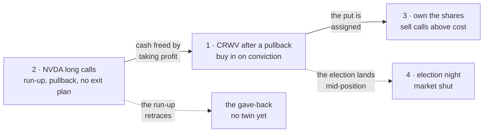

# Market scenarios — real situations a member brings, run as acceptance tests

_The journeys (`e2e/journeys/`) check that a member can **reach** a screen; a study checks they can
**use** it. A scenario checks the third thing: when a real market situation arrives, does the app
**say the right thing**? Each line below is an `it` in `tests/scenarios/`, run by `npm test` against
the pure decision engines (position guidance · Needs a decision), so no live quote is needed._

- **14 acceptance lines, 1 of them a known gap** (`it.fails`), turning red the day it is fixed.
- **Two engines disagree on one CRWV holding:** guidance says hold, the card says "cut it" (#4952).

<strong>How a scenario is written, and the ratchet</strong>

- One scenario = one situation, one spec file (or one `describe` in `adjacent.spec.ts`), one
  section here. Same ids (`s1`, `s2`…) in both.
- Each step is an EARS line (`/ears`) and the `it` title is that line. Its body asserts the
  **outcome** the line asks for, never today's defect.
- A known gap is `it.fails` with a `KNOWN GAP —` comment citing where. The suite stays green while
  the gap is real; the fix makes it red, then flips it to `it` — the same ratchet as a journey's
  `known_gap` (`README.md`).
- **A gap whose fix needs an input the engines don't take yet has no twin** — an `it.fails` that
  can never pass would read as open forever. It is listed under "No twin yet" with the input it
  needs, and becomes a spec when the input lands.
- Source tag on every scenario: `src: <member> · <date>` (their words, quoted) or `src: Claude`
  (a proposal for the member to prune).

## 1 — CRWV after a pullback, buying in on conviction

_src: Eric · 2026-10-18 · `tests/scenarios/crwv-pullback.spec.ts`_

> CRWV is a stock I believe to have long term significance just had significant pullback. I feel
> like we are close to the bottom of the pullback but could see it stalled out for awhile or pull
> back more.. I expect the next round of earnings over the next month or so across tech will be a
> determining force. I also expect the election to play into the equation.. a lot of negative
> sentiment towards billionaires which have direct associations to AI that I anticipate to cause
> turbulence. Long term, AI will dominate anyone who doesn't embrace it.

**World:** cash $40,000, no shares, would happily own at $70; spot $80; print window Nov 9–16
(estimate); MSFT Oct 28, the midterms Nov 3, NVDA Nov 18; the research ledger has no buy signal.

| id | acceptance line | today |
|---|---|---|
| s1 | WHEN the member names a price they'd happily own at and the research licenses no buy, the app shall say the research disagrees and still show the puts at or under that price | passes — WAIT, the ledger reason, every put row ≤ $70 with its real entry price |
| s2 | WHEN an expiry spans the earnings window, the app shall not price a put on it and shall mark it as spanning the print | passes — Nov 13 and Nov 20 marked, never priced |
| s3 | WHEN the election and the tech prints land before the next decision, the app shall list each, dated, among what the calls are waiting on | passes |
| s4 | WHEN a long-term holder is down from cost, the guidance shall hold and say cost never decides | passes |
| s5 | WHEN the same holding reaches Needs a decision, the card shall not offer cutting it on a return-from-cost test alone | **known gap — #4952** |

**What the scenario taught:** the guidance engine already behaves like a careful CSP seller here —
honest that the research disagrees, and it refuses to sell a put across a print CRWV's options
have under-priced before. The card that greets him on the Overview does not: on the same holding
it reads "cut it, or say why you're holding". That is his 2026-10-08 complaint, now pinned.

- _hypothesis — "close to the bottom" wants a staged entry (several puts at falling strikes over
  weeks), not one put. Proves it wrong: him selling a single put at one strike when the ladder
  offers several._
- **The fork that was here is settled, for the bots.** "Should a member's conviction license a put
  the research doesn't?" — yes: the CRWV wheel and long-call bots already run *as* his conviction,
  against the study's stand-aside (#4642), from the record
  [`ai-dip-2026-10.md`](../research/convictions/ai-dip-2026-10.md). What's left is the member
  side (below).

**His thesis, the same day (Eric, 2026-10-18):**

> CRWV backlog, NVDA ownership and access, constant demand, NVDA contractually obligated to buy
> surplus compute until 2032, nvda ability to finance hardware as a depreciating asset.. demand
> will remain at whatever peak capacity has available for the foreseeable future. There are
> predicable cycles.. Significant pullback should be met with looking to forecast when the next
> peaks/cycles to play the cycle. Misjudging the timing and Owning stock is fine given the 6m to
> 18 months will continue to experience significant growth with upswings to take profit.

It landed as four claims on the conviction record (3b, 10, 11, 12 — size zero, each with a dated
falsifier) and one line of risk stance: assignment is accepted, not a failure. It exposes two gaps
(neither with a twin yet) and one fork, since settled:

- **The guidance never reads his conviction** — WHEN the member holds a stated conviction on the
  symbol, position guidance shall show it beside the research stance, with its check date and the
  claims it rests on. _Needs: the conviction record as a guidance input (today only `ledger`)._
- **Play the cycle** — WHEN a pullback reaches the cycle study's floor band, the app shall say when
  past upswings from there peaked, so a take-profit can be planned before the bounce. _Needs: a
  peak-timing study (claim 12); the cycle study times the way back, not the next peak — #4952._
- **His stance vs. the wheel's retire test — settled 2026-10-18.** The record says assignment is
  fine, yet the wheel's own retire test stops it when more than 1 in 3 sold puts are assigned.
  His call: stop it only if it is losing money overall. Done as `acceptsAssignment` on the record,
  which skips that test (`src/playbooks/conviction-check.ts`).

## 2 — NVDA long calls: run-up, pullback, no exit plan

_src: Eric · 2026-10-18 · `tests/scenarios/nvda-long-calls.spec.ts`_

> I have a bunch of long calls on NVDA that I entered with no plan to take profit and cycle out.
> NVDA recently had run up followed by significant pullback. This is the second time this
> happened which has effectively resulted in me bleeding out theta for no profit, likely taking
> some losses. I would like to develop a strategy to effectively cycle capital out of position.
> Doing this effectively would've set me up to have a lot of capital for the current situation to
> buy CRWV cash secured PUTs at an extreme low ahead of earnings which to take advantage of market
> conditions to buy in a lull.

**World:** NVDA calls at several strikes and expiries on 2026-10-18; NVDA's print Nov 18 (estimate).

| id | acceptance line | today |
|---|---|---|
| s1 | WHEN a long call is up past the lock-in bar on the run-up, the app shall raise a lock-in decision with its expiry and next print as clocks | passes (+50% bar) |
| s2 | WHEN a long call expires after its own print, the card shall warn the print can shrink it even if the stock rises | passes |
| s3 | WHEN cash is tied up and the member asks for a put to sell, the app shall say the cash is why nothing passes | passes — the cost of not cycling, in one line |
| s4 | WHEN the member holds a long call, position guidance shall carry a call on that contract — take, trim, roll or hold — with the day it is next due | passes — its own `longCalls` verdict, read from the bot's exit rules; `manage` covers sold calls |
| s5 | WHEN a member's long call reaches 45 days left, the app shall raise a decision naming the time stop, whatever its return | passes — a time-stop card at 45 days, the house bot's rule (`src/playbooks/long-call-rules.ts`) |

**What the scenario taught:** the house already *has* the exit plan he is asking for — the
long-call playbook (#5482) sells at double the cost or 45 days left. The ask is one rule book:
the bot's exit rule, offered to the member when they buy, and carried on the position until it
fires (#5709). A member holding the same call hears both rules on the card and in position
guidance, read from `src/playbooks/long-call-rules.ts`; offering them at purchase is the open part.

**No twin yet** (each needs an input the engines don't take):

- **The gave-back** — WHEN a long call has given back most of a gain it once showed, the app shall
  say how much and when it peaked. _Needs: the position's peak value since entry._
- **An exit plan at entry** — WHEN a member buys a long call, the ticket shall propose a
  take-profit and a time stop and carry them on the position. _Needs: an exit plan stored with the
  position._
- **Where freed cash goes** — WHEN a member locks in profit, the app shall show what the freed cash
  could do next (the put rows on names they watch at a price they named). _Needs: book-level
  guidance — eric.md j3/j4 already pin its absence._
- **Theta named as the cause** — WHEN a long call is down while its stock sits near where it was
  bought, the card shall name time decay. _Needs: the stock's price at entry._

## 3 — the CRWV put is assigned; sell calls above what was really paid

_src: Claude · 2026-10-18 · `tests/scenarios/adjacent.spec.ts` — where scenario 1 goes when CRWV keeps falling_

**World:** sold the $70 put for $1.25, CRWV fell to $64, assigned: 100 shares, really $68.75 each.

| id | acceptance line | today |
|---|---|---|
| s1 | WHEN assigned shares sit below what the member really paid, the app shall offer no covered call that would sell them below it | passes — the $65 call is refused |
| s2 | WHEN the shares are held through a drop, the guidance shall never say sell on the drop | passes |

## 4 — election night: the market is shut and the member wants out

_src: Claude · 2026-10-18 · `tests/scenarios/adjacent.spec.ts` — scenario 1's turbulence, the night it lands_

| id | acceptance line | today |
|---|---|---|
| s1 | WHEN the market is closed, an acting call shall read as a plan for the next open, never an order for now | passes |
| s2 | WHEN the member chooses to sell, the app shall say it is a taxable sale | passes |

## Proposed next — not yet written (src: Claude, for pruning)

Ranked by how much of the book each touches:

1. **One theme, three positions** — NVDA calls, CRWV puts and CRWV shares are one AI bet. WHEN a
   book's positions share a theme, the app shall show the combined exposure. _Needs: a theme per
   symbol; the concentration line is per name today._
2. **The print lands overnight** — the day after NVDA's Nov 18 print, IV drops and the calls lose
   value though NVDA rose. WHEN the print has passed, the card shall say how much of the loss was
   the drop in option prices. _Needs: IV at entry vs. now per position._
3. **The bot and the member hold the same contract** — the long-call bot and Eric both own NVDA
   Dec calls. WHEN a bot exits a contract a member also holds, the member's position shall say so.
   _Needs: the member's positions read beside the bots' fills._
