# Member study readout — bot-loop-2026-11

## A member, stuck

The eric member on a phone, at their most confused (confusion 3 of 3):

| Before | What they did | After | Yours |
|---|---|---|---|
| 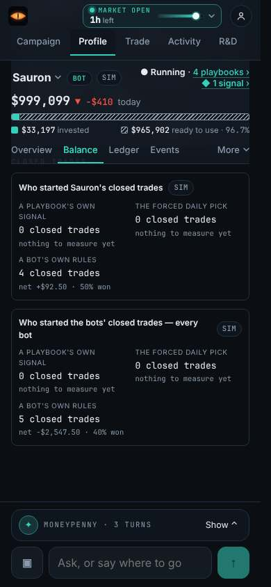 | gave up: "I checked Balance, Ledger (filtered to NVDA), Overview and Moneypenny, and none of them told me how much Sauron is up or down on NVDA. The Ledger lists the NVDA buys but gives no net, and Balance only groups closed trades by who started them. I'd have to add up the trades myself, so I can't decide whether to take profit." | _none_ | _your screenshot goes here (`--owner-shot`)_ |

> "As Eric, I've run out of places to look for an overall up/down number on Sauron's NVDA, so I'm stopping here. — The bottom of Balance shows "Who started Sauron's closed trades": 4 closed trades from the bot's own rules, net +$92.50, 50% won. Nothing is broken out by ticker, so there's no NVDA line. The Ledger showed my NVDA buys but no net. Moneypenny couldn't see Sauron." — eric

## What it found

**Found 6 of your 17 without seeing them (3 only partly) · 53 new structural problems · 107 new smaller ones.**

Partly means the right place with a vaguer reason; the bar counts it as found. Full matches alone: 3 of 17 (18%).

With 17 items the range is wide: 6 of 17 is anywhere from 17% to 59% (95% confidence).

Not counted as new: 2 structural already on your key (re-found, not new).

It missed the bar: recall (0.353, needs ≥ 0.6).

## New structural problems

Grouped by where each problem's root sits: a row of the IA ledger (docs/IA.md §10) or a new root named after grading. Roots are ranked by their worst problem, then how many times they were reported, then how many members they reached; the problems under each keep that order.

### 1. New root: playbook detail inline in one long catalogue page

_5 problems · reported 6 times · 0 members reached._

**In the R&D playbooks list, tapping a playbook card makes the page scroll by itself 1,000–14,000px to a detail block far down a page that is about 19,000px long. The reader lands mid-text, often under the wrong playbook's heading, with no title and no way back to the list.**

| Frame 1 | Frame 2 | Frame 3 | Frame 4 |
|---|---|---|---|
| 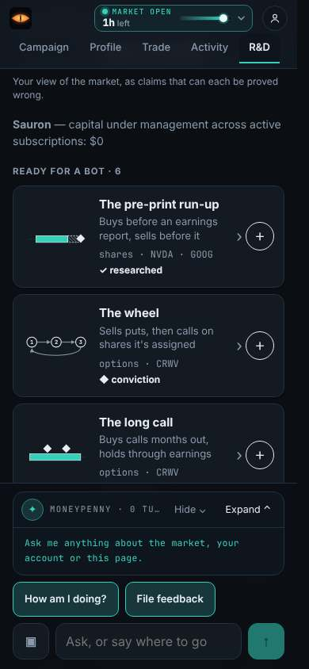 | 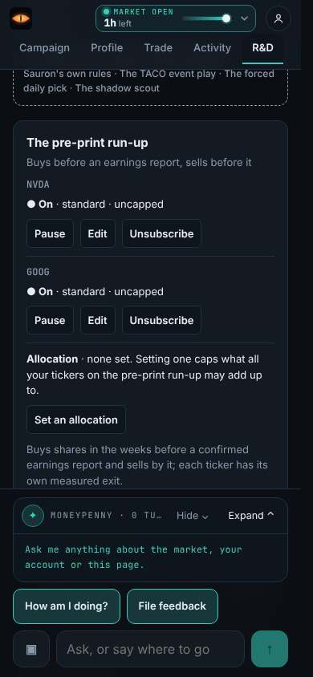 | 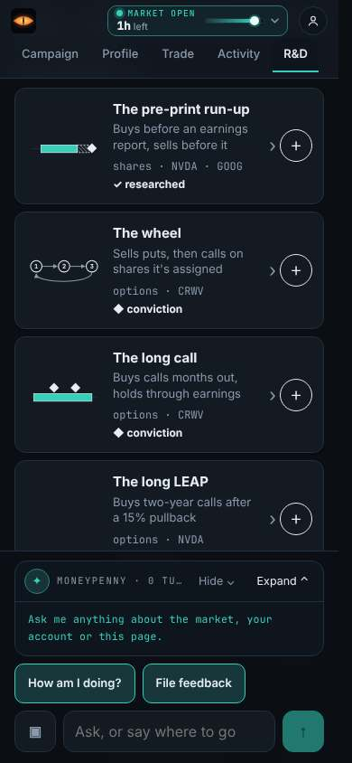 | 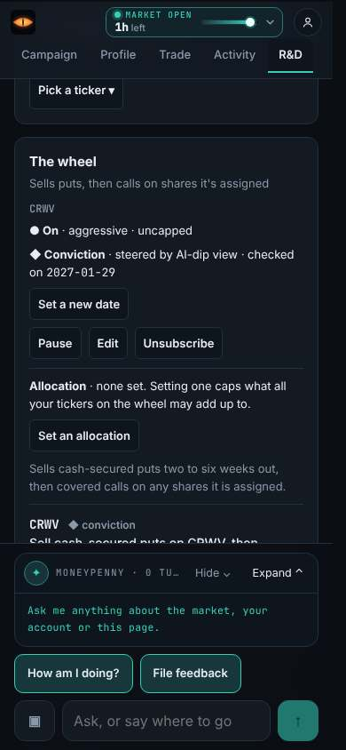 |

In the R&D playbooks list, tapping a playbook card makes the page scroll by itself 1,000–14,000px to a detail block far down a page that is about 19,000px long. The reader lands mid-text, often under the wrong playbook's heading, with no title and no way back to the list — this breaks H3 user control and freedom / IA navigation (navigational and memory waste), which matters because A one-handed phone owner or bot-watcher taps one strategy and ends up 5–15 screens down with no idea which playbook they are reading. Comparing a second playbook means scrolling all the way back up, so the task fails; the fix: Open the detail in place under the tapped card (an accordion), or as its own view or sheet with a Back control that returns to the same list position. Never auto-scroll to a block rendered somewhere else. If the block stays where it is, put the playbook's name and a sticky 'Back to playbooks' at its top.

_Found by expert reviews (expert 1) · critical · reported 1 more time._

- **Tapping a playbook card scrolls the page 9,000–14,000px down on its own, into a rules table with no heading naming the card. The URL doesn't change, so Back doesn't return you to the list.** — Found by expert reviews (expert 2) · high.
- **The R&D playbooks page is about 19,000px (around 23 phone screens) of full cards. It opens with three authoring buttons (New playbook, New chain, State a conviction). There's no summary of what Sauron runs, which playbooks are on, paused, failing or can't run, and no filter. Every card repeats empty 'Sauron/House — no closed trades' boxes.** — Found by expert reviews (expert 3) · high.
- **The R&D cards cause friction. There are two targets per card ('+' expands a subscribe panel, the body jumps away), and the '+' icon is unlabelled and turns into '×'. 'Pick a ticker' sits at the card's bottom edge beside the next card's heading, and its sheet names a different playbook, uses an 'AMZN' value styled like input, and says 'Pause or Edit it at the top of this card'. Card descriptions are cut mid-sentence, and the descriptions plus empty SIM boxes repeat on every card.** — Found by expert reviews (expert 1) · moderate.
- **Playbook card controls lose their context. Once the title scrolls off, identical Pause/Edit/Unsubscribe/Subscribe/Pick a ticker controls don't name their playbook. Sizing is split across per-ticker Edit, 'Set an allocation' and 'Set a new date'. 'Pick a ticker' opens a sheet with nothing to pick (just 'Yours already — Pause or Edit it at the top of this card' and an 'AMZN' that looks prefilled).** — Found by expert reviews (expert 3) · moderate.

### 2. New root: holdings have no home of their own

_2 problems · reported 5 times · 3 members reached._

**There is no reachable per-holding view with an all-time P/L on Sauron's Profile. On phone, the Positions list sits deep on Overview below the earnings and league cards, hidden by the Moneypenny panel and a wall of filter chips. No tab or More item is named Positions or Holdings. Balance's closed-trade cards group results by who started the trade, not by ticker. On desktop the list is also far below the fold.**

| Frame 1 | Frame 2 | Frame 3 | Frame 4 |
|---|---|---|---|
| 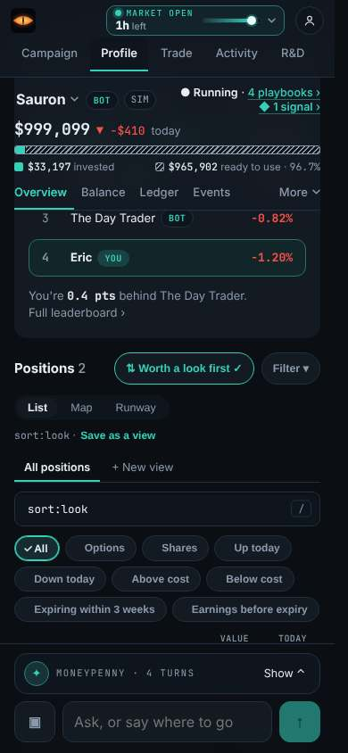 | 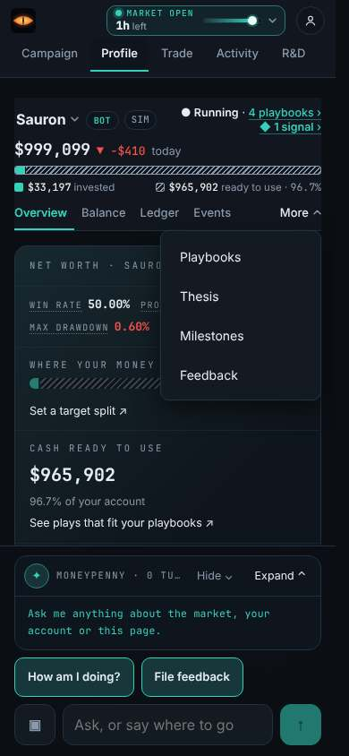 | 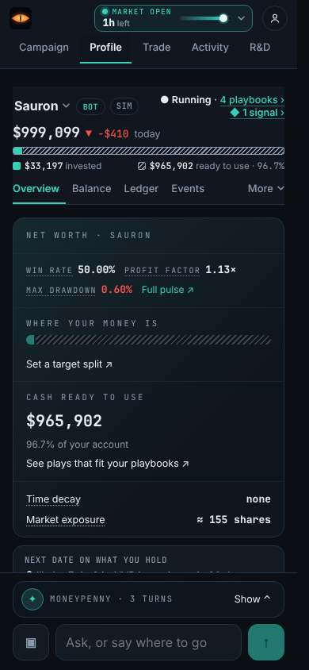 | 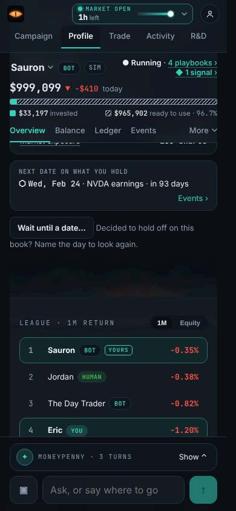 |

> "The positions list is buried under filter chips, and the rows only show VALUE and TODAY, not an all-time gain or loss."

_Found by simulated members (eric) · critical · reported 2 more times._

- **Tapping a position row (NVDA, AVGO) leaves the bot for the Trade ticket. It doesn't show what the bot did with the position or why. A 'New trade' card also appears for viewers who can't trade from this desk.** — Found by expert reviews (expert 2) · high · reported 1 more time.

### 3. New root: assistant blind to the account on screen

_2 problems · reported 4 times · 3 members reached._

**Moneypenny, opened on Sauron's Profile, reads only Eric's own desk. It denies that Sauron and NVDA exist while the page shows them, and it gave a wrong 'no closed trades' answer that Eric trusted (S8).**

| Frame 1 | Frame 2 | Frame 3 | Frame 4 |
|---|---|---|---|
| 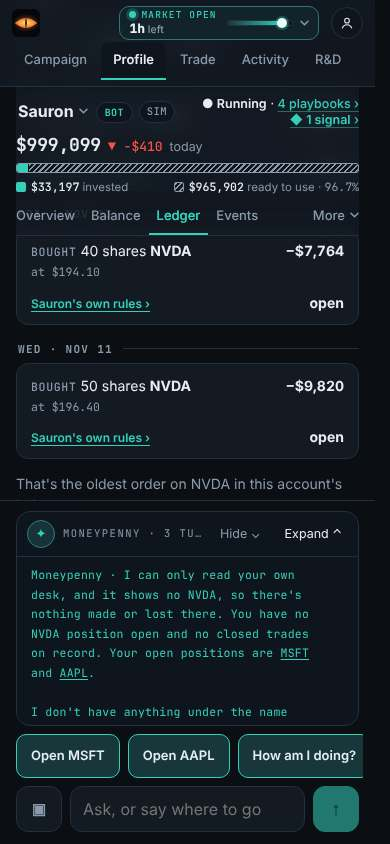 | 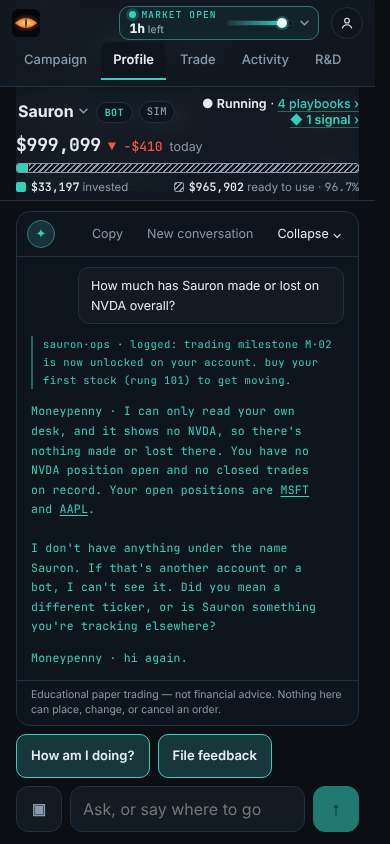 | 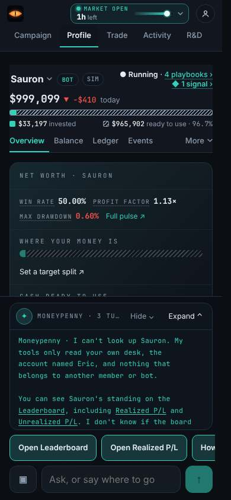 | 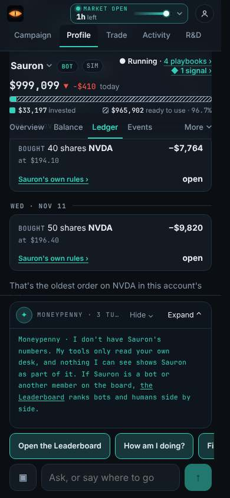 |

> "it says there's no NVDA, even though the ledger right above it shows Sauron bought NVDA."

_Found by simulated members (eric) · critical · reported 2 more times._

- **Asked 'How am I doing?' with Sauron selected, Moneypenny described Eric's account (MSFT, AAPL, equity $97,835). It gave no loss figures and pointed to 'the row' instead.** — Found by simulated members (phone-only) · high.

### 4. U1 — One history, three homes · on the ledger: plan filed as #8008 (3 screens; with U2)

_8 problems · reported 12 times · 0 members reached._

**Every ledger card has an 18px 'Sauron's own rules ›' link 3px below the card's tap area, which leaves for another page. The same link is repeated inside the expanded detail.**

| Frame 1 | Frame 2 | Frame 3 | Frame 4 |
|---|---|---|---|
| 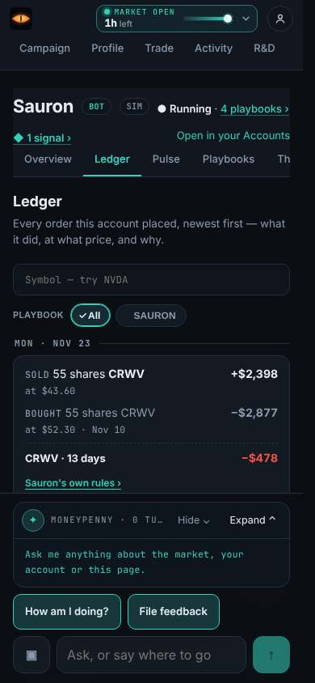 | 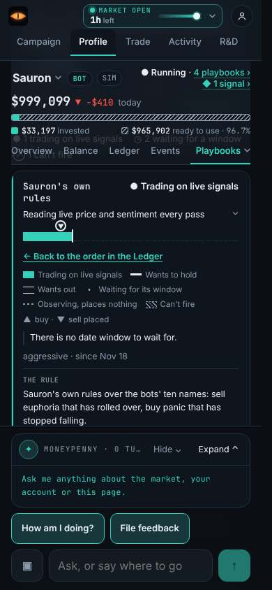 | 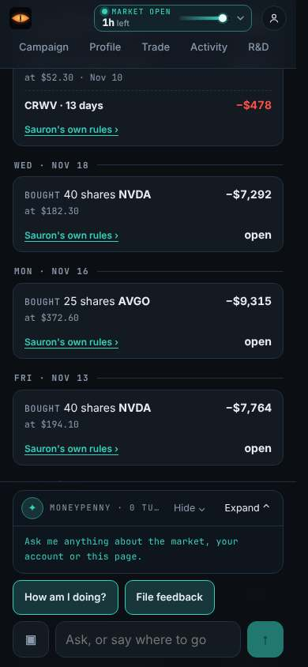 | 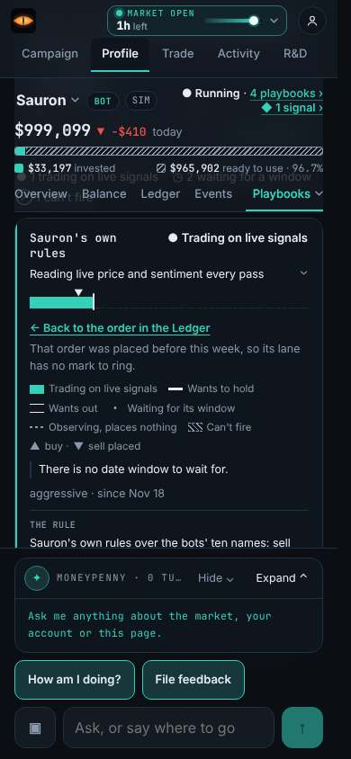 |

Every ledger card has an 18px 'Sauron's own rules ›' link 3px below the card's tap area, which leaves for another page. The same link is repeated inside the expanded detail — this breaks H5 error prevention (small, adjacent targets with different outcomes), which matters because phone-only, trying to expand an order, regularly lands on the link instead and loses their place in the ledger; the fix: Remove the per-row link from the collapsed card and keep a single full-row, 44px 'Why: Sauron's aggressive rule ›' inside the expanded detail.

_Found by expert reviews (expert 1) · high · reported 2 more times._

- **An order's reason is only on Thesis and its outcome (P/L, closed date) only on Ledger. The thesis text also refers to trades by number ('Trades 3, 7, 8, 11, 12…') far above the numbered list, and the chart markers bunch together and aren't linked to the list.** — Found by expert reviews (expert 1) · high · reported 1 more time.
- **Each bot has two homes. '◆ 1 signal ›' and 'Open in your Accounts' leave /app/u/<bot> for /app/accounts under the 'Profile' top tab. There, a second tab set (Overview/Balance/Ledger/Events/More) repeats the bot's Overview and Ledger with different figures. Day P/L is -$283 on one and -$419 'today' on the other. The signal lands under a tab called 'Balance', which actually means 'what's stuck'. 'Overview' vs 'Pulse' vs Accounts repeat the same metrics.** — Found by expert reviews (expert 2) · high · reported 1 more time.
- **The same bot has two homes with different tab sets and different numbers: /app/u/sauron (Overview/Ledger/Pulse/Playbooks/Thesis/Settings, day P/L −$283) and /app/accounts?account=sauron under 'Profile' (Overview/Balance/Ledger/Events/More, −$419 today). '◆ 1 signal ›', 'Open in your Accounts', the ledger's 'Sauron's own rules ›' and '← Back to Sauron' all jump between them without warning. The signal that says what holds the bot back (97% idle cash) lives under 'Balance'.** — Found by expert reviews (expert 1) · high.
- **Each order row on Thesis has two tiny, look-alike targets (18px rows 22px apart, 'Why?' at 29×17px). The order name leaves for the Ledger tab, while 'Why?' expands in place, then grows to 'Hide reasoning' and shifts 50px. On the accounts copy, Thesis then folds into 'More', so the tab you came from disappears. Only one reason can be open at a time.** — Found by expert reviews (expert 1) · high.
- **On Thesis, each 'Why?' is a 29×17px target, rows are 22px apart, and the plain-white order text on the same row is a link to the Ledger tab that looks like list text. Tapping it switches tabs, jumps the scroll and closes open reasons. After you land on Ledger, the way back is under 'More ▾'.** — Found by expert reviews (expert 2) · high.
- **Thesis rows show only action, size and ticker. Date, price and result exist only on the Ledger, so tapping a trade name jumps there (scroll position lost, from 1881px to 230px). On the accounts view, Thesis then disappears into 'More'. The Ledger runs newest first while Thesis runs oldest first.** — Found by expert reviews (expert 3) · high.
- **Thesis reasons and the sentiment section are written in trader code ('RVOL… momentum +0.092', 'exit-safety trip (aggressive): drawdown 16.6% ≥ 16.0% cap', 'panic −0.58', 'tranche', 'Walls ±0.70'). They refer to trades only by number ('Trades 3, 7, 8, 11, 12'), while the numbered list is about 2,000px away and the chart markers overlap. The health verdict ('Holding … Health: steady') is on screen two.** — Found by expert reviews (expert 2) · moderate.

### 5. New root: assistant dock fixed over every page

_5 problems · reported 9 times · 1 member reached._

**On phone the Moneypenny dock (header, greeting, two suggestion chips, ask bar) is fixed over the bottom 25–40% of the screen on every page. It covers the content each page exists for: positions, playbook cards and their 'Can't fire' verdicts, ledger rows and amounts, the Max Drawdown tile, thesis text, the Bots card on the leaderboard, and the settings below 'Suspend trading'. Pages also have no bottom padding, so the last item can't be scrolled clear of it.**

| Frame 1 | Frame 2 | Frame 3 | Frame 4 |
|---|---|---|---|
| 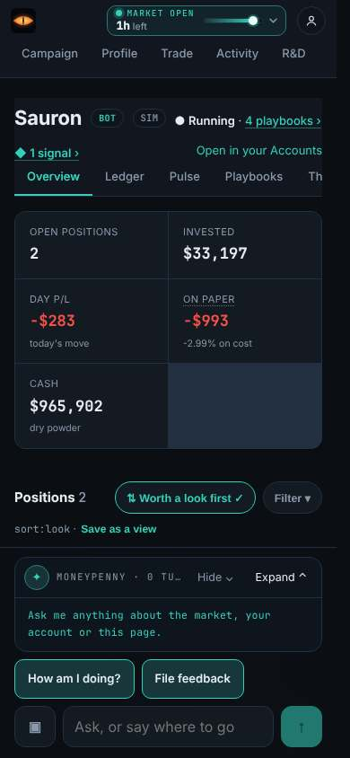 |  | 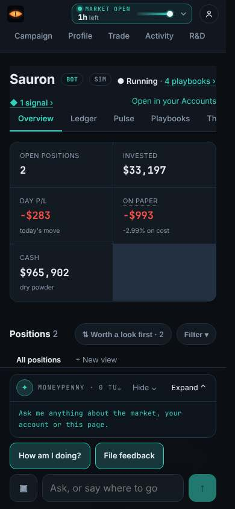 | 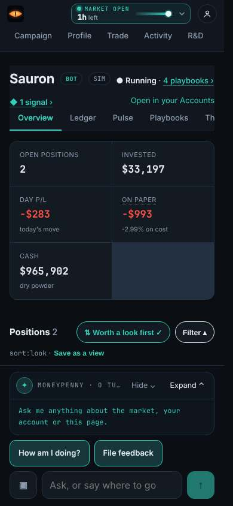 |

On phone the Moneypenny dock (header, greeting, two suggestion chips, ask bar) is fixed over the bottom 25–40% of the screen on every page. It covers the content each page exists for: positions, playbook cards and their 'Can't fire' verdicts, ledger rows and amounts, the Max Drawdown tile, thesis text, the Bots card on the leaderboard, and the settings below 'Suspend trading'. Pages also have no bottom padding, so the last item can't be scrolled clear of it — this breaks H8: a control covers content the person came to read (numbers and labels), which matters because Every member checks in briefly on a phone, usually one-handed. A third of each screen goes to a tool nobody opened, so the answer to 'is it working, what did it do, what's holding it back' sits underneath it. On the Day Trader page the 'can't fire' blocker is visible only after tapping Hide, so a member can read 'Running · none missed' and leave thinking all is well; the fix: On phone, start the dock collapsed to one small launcher (an icon or a one-line pill), open it only when tapped, and remember the choice. Reserve bottom padding equal to whatever stays fixed. When a disclosure opens, scroll what it reveals into view above the dock.

_Found by expert reviews (expert 2) · high · reported 2 more times._

- **The Moneypenny assistant dock (header, 'Ask me anything' prompt, 'How am I doing?'/'Help me get set up' and 'File feedback' buttons, and an input bar) is open by default on every page and fixed over the bottom 30–40% of the phone screen. It covers the content each page exists for: the position rows and league ranks on Overview, the playbook list and its 'can't fire' line, ledger amounts and reasons, Pulse stats, thesis orders and reasoning, the Bots card on the leaderboard, the Account card on Trade, and the controls under Suspend trading in Settings. On Day Trader's Playbooks, the fact that 'None of this bot's playbooks is on' and that the only playbook 'can't fire' shows only after tapping Hide.** — Found by expert reviews (expert 1) · high.
- **Expanding the Moneypenny dock grows it over the page and covers the numbers and controls being asked about: the CASH and Equity tiles (cut in half), the 'Running' card, 'Suspend trading', the whole ledger, and the leaderboard cards. It opens with a generic setup or feedback greeting.** — Found by expert reviews (expert 2) · high.
- **The dock adds off-task content to every page: 'How am I doing?', 'Help me get set up' and 'File feedback' chips, two duplicate prompts ('Ask me anything…' and 'Ask, or say where to go'), a clipped 'MONEYPENNY · 0 TU…' counter, and an expanded greeting about connecting an Alpaca account even on a running bot's page.** — Found by expert reviews (expert 1) · moderate · reported 2 more times.
- **The Moneypenny chat panel covers the bottom of every screen, hiding the start of lists (The Field, Positions). In S14 it hid The Day Trader's positions when the member ran out of steps.** — Found by simulated members (bot-watcher) · moderate.

### 6. U5 — One play's status, safety stages and stop switch spread over three places · on the ledger: waiting (2 screens)

_4 problems · reported 9 times · 0 members reached._

**The bot's status contradicts itself or hides what is blocking it. Day Trader shows 'Running' and 'Halted · data-gap' side by side, and its header says 'Running · 1 playbook' with green 'none missed' while its only playbook 'can't fire'. GOOG is labelled 'Waiting for its window' even though no print date exists, so the summary undercounts what is blocked. Day Trader's Settings says 'Autonomous trading is currently active' while Paper orders is set to 'Watch only — place nothing'. The empty state 'Which playbooks these are is the bot owner's to see…' reads like a privacy notice.**

| Frame 1 | Frame 2 | Frame 3 | Frame 4 |
|---|---|---|---|
| 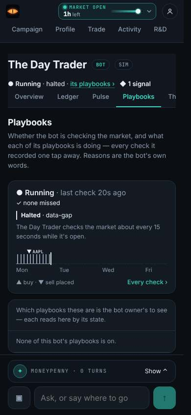 |  |  | 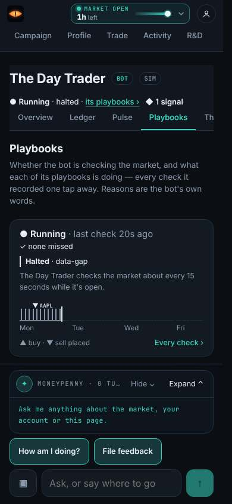 |

The bot's status contradicts itself or hides what is blocking it. Day Trader shows 'Running' and 'Halted · data-gap' side by side, and its header says 'Running · 1 playbook' with green 'none missed' while its only playbook 'can't fire'. GOOG is labelled 'Waiting for its window' even though no print date exists, so the summary undercounts what is blocked. Day Trader's Settings says 'Autonomous trading is currently active' while Paper orders is set to 'Watch only — place nothing'. The empty state 'Which playbooks these are is the bot owner's to see…' reads like a privacy notice — this breaks H1 visibility of system status / H2 match with the real world, which matters because 'Is it working?' is the main question for eric, invited-friend and phone-only. Green 'Running' and 'active' say yes when the bot cannot place an order, so an owner can be wrongly reassured for days. bot-watcher can't decode 'data-gap'; the fix: Lead every bot page with one plain verdict that reflects every limit, e.g. 'Checking, not trading: no playbooks on' or 'Watching only since Nov 20 (by you) · Resume'. Count playbooks that are missing a prerequisite (no print date, no feed) as 'Can't fire'. Say whether the owner needs to act.

_Found by expert reviews (expert 1) · high · reported 2 more times._

- **On Thesis, the bot's live status ('Holding — no signals fired for 2 cycles', 'Health: steady') sits on the second screen, below the unbuilt Subscribe form and partly under the dock.** — Found by expert reviews (expert 1) · high · reported 1 more time.
- **Three overlapping switches limit the bot (Suspend trading, New positions, Paper orders) with no explanation of which wins. The help text under each dropdown describes the option that is not selected.** — Found by expert reviews (expert 1) · high · reported 1 more time.
- **The Day Trader settings say 'Autonomous trading is currently active', while further down Paper orders is set to 'Watch only — place nothing' and 'New positions' is another stop. Three separate controls, explained in three paragraphs far apart, all stop or limit the bot, and nothing summarises their combined effect.** — Found by expert reviews (expert 2) · high · reported 1 more time.

### 7. U2 — Derived numbers on a log · on the ledger: plan filed as #8008 (3 screens; with U1)

_4 problems · reported 6 times · 3 members reached._

**Each closed buy appears twice: inside the round-trip card on the sell date, and again on its own on the buy date ('closed Nov X') without the result.**

| Frame 1 | Frame 2 | Frame 3 | Frame 4 |
|---|---|---|---|
| 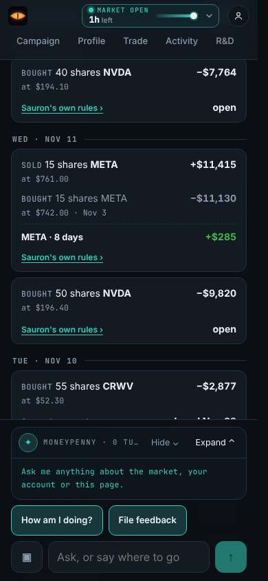 | 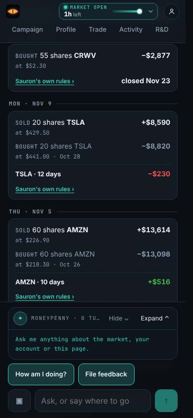 | 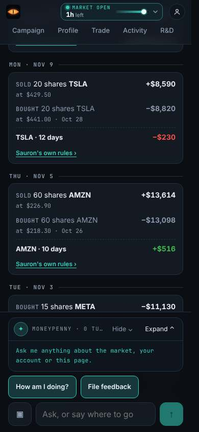 | 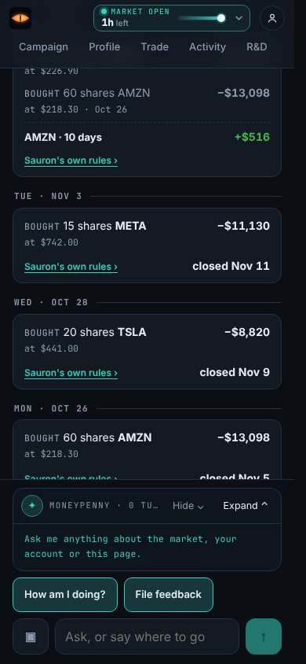 |

Each closed buy appears twice: inside the round-trip card on the sell date, and again on its own on the buy date ('closed Nov X') without the result — this breaks IA organisation / H8 / H4, which matters because Members counting what the bot did double-count it, and may read the standalone copy as a separate loss; the fix: Show each order once. Replace the standalone row with a slim 'bought → see round trip Nov 5' link, or offer an Orders / Round trips toggle.

_Found by expert reviews (expert 2) · high · reported 1 more time._

- **In the Ledger filtered to NVDA, open buy lots show only the cash paid and 'open'. There is no current value, no unrealized P/L and no position total, unlike the closed CRWV round trip, which shows a net. Open lots aren't grouped into one transaction with a running result.** — Found by simulated members (eric) · high.
- **There is no clear total for profit or loss on closed trades. It sits below an idle-cash signal on Balance, split into three groups. In the Ledger route, the member had to work it out from individual trades.** — Found by simulated members (invited-friend) · moderate · reported 1 more time.
- **The ledger misleads. Closed buys appear twice (inside the round trip and again on the buy date). Round trips list SOLD before BOUGHT, with a green sale amount beside a red result. Buy outlays are shown as '−$' in the slot used for P/L. Open positions show no current P/L ('now: no quote right now' while the market is open), and the card's fill price differs from the detail.** — Found by expert reviews (expert 1) · moderate.

### 8. New root: leaderboard summary cards stand in for the ranked list

_2 problems · reported 5 times · 1 member reached._

**On the leaderboard, the ranked list ('The Field') starts a full screen down, below the Humans/Bots summary cards, and Humans come first. Rows show no bot status, although Day Trader is halted, and nothing marks the viewer's own account or bot.**

| Frame 1 | Frame 2 | Frame 3 | Frame 4 |
|---|---|---|---|
| 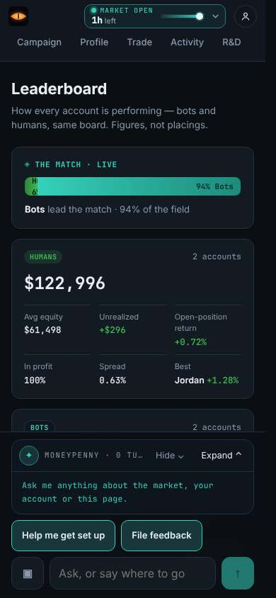 |  | 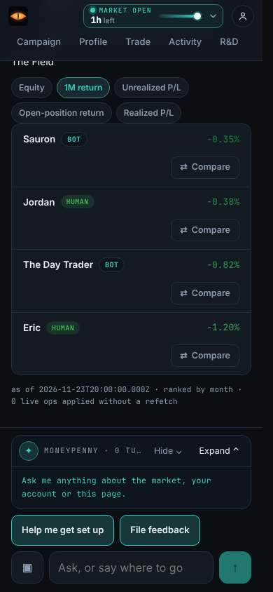 | 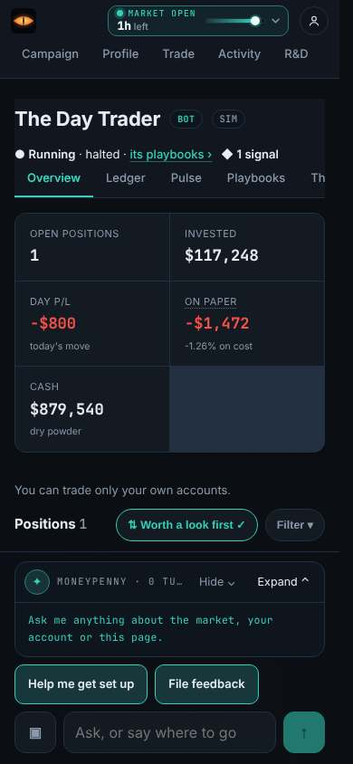 |

On the leaderboard, the ranked list ('The Field') starts a full screen down, below the Humans/Bots summary cards, and Humans come first. Rows show no bot status, although Day Trader is halted, and nothing marks the viewer's own account or bot — this breaks IA organisation / posture / H1 / H6, which matters because 'Where does my bot rank, and is it running?' needs a scroll, and a halted bot ranked last looks as if it is merely losing; the fix: Put a compact ranked list under the match bar, with a status dot next to each BOT tag and a 'You / Your bot' marker. Move the group cards below it, with Bots first.

_Found by expert reviews (expert 1) · high · reported 3 more times._

- **The Bots summary card on the leaderboard doesn't list the bots by name. It names only the 'Best' bot, and its '2 accounts' label looks tappable but does nothing.** — Found by simulated members (bot-watcher) · low.

### 9. U3 — A section switch that can't hold its sections at 390 · on the ledger: filed as #5206 (7 screens)

_3 problems · reported 5 times · 1 member reached._

**The Settings section strip (Accounts · Settings · Preferences · Account · Target split) overflows the screen. The open section, 'Account', is off-screen, 'Settings' is highlighted instead, and 'Accounts' and 'Account' sit side by side meaning different things. Some chips are links that leave the page, others switch in place.**

| Frame 1 | Frame 2 | Frame 3 | Frame 4 |
|---|---|---|---|
| 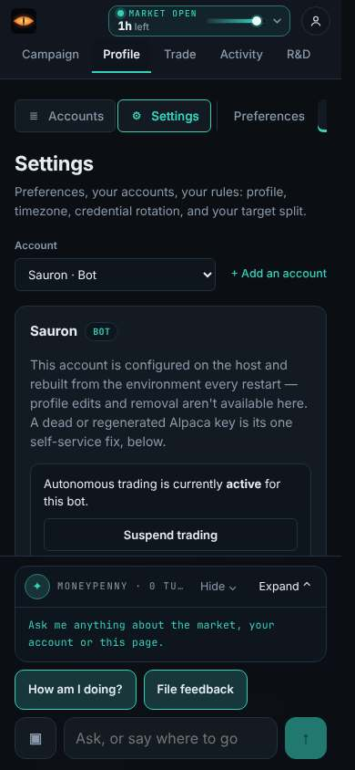 |  | 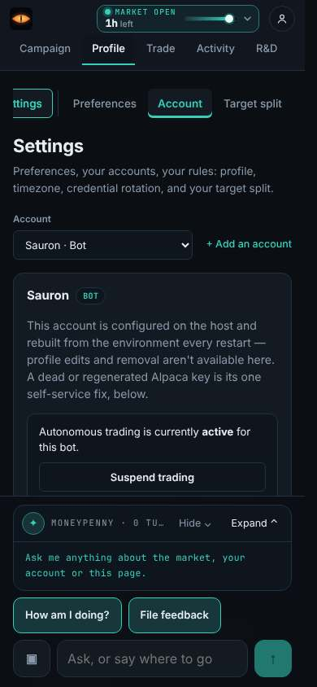 | 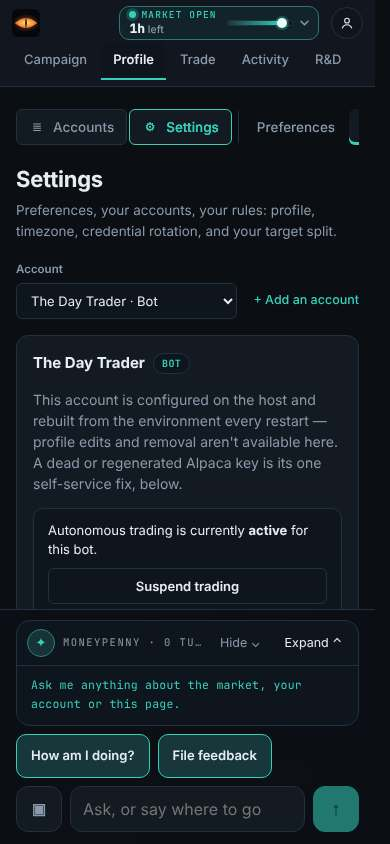 |

The Settings section strip (Accounts · Settings · Preferences · Account · Target split) overflows the screen. The open section, 'Account', is off-screen, 'Settings' is highlighted instead, and 'Accounts' and 'Account' sit side by side meaning different things. Some chips are links that leave the page, others switch in place — this breaks IA navigation and labelling / H1 / H4 / H6, which matters because Members can't see where they are, or that the bot controls live in a hidden 'Account' tab; the fix: Use one level of in-page tabs with the current one marked and scrolled into view (or a selector on phone). Move 'Accounts' out, and rename 'Account' to something like 'Bot controls'.

_Found by expert reviews (expert 2) · high · reported 1 more time._

- **The bot's own reasoning is hard to reach. The desk opens on Overview, and scrolling down ends at a league card. Decisions and the thesis sit in a tab row that members missed, so in S5 and S6 they never reached the thesis at all.** — Found by simulated members (bot-watcher) · high.
- **In the Accounts view, Thesis and Playbooks are hidden under 'More ▾' while Overview/Balance/Ledger/Events stay visible, and the More tab is renamed 'Thesis ▾' or 'More ▾' depending on where you are. The name 'Thesis' doesn't suggest 'trades and reasons'.** — Found by expert reviews (expert 2) · moderate · reported 1 more time.

### 10. New root: leaderboard has no place in the main nav

_2 problems · reported 4 times · 2 members reached._

**There is no clear way back to the leaderboard from a bot's desk. The logo does nothing, the top nav has no Leaderboard item, and back steps through every desk tab first.**

| Frame 1 | Frame 2 | Frame 3 | Frame 4 |
|---|---|---|---|
| 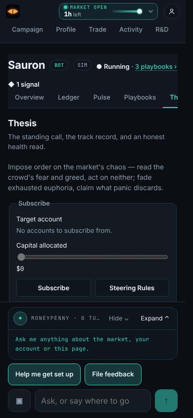 | 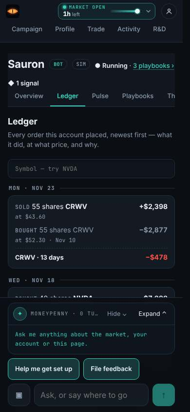 | 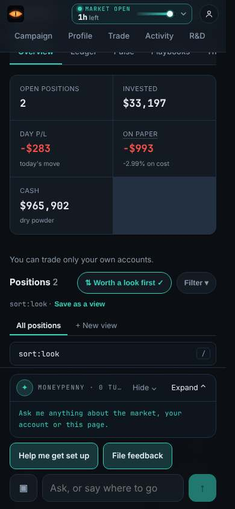 | 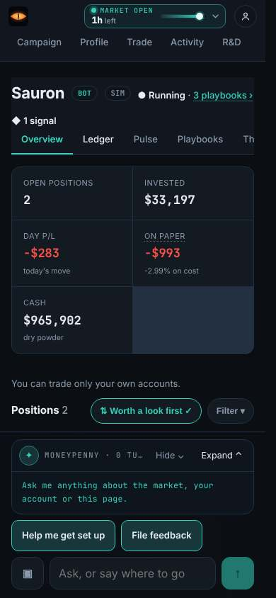 |

> "The logo didn't take me home, so getting back took three presses of back"

_Found by simulated members (bot-watcher) · high · reported 2 more times._

- **There is no obvious place that lists the other traders. The member expected Campaign (or the account picker) to show the league, but Campaign is a market/news overview and the picker lists only their own accounts. Sauron only turns up on Activity.** — Found by simulated members (invited-friend) · high.

The other 12 roots, ranked the same way, text only

- **New root: chosen account not carried across pages** (2 problems): Top-nav tabs that are already highlighted change context when tapped. 'Profile' while viewing Sauron switches to Eric's account and drops the section. 'Trade' on Sauron's desk silently switches to the member's own desk, and the heading still just says 'Trade'. 'Profile' also opens accounts or onboarding rather than a profile, and 'Campaign' opens home.; Switching to Sauron on Profile doesn't carry over to Trade. The Trade 'Account' box still defaulted to Eric, and once switched it was an order form, not a list of holdings.
- **New root: adding an account is an onboarding milestone, not a form** (1 problem): '+ Add an account' leads into an onboarding milestone page, scrolled past its end, instead of a form for adding an account.
- **New root: research studies live outside the app shell** (2 problems): The study links ('its study →', 'the study behind it →', 'R&D's research on this report →') are labelled three different ways, are as small as 63×15px, and do a full page load into chrome without the app nav. Coming back loses the scroll position thousands of pixels down. The study tables scroll sideways and hide the 'Why' and 'Proves it wrong' columns.; Study links ('its study →', 'the study behind it →') are 15px inline links. They do a full reload to /research pages outside the app shell, losing a scroll position 10,000–17,000px down, and the only way back is '← Research'. On phone, the study tables clip the CONFIDENCE column ('medi', 'CONF') with no scroll cue.
- **U13 — The owner's tools have no home of their own · on the ledger: waiting (1 screen; joins #5462)** (2 problems): The bot's own 'Settings' tab, which is hidden past the clipped tab row, opens the global /app/settings display preferences (density, theme) and switches the top nav to Profile. It never opens the bot's settings.; The 'Settings' tab in the bot's tab row, hidden off-screen at phone width, opens the app-wide Preferences (density, motion, theme) under Profile. It does not open settings for this bot, and the member menu already has the same link.
- **U12 — A record can't open the trades that made it · on the ledger: waiting (1 screen)** (1 problem): On a bot's desk, tapping a position row (NVDA) opens a generic Trade ticket for the member's own unlinked account, not that bot's history for the stock.
- **U7 — R&D as a destination, not a capability · on the ledger: waiting (2 notes; long term)** (1 problem): The R&D Playbooks page, scoped to account=sauron, opens with three creation buttons and is about 19,000px of catalogue, studies, empty SIM boxes and control rows. It has no summary of what Sauron runs, its status or its blockers, no filter, and only one small line ('capital under management… $0') saying which bot this is. That line seems to contradict 'Sauron already runs it'. Cards show no results.
- **New root: position list tooling built for large books regardless of size** (2 problems): With only two positions, most filter chips (Options, Up today, Above cost, Expiring…, Earnings…) empty the list to 'No positions match this filter'. The only recovery offered is a 'New trade' card; there is no 'clear filter'.; Above two positions sit a sort button, 'Filter ▾', 'Save as a view', 'All positions / + New view', a search box showing raw syntax ('sort:look', 'day:>0', 'dte:<21') and nine chips, about 330px of tooling. Sorting and saving views give unclear feedback ('Save as a view' just vanishes, and the sort turns dim).
- **U8 — The Profile head assumes an account · on the ledger: waiting (1 screen)** (1 problem): Profile always opens on Eric's book. The only way to Sauron is a small chevron next to the name, and nothing on the first screen says whose numbers you're reading. Members who didn't notice answered Sauron questions with Eric's data.
- **New root: expanding detail doesn't bring it into view** (1 problem): Tapping a ledger order card expands detail (fill, WHY, guards, 'Full detail') that opens below the fold or under the dock. The page doesn't scroll to it, so only a highlight border changes. Cards have no chevron, and the page jumps on each expand.
- **New root: Balance tab named for holdings holds signals** (1 problem): The Balance tab reads like 'what I hold and how it's doing', but it shows imbalance signals (idle cash) and playbooks. Members tapped it expecting holdings and hit a dead end.
- **New root: ledger filters not built from the account's own trades** (1 problem): The ledger can only be filtered by symbol, and the hint suggests NVDA even for a bot with no NVDA orders. The playbook chips show only 'SAURON' (same as All), though the header says 4 playbooks. The price lines are low-contrast grey.
- **New root: section switches replace history instead of pushing it** (1 problem): Section changes replace history instead of pushing it: account sections, ledger chips, R&D Board/Coverage/Playbooks, settings sections and '+ Add an account'. The phone Back gesture leaves the area instead of undoing the last step, and R&D and settings drop '&account=sauron'.

Not counted as new:

- F-8def0a9e68: already on your key (B3), so re-found, not new — not counted.
- F-899201f420: already on your key (B3), so re-found, not new — not counted.

## Your items, one by one

| Your item | Members | Experts | Words | Measurements (not blind) | Chat drafts (not blind) | Note |
|---|---|---|---|---|---|---|
| A1 — The pause for one bot is not on any of the bot's own pages. An owner who wants to stop or narrow their bot (pause it, stop new positions, only watch) has to leave the bot, go to Settings, open its Account part and scroll past their own account card; on a phone, blind members took more than a dozen steps and gave up (#7673 BT-01; IA §5.2 "the owner leaves the account to act on it"). | — | yes | — | — | — |  |
| A2 — The stop for every bot at once sits in one member's personal Settings, under their own account card, on a part Settings does not open on, rather than in an owner's area of its own; on a phone it is a hunt (#7673 BT-02; U13). | — | — | — | — | — |  |
| A3 — A bot set to only watch still reads "Running" on its status line, with no word that it records decisions and sends no orders (bot-loop worlds' build notes, #8021). | — | — | — | — | — | **disputed** |
| A4 — A bot that something holds back shows the bare word "halted" on its status line: no who (its own breaker or its owner), no reason beside it and no end date, so held on purpose reads the same as broken (IA §5.2 heartbeat vocabulary; MISSING 11; #1307). | — | partly | partly | — | — | **disputed** |
| A5 — One strategy's state, its safety stages and its off switch are spread over three places: the reasoning view, the strategies section and Settings (U5). | — | — | — | — | — |  |
| A6 — The status line ("Running · checked …") and the strategy cards read as two unrelated things: the line never says what a check is or that each check asks those strategies (Eric, r1 2026-10-09: "no idea what this information is"; "no clear or intuitive association"). | — | — | — | — | — |  |
| A7 — Changing what a bot runs means leaving it for R&D's catalog, and there the bot is named in bold text that is not a link, so the only way back to the bot is the browser's Back (invited-friend journey gap; IA §6 joint 4). | — | partly | — | — | — |  |
| A8 — One word for three unrelated places: "Playbooks" is the bot's own section, R&D's catalog, and a chapter on the member's progress page (dead end 7; cohesion census). | — | — | — | — | — |  |
| A9 — "conviction" names two different records on one screen: the member's own stated views of the market, and a strategy pair that runs on its owner's reason and check day (invited-friend journey gap). | — | — | — | — | — |  |
| A10 — A fill in the league feed opens the bot's page at its top, never that fill: the order is dropped at the hand-off (bot-watcher journey gap; U1). | — | — | — | — | — |  |
| A11 — The bot's order history has several homes, each with its own controls and rows (the league feed, the account's Activity, the bot's public activity page), and two "Activity" labels sit close together (U1). | — | — | — | — | — |  |
| A12 — The weekly results cannot open their trades: the bars are one picture and the order list takes no date (U12; bot-watcher journey gap). | — | — | — | — | — |  |
| A13 — At phone width the section switch cuts off its last tabs with no cue, and the head above it takes a large share of the first screen (U3). | yes | yes | — | partly | — |  |
| A14 — Taking over a bot's position safely takes three writes in three places (stop the bot in Settings, trade on Trade, start it again in Settings), and the bot's switch cannot be reached from the order form opened for the bot (IA §5.2 evidence s4 and its 390 note). | — | — | — | — | — |  |
| A15 — The reasoning view shows a locked set of controls (subscribe, a target account listing the viewer's own accounts) that no member can use, with no visible reason on a phone (IA §5.2 amendments; dead end 8). | partly | yes | — | partly | — |  |
| A16 — On a phone, Trade's order form starts below the ladder card and under the assistant dock, so starting an order begins with a scroll hunt (#7670). | — | partly | — | — | — |  |
| A17 — Moneypenny's directions name places by words the tabs no longer carry: she sends a member to "Research" for the strategy catalog while the tab reads "R&D", and calls the front page "the landing page" while its tab reads "Campaign" (her place list at the pin; fixed by #8012). | — | — | — | — | — |  |
| **Found** | 2 of 17 (3%–34%) | 6 of 17 (17%–59%) | 1 of 17 (1%–27%) | 2 of 17 (3%–34%) | 0 of 17 (0%–18%) | |

The measurements were designed after reading your list, so they never count as finding anything.
A chat draft is a filing Moneypenny wrote from what a member told her; it is counted apart, never as discovery.

The two matchers agreed on 100% of 690 findings (Cohen's kappa 0.968).
- Disputed F-0877df4055: one matcher said none (0), the other A3 (0.5); a third matcher said none (0).
- Disputed F-85ad24b09f: one matcher said A4 (0.5), the other none (0); a third matcher said none (0).

Of what the blind evaluators reported, 251 of 277 were real (91%); 11 came from the test world, not the app, and are left out.

By member: bot-watcher 2 of 17 (1 hinted) · eric 0 of 17 · invited-friend 0 of 17 · phone-only 0 of 17.

Members succeeded in 65% of 72 sessions; middle ease 6 of 7. (Counted over every session, not only the tasks you found hard, so this is a rough check, not the plan's calibration test.)

## The design battle-test

Did not run: the round did not pass the bar, so no design was battle-tested.

## What members hire this area for

Hired for: eric: Decide whether each of his bots is doing the job he gave it (running, protected, following the right strategies against the current market), and adjust it before it costs him or misses a chance. · invited-friend: Check on the bot they took over (is it running, what does it believe and hold right now) and see where it stands against everyone else. · bot-watcher: Find out what a bot did and why: what it wanted, what it was allowed to do, and how it turned out. · phone-only: In a 30-second, one-handed check, learn how a bot is doing and whether anything is wrong..

| Stage | What members want from it | What the area holds |
|---|---|---|
| Define | minimize the time it takes to know whether a bot is running and whether anything is holding it back; minimize the effort to tell whose bot this is and whether I can change it; maximize the clarity of which strategies a bot runs and what each is trying to do | — |
| Locate | minimize the steps to reach a bot's page from the league table; minimize the time to find the reason behind a specific order; minimize the chance of missing a held-back or refused check | — |
| Prepare | minimize the effort to see the bot's current view of the market before changing its strategies; maximize the certainty that the market information the bot used is fresh, with its date shown | — |
| Confirm | minimize the chance of changing a bot's settings without knowing what the change will do; minimize the chance of acting on a bot I don't own; maximize how clearly a greyed-out control says why it's off, in visible words | — |
| Execute | minimize the steps to pause a bot, stop it opening new positions, or re-arm a safety stop; minimize the steps to subscribe a bot to a strategy or narrow one to a dated market view | — |
| Monitor | minimize the time it takes to know if a bot's results are getting better or worse, week to week; maximize the clarity of which strategy placed each order and on what evidence, newest first; minimize the time to see whether a safety stage has fired for any strategy | — |
| Modify | minimize the effort to see what changed after I adjusted a bot, from the change log; minimize the effort to move from a bot's holding to trading that holding | — |
| Conclude | minimize the steps to return to where I came from (league table or overview); maximize the confidence that I understood what the bot did this period | — |

Measured: minimize the time it takes to know whether a bot is running and whether anything is holding it back (Task success); maximize the clarity of which strategy placed each order and on what evidence, newest first (Happiness).

## What it missed

- **Not known whether a task went there (no record of which pages were touched):** A2 — The stop for every bot at once sits in one member's personal Settings, under their own account card, on a part Settings does not open on, rather than in an owner's area of its own; on a phone it is a hunt (#7673 BT-02; U13). · A3 — A bot set to only watch still reads "Running" on its status line, with no word that it records decisions and sends no orders (bot-loop worlds' build notes, #8021). · A5 — One strategy's state, its safety stages and its off switch are spread over three places: the reasoning view, the strategies section and Settings (U5). · A6 — The status line ("Running · checked …") and the strategy cards read as two unrelated things: the line never says what a check is or that each check asks those strategies (Eric, r1 2026-10-09: "no idea what this information is"; "no clear or intuitive association"). · A8 — One word for three unrelated places: "Playbooks" is the bot's own section, R&D's catalog, and a chapter on the member's progress page (dead end 7; cohesion census). · A9 — "conviction" names two different records on one screen: the member's own stated views of the market, and a strategy pair that runs on its owner's reason and check day (invited-friend journey gap). · A10 — A fill in the league feed opens the bot's page at its top, never that fill: the order is dropped at the hand-off (bot-watcher journey gap; U1). · A11 — The bot's order history has several homes, each with its own controls and rows (the league feed, the account's Activity, the bot's public activity page), and two "Activity" labels sit close together (U1). · A12 — The weekly results cannot open their trades: the bars are one picture and the order list takes no date (U12; bot-watcher journey gap). · A14 — Taking over a bot's position safely takes three writes in three places (stop the bot in Settings, trade on Trade, start it again in Settings), and the bot's switch cannot be reached from the order form opened for the bot (IA §5.2 evidence s4 and its 390 note). · A17 — Moneypenny's directions name places by words the tabs no longer carry: she sends a member to "Research" for the strategy catalog while the tab reads "R&D", and calls the front page "the landing page" while its tab reads "Campaign" (her place list at the pin; fixed by #8012).

## One question

Scale to **the workbench (Trade)** next (predicted cost: about 730 sealed calls for the round and 490 for both controls, as this round measured), revise the method first, or stop?

If you like, sit one short session yourself on the same tasks.
