# Member study readout — cross-feature-2026-11

## A member, stuck

The phone-only member on a phone, at their most confused (confusion 2 of 3):

| Before | What they did | After | Yours |
|---|---|---|---|
|  | scrolled down half a screen | 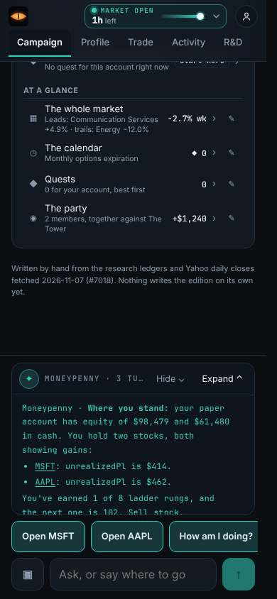 | _your screenshot goes here (`--owner-shot`)_ |

> "As the phone-only member, I'm reading Moneypenny's answer to see if it says how much I'm up or down today. — Moneypenny: "Where you stand: your paper account has equity of $98,479 and $61,480 in cash." MSFT unrealizedPl $414, AAPL $462. Then something about ladder rungs. Nothing says "today" yet. "The party +$1,240" is above it, but I can't tell if that number is mine." — phone-only

## What it found

**Found 6 of your 32 without seeing them (4 only partly) · 48 new structural problems · 111 new smaller ones.**

Partly means the right place with a vaguer reason; the bar counts it as found. Full matches alone: 2 of 32 (6%).

With 32 items the range is wide: 6 of 32 is anywhere from 9% to 35% (95% confidence).

Not counted as new: 2 structural already on your key (re-found, not new) · 3 smaller already on your key (re-found, not new).

It missed the bar: recall (0.188, needs ≥ 0.6) · negative control (still reported: A4, needs pass).

The stop rule fired (recall under 0.35): nothing is revised until you answer.

## New structural problems

Grouped by where each problem's root sits: a row of the IA ledger (docs/IA.md §10) or a new root named after grading. Roots are ranked by their worst problem, then how many times they were reported, then how many members they reached; the problems under each keep that order.

### 1. New root: the dock covers the page

_1 problem · reported 9 times · 3 members reached._

**The Moneypenny chat panel sits over the page and hides what he navigated to: the Profile header and rows, the Sauron position rows, and the expanded Activity trade row. Each time he had to collapse it or scroll past it.**

| Frame 1 | Frame 2 | Frame 3 | Frame 4 |
|---|---|---|---|
| 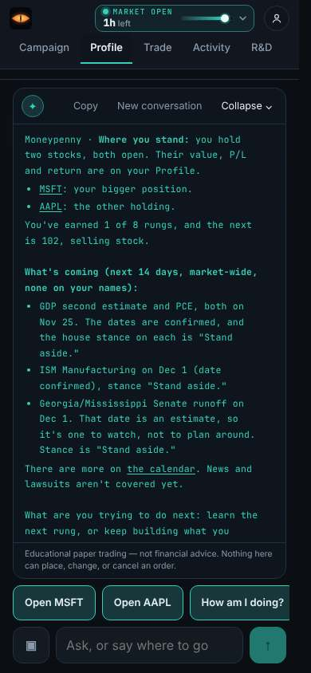 | 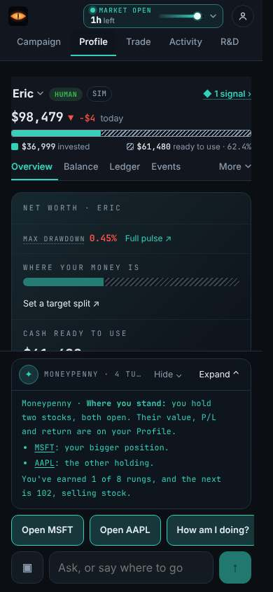 | 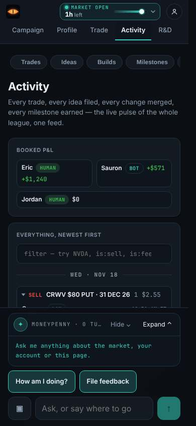 |  |

> "the chat covered the page until I collapsed it"

_Found by simulated members (eric) · critical · reported 8 more times._

### 2. U15 — Nothing writes the day's edition · on the ledger: waiting (1 screen) · #6949 closed without an edition writer (src/domain/edition.ts: still written by hand); owned by #6948

_1 problem · reported 3 times · 2 members reached._

**The calendar has no upcoming monthly jobs report. It opens on past stories, and December only says 'Nothing on the edition's calendar in December 2026', with no reason given and nowhere else to look.**

| Frame 1 | Frame 2 | Frame 3 | Frame 4 |
|---|---|---|---|
| 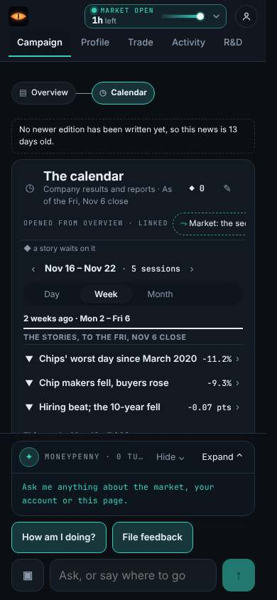 | 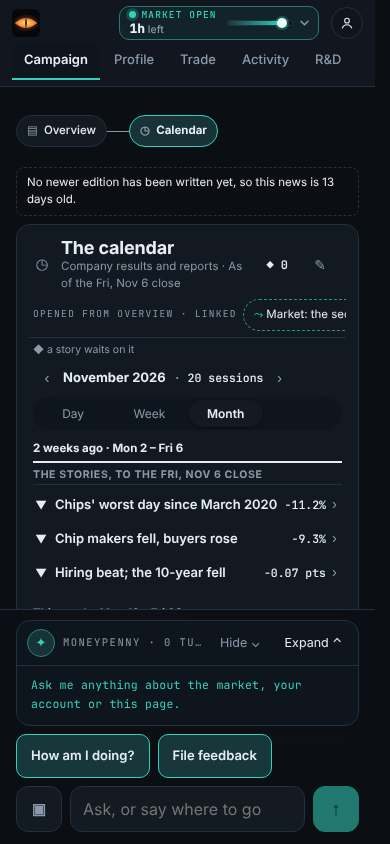 | 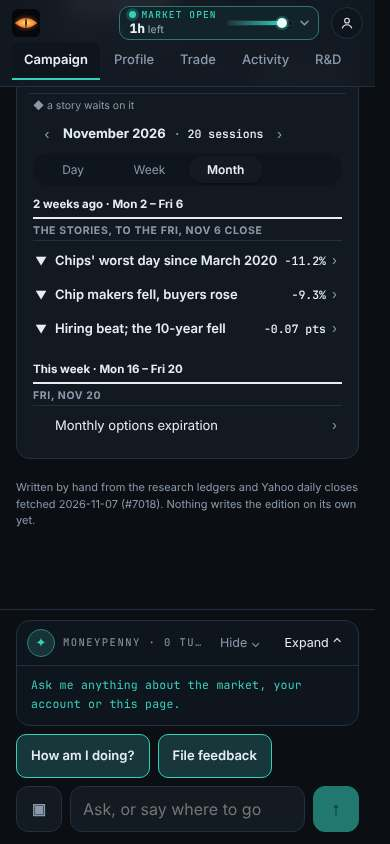 | 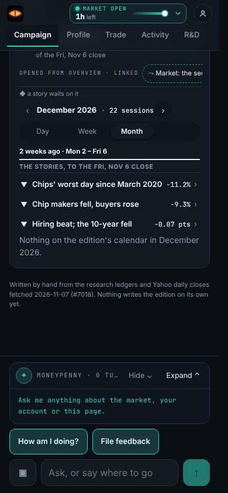 |

> "The calendar says nothing is scheduled in December, and the assistant says it has no confirmed date for the next jobs report."

_Found by simulated members (phone-only) · critical · reported 2 more times._

### 3. New root: the assistant can't read the figures the app shows

_1 problem · reported 2 times · 2 members reached._

**Moneypenny says it can't give today's move on the book ('I don't have that figure… I won't guess a $ or % for today'), but the Profile header shows '▼ −$4 today'. Its 'How am I doing?' reply gives only equity and since-purchase P/L. So the assistant, his first stop, leaves him without an answer the app already has.**

| Frame 1 | Frame 2 | Frame 3 | Frame 4 |
|---|---|---|---|
| 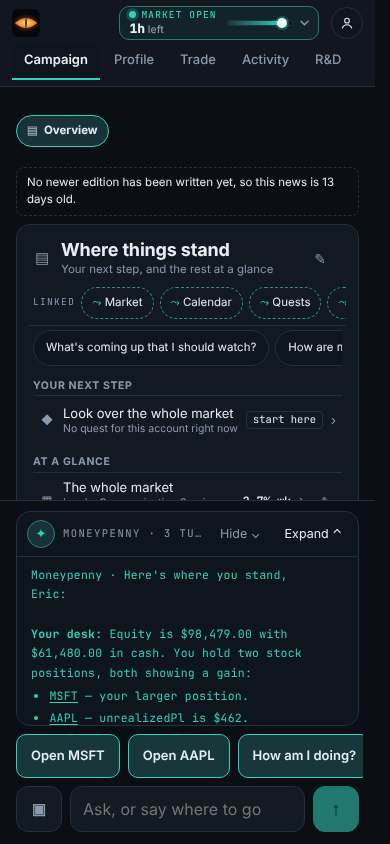 | 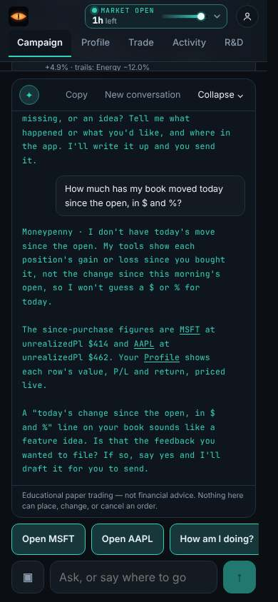 | 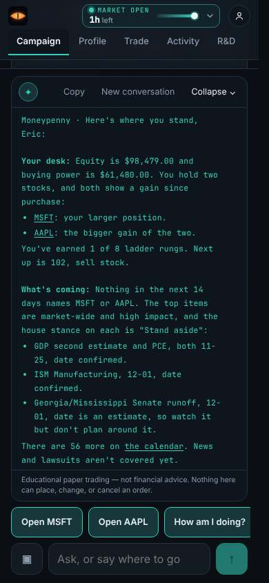 | 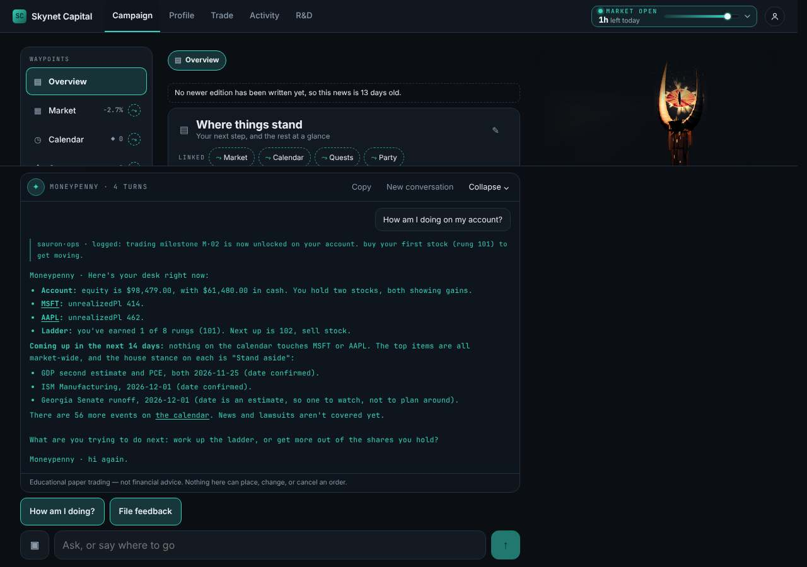 |

> "Moneypenny said outright that it couldn't give me today's move, and the "How am I doing?" reply only showed equity, with no change in $ or %."

_Found by simulated members (eric) · critical · reported 1 more time._

### 4. New root: pages stack preamble above their main content

_7 problems · reported 16 times · 2 members reached._

**The order ticket starts 540–600px down. Above it sit a market-calendar strip, an earnings line, a back link, the 'Trade' title, a paragraph about 'the gate' and the full 8-rung milestone ladder. No symbol, price or account appears at the top. Review order is about one screen down.**

| Frame 1 | Frame 2 | Frame 3 | Frame 4 |
|---|---|---|---|
|  |  |  |  |

The order ticket starts 540–600px down. Above it sit a market-calendar strip, an earnings line, a back link, the 'Trade' title, a paragraph about 'the gate' and the full 8-rung milestone ladder. No symbol, price or account appears at the top. Review order is about one screen down — this breaks Posture / H8 / navigational excise, which matters because The returning-trader and eric come to place one order quickly, and every visit means scrolling past one-time course material before the task begins; the fix: Lead with a compact header (NVDA · price · change · account) followed directly by the ticket. Collapse the ladder to a one-line 'Rung 101 · 1/8 ▸' and the gate text to an info icon, and move the calendar strip off the ticket.

_Found by expert reviews (expert 1) · high · reported 3 more times._

- **The ranked list ('The Field') starts about a screen below the fold on phone, behind the intro, the Match bar and two 8-figure summary cards that repeat the same team comparison three ways. On desktop only two rows show before the dock.** — Found by expert reviews (expert 1) · high · reported 2 more times.
- **The Activity feed starts 390–450px down, after the chip row, a 2–3 line description, the Booked P&L card, a heading and the filter box. Only one row shows before the dock.** — Found by expert reviews (expert 1) · high · reported 2 more times.
- **On Sauron's Playbooks tab, the list starts at about scrollY 445. Before it come the market pill, nav, account header, tab row, an intro paragraph and the week strip, so the first screen shows no playbook.** — Found by expert reviews (expert 1) · high.
- **Profile opens on account totals (net worth, drawdown, cash). The Positions rows sit a full screen down, below the List/Map/Runway toggle, a search box and two rows of filter chips. Getting from the book to a position row always takes scrolling.** — Found by simulated members (returning-trader) · moderate · reported 1 more time.
- **The Playbooks page opens with three create buttons (New playbook / New chain / State a conviction). The 'Ready for a bot · 6' library most people come for starts below them, half under the dock.** — Found by expert reviews (expert 1) · moderate · reported 1 more time.
- **The event page is a long document with no title on the first screen (the slug-titled heading sits about a screen down). The verdict is restated in seven places, and opening sections shifts the page or opens off-screen.** — Found by expert reviews (expert 2) · moderate.

### 5. New root: filters built differently on each page

_3 problems · reported 7 times · 0 members reached._

**For three positions, the account page stacks a 'Worth a look first' sort, Filter ▾ (with its own Review/Consider/On plan facets), a raw 'sort:look' query line, 'Save as a view', '+ New view', an 'All positions' tab, an 'All' chip, a query box and nine chips. The two save paths differ (one saves instantly with no name), and chips that match zero positions are still offered.**

| Frame 1 | Frame 2 | Frame 3 | Frame 4 |
|---|---|---|---|
|  | 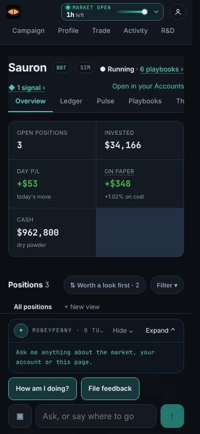 |  | 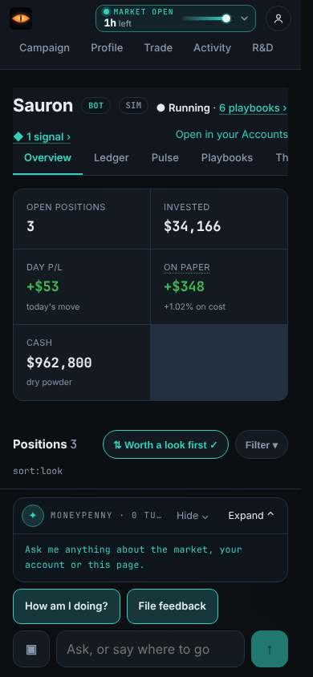 |

For three positions, the account page stacks a 'Worth a look first' sort, Filter ▾ (with its own Review/Consider/On plan facets), a raw 'sort:look' query line, 'Save as a view', '+ New view', an 'All positions' tab, an 'All' chip, a query box and nine chips. The two save paths differ (one saves instantly with no name), and chips that match zero positions are still offered — this breaks H8 / H4 / IA search-filter, which matters because Positions get pushed under the dock, and the invited-friend and first-timer have to decode which control is in charge; the fix: Hide filtering behind one Filter control until there are 8+ positions. Have one save path with a name step, and hide chips with 0 matches.

_Found by expert reviews (expert 1) · high · reported 2 more times._

- **Two filter systems sit far apart on Activity: chips above the page title and a query box ('is:sell, is:feedback') inside the feed. The chip names don't match the syntax (Ideas→is:feedback, Builds→is:development), chip kinds mix in one flat row, and the placeholder is truncated.** — Found by expert reviews (expert 1) · high · reported 2 more times.
- **Selecting a chip removes other chips: after Ideas, Builds or Milestones only four remain, and after Buys, Sells, Bots or Humans 'Include shipped' disappears. There is no 'All' chip and no × to clear, so the only exit is re-tapping the checked chip.** — Found by expert reviews (expert 1) · high.

### 6. New root: a playbook has no page of its own

_1 problem · reported 6 times · 0 members reached._

**On phone, tapping a playbook card scrolls the page 1,000–9,600px to a detail block far down a 14,400px page. It lands mid-text, often inside another playbook's rules, with no heading, no URL change and no 'back to list'.**

| Frame 1 | Frame 2 | Frame 3 | Frame 4 |
|---|---|---|---|
| 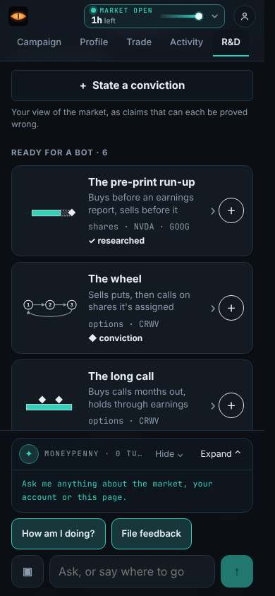 | 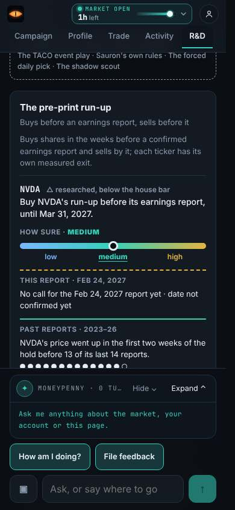 | 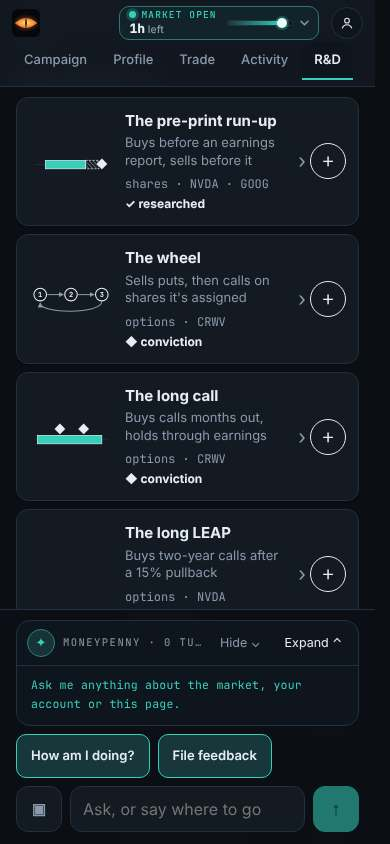 | 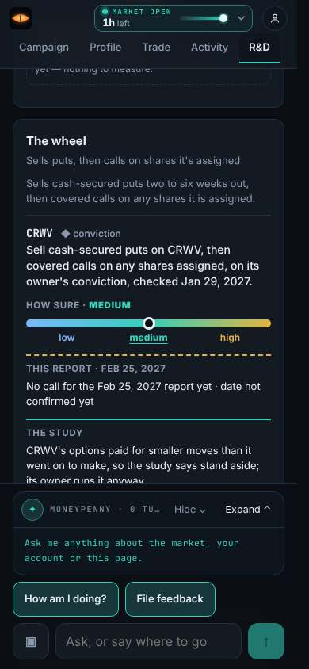 |

On phone, tapping a playbook card scrolls the page 1,000–9,600px to a detail block far down a 14,400px page. It lands mid-text, often inside another playbook's rules, with no heading, no URL change and no 'back to list' — this breaks H3 / IA navigation (where am I), which matters because A phone-only user or bot-watcher comparing strategies loses their place on every tap and must thumb-scroll about 10 screens back; the fix: Expand the detail in place under the card, or open it as its own view or sheet with a history entry, so Back restores the list position. Put a '← All playbooks' link at the top of each detail.

_Found by expert reviews (expert 1) · high · reported 5 more times._

### 7. New root: navigation drops the member's place and state

_4 problems · reported 6 times · 0 members reached._

**Tapping the top-nav 'Trade' while already on Trade drops desk=sauron and symbol=NVDA. The account silently switches to Eric, NVDA disappears, and only a small back link changes.**

| Frame 1 | Frame 2 | Frame 3 | Frame 4 |
|---|---|---|---|
| 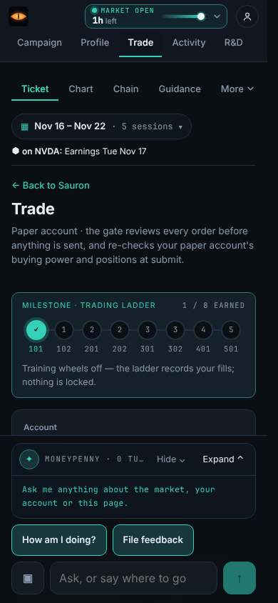 | 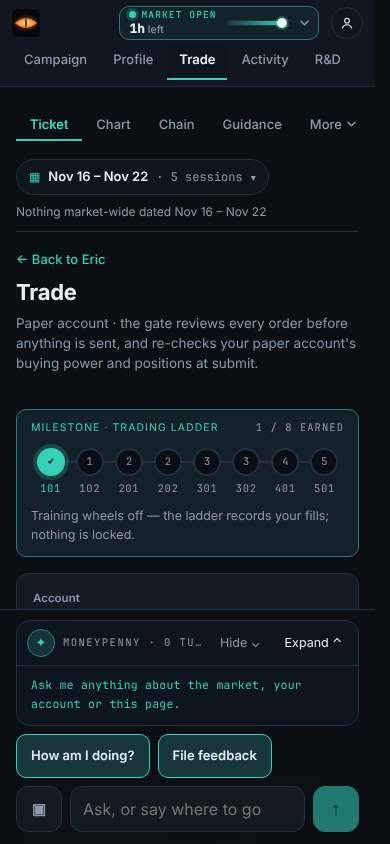 | 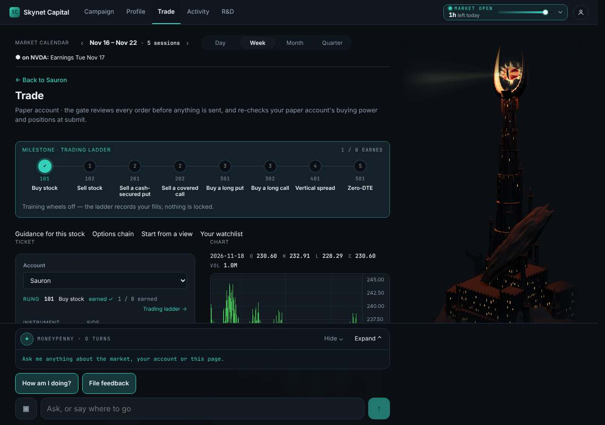 | 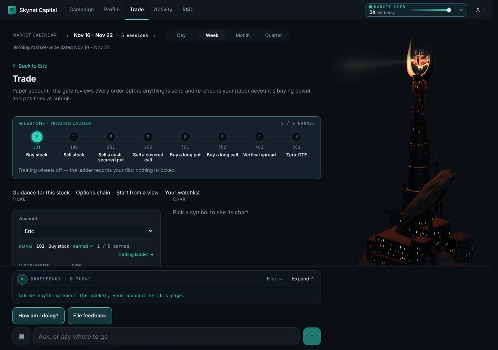 |

Tapping the top-nav 'Trade' while already on Trade drops desk=sauron and symbol=NVDA. The account silently switches to Eric, NVDA disappears, and only a small back link changes — this breaks H5 error prevention / H1, which matters because Eric trades both his own account and the bots. One reflexive tap moves him to a different account that looks the same, and his next order could go to the wrong book; the fix: Re-tapping the active Trade tab should keep the desk and symbol (or scroll to top). Any account change must be announced at the top of the ticket.

_Found by expert reviews (expert 1) · high · reported 2 more times._

- **Leaving the feed loses your place. Name links open profiles at the top (with a 0.156 layout shift on load). 'your Profile' full-reloads with replaceState to a page titled 'Your filings', so Back skips Activity altogether. Scroll restore on Back is unproven.** — Found by expert reviews (expert 1) · high.
- **The trade ticket's 'Trading ladder →' link leaves for Profile › Milestones and drops the half-filled order.** — Found by expert reviews (expert 1) · moderate.
- **History handling is inconsistent. Calendar week steps, R&D tabs and Activity chips use replaceState, so Back leaves the page. Leaderboard sorts each push an entry. The feed's 'your Profile' link replaces Activity in history.** — Found by expert reviews (expert 2) · moderate.

### 8. New root: a position has no single home

_4 problems · reported 5 times · 1 member reached._

**Held positions and their Close…/Roll… actions sit at the very bottom, about 1,240px down, below the NVDA ticket, chart, recent orders, an empty Working orders, Alerts, and a 'Send these to me — not configured' notice. Orders and Watchlist are hidden under 'More', and 'Your recent orders' splits the ticket's fields from its submit button.**

| Frame 1 | Frame 2 | Frame 3 | Frame 4 |
|---|---|---|---|
|  | 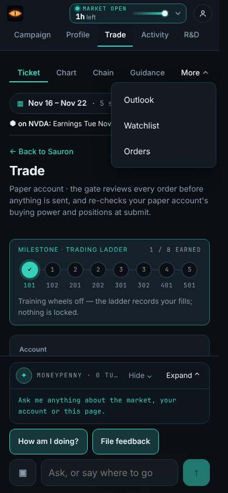 | 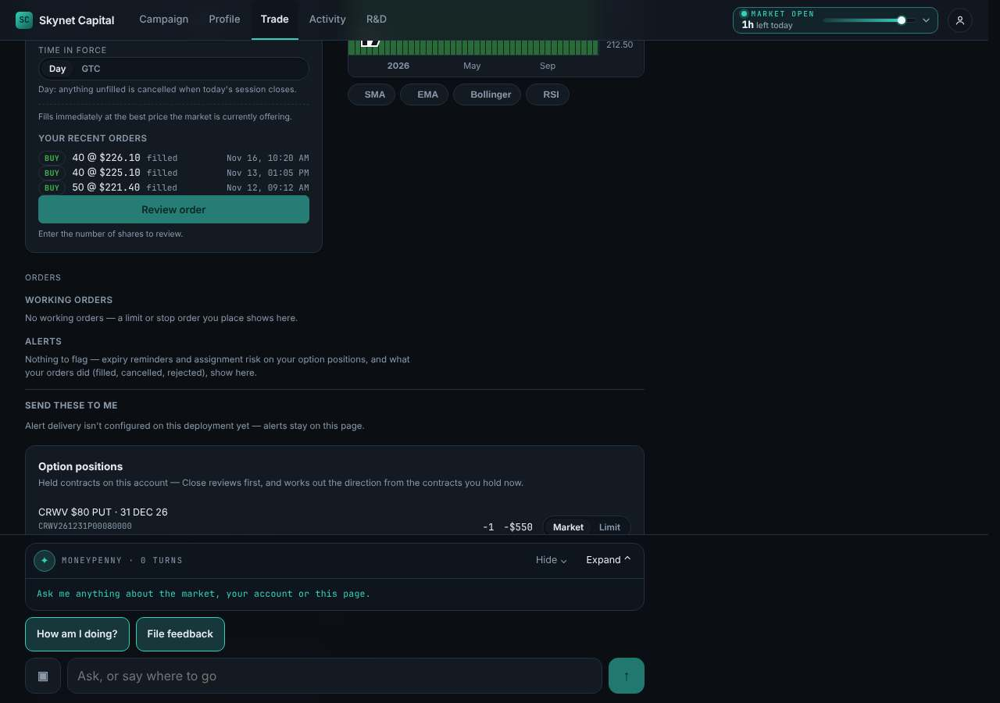 | 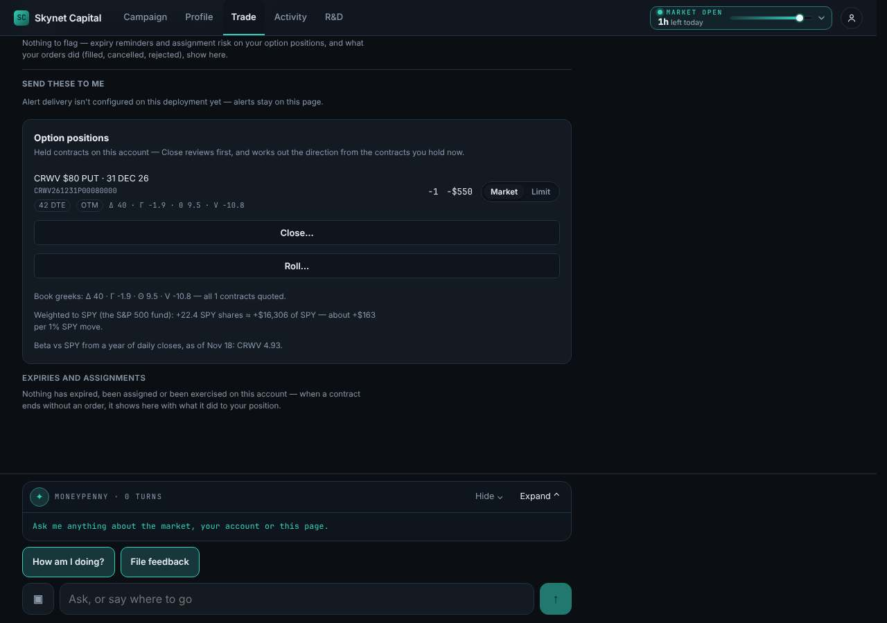 |

Held positions and their Close…/Roll… actions sit at the very bottom, about 1,240px down, below the NVDA ticket, chart, recent orders, an empty Working orders, Alerts, and a 'Send these to me — not configured' notice. Orders and Watchlist are hidden under 'More', and 'Your recent orders' splits the ticket's fields from its submit button — this breaks IA organisation / navigational excise, which matters because The returning-trader came to act on what they hold and must scroll past a ticket for a different stock to reach it; the fix: Put a compact 'Your positions' block (Close/Roll) above or next to the ticket, and group recent and working orders with it. Move recent orders out of the ticket and hide unconfigured sections.

_Found by expert reviews (expert 1) · high._

- **Tapping a position row on a bot's page opens a Trade ticket: a scrolled-down manage panel for options, a fresh ticket with ladder text for shares, and 'Back to Jordan'. The page also says 'You can trade only your own accounts', while 'Guidance ›' on the same row expands in place.** — Found by expert reviews (expert 1) · high.
- **Each position row has two look-alike expanders: an unlabelled '›' (cost basis and 'Close this buy') and 'Guidance ›' (an 'At expiry' chart, wrong for shares). Each pushes the list down a lot.** — Found by expert reviews (expert 2) · moderate · reported 1 more time.
- **The Trade tab opens on a new-order ticket with an account picker but shows no positions. He went there expecting his open CRWV put.** — Found by simulated members (eric) · moderate.

### 9. New root: the calendar list isn't tied to the selected date

_2 problems · reported 5 times · 0 members reached._

**The calendar's list doesn't follow the selected range. The '2 weeks ago · Mon 2 – Fri 6' stories stay at the top for any week, sometimes directly above 'Nothing on the edition's calendar in Nov 2 – Nov 8'. This week's events come last, under the dock. Tapping a single date selects its whole week and shows nothing for that day, and empty weeks only sometimes point to the next event.**

| Frame 1 | Frame 2 | Frame 3 | Frame 4 |
|---|---|---|---|
|  | 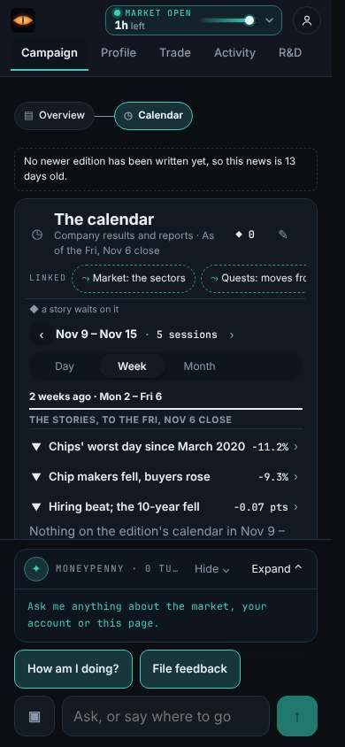 | 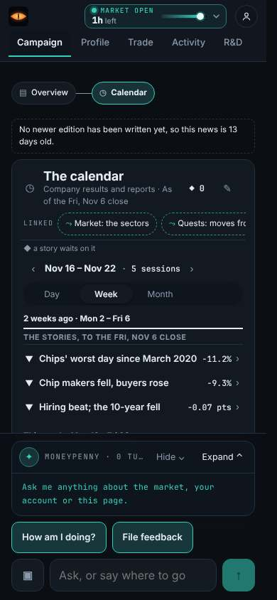 | 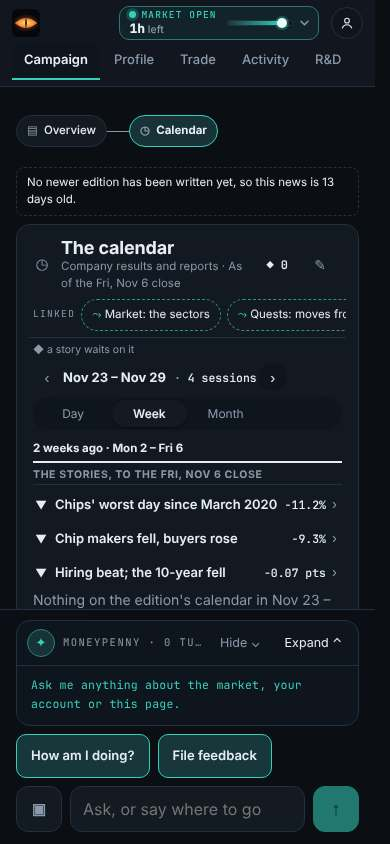 |

The calendar's list doesn't follow the selected range. The '2 weeks ago · Mon 2 – Fri 6' stories stay at the top for any week, sometimes directly above 'Nothing on the edition's calendar in Nov 2 – Nov 8'. This week's events come last, under the dock. Tapping a single date selects its whole week and shows nothing for that day, and empty weeks only sometimes point to the next event — this breaks H1 / H2 / IA organisation, which matters because The returning-trader and the bot-watcher can't tell what is coming up, and may read old stories as this week's or think the arrows did nothing; the fix: Put the selected range's events first, directly under the picker, and move older stories into a separate dated 'Recent stories' block. A date tap should show that day (or an explicit 'Nothing on Fri Nov 20'). Every empty range should point to the nearest event.

_Found by expert reviews (expert 1) · high · reported 2 more times._

- **Tapping a date doesn't behave like a date tap. It selects the whole week while 'Week' stays active; six of eight taps in the current week changed nothing visible. Tapping an outside-month day redraws the grid as another month and moves the tapped row 172–215px. Tapping '20' (the one event day) scrolled the page 141px and slid the title under the header.** — Found by expert reviews (expert 2) · high · reported 1 more time.

### 10. New root: one account, two homes

_2 problems · reported 5 times · 0 members reached._

**One account has two homes with different tab sets and headline numbers. /app/u/sauron has Overview/Ledger/Pulse/Playbooks/Thesis/Settings. 'Open in your Accounts', '1 signal' and the 'Opened by …' links go to /app/accounts?account=sauron (Overview/Balance/Ledger/Events/…), which highlights 'Profile' and shows $996,966 equity versus $34,166 invested. The same split applies to a member's own account: /app/u/eric versus Profile.**

| Frame 1 | Frame 2 | Frame 3 | Frame 4 |
|---|---|---|---|
| 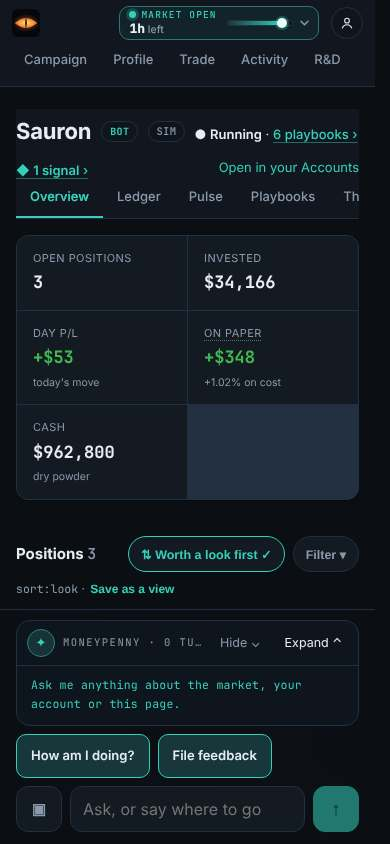 | 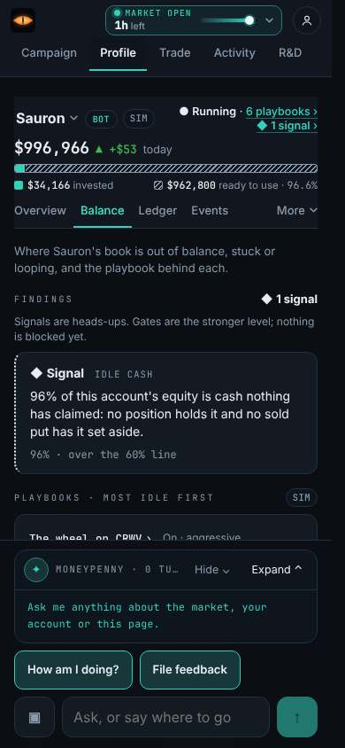 |  | 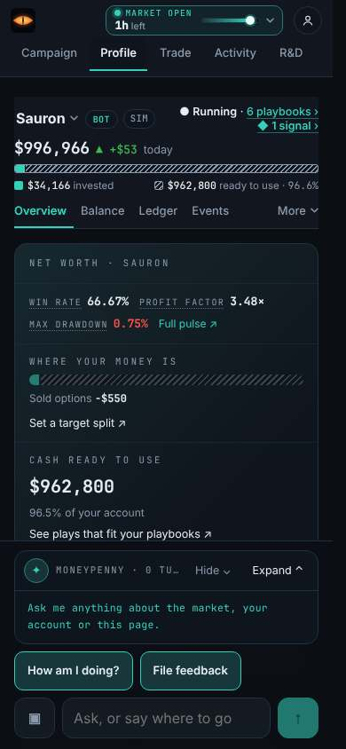 |

One account has two homes with different tab sets and headline numbers. /app/u/sauron has Overview/Ledger/Pulse/Playbooks/Thesis/Settings. 'Open in your Accounts', '1 signal' and the 'Opened by …' links go to /app/accounts?account=sauron (Overview/Balance/Ledger/Events/…), which highlights 'Profile' and shows $996,966 equity versus $34,166 invested. The same split applies to a member's own account: /app/u/eric versus Profile — this breaks IA organisation and navigation / H4, which matters because Eric must remember which copy holds which view, and the bot-watcher can't tell which is 'the' Sauron page. Following a link throws them into another section with no route back; the fix: Give each account one page with one tab set. Show signals and playbook cards in place, and redirect the duplicate route.

_Found by expert reviews (expert 1) · high · reported 2 more times._

- **The 'Settings' tab in Sauron's account tabs opens the global /app/settings (density, theme, tower motion). The account header disappears and 'Profile' lights up.** — Found by expert reviews (expert 1) · high · reported 1 more time.

The other 17 roots, ranked the same way, text only

- **U7 — R&D as a destination, not a capability · on the ledger: waiting (2 notes; long term)** (2 problems): The study links ('its study →', 'the study behind it →', 'R&D's research on this report →') full-reload into /research/… pages with no app header, tabs or dock. '← Research' lands on the R&D Board top, not on the playbook or the 10,000px scroll position the reader came from.; The 'FT-6' and 'forward-tests/…md' links open a bare black page that says only 'no such research document', with no app chrome and no back link. The .md link also wraps, so a tap on its centre does nothing.
- **New root: home doesn't show the member's own book** (2 problems): Campaign, the landing page, shows the whole market's weekly move but nothing about his own book today. The day change is only in the Profile header, a tab away, and he never found it on the sessions he gave up.; The league standings are the least visible thing on the home page: Party is a 19px sliver at the end of a sideways chip row, and its At-a-glance row is behind the dock. The home page also shows no figure for the person's own account.
- **New root: the milestone ladder is built into the order ticket** (1 problem): The milestone ladder doubles as a hidden order-type picker. Tapping a rung (401, 501) silently rebuilds the ticket off-screen. Choosing 'Option' loads rung 301 with 'Buy to open · Put' preselected. 'Sell' switches the rung to 102. The chart hides and the layout shifts (CLS up to 0.24) under the thumb.
- **U9 — A call's words go stale while its date stays fresh · on the ledger: waiting (1 screen)** (1 problem): The NVDA event study is stale and contradicts itself. Today is 11-24, after the print, yet the TL;DR still gives pre-report advice ('Today: Stand aside', the date is an estimate). The header says 'Last assessed 2026-10-05' while the body has a 10-30 update. Kill switches with past deadlines show no fired or not-fired status, and the playbook linking here cites a Feb 2027 report.
- **New root: game-word labels over plain names** (2 problems): The game-word navigation and labels don't say what is behind them. 'Campaign' is home and holds market data, 'Profile' opens the accounts and money page and onboarding, 'Party' is the league standings, 'Quests' is suggested moves, 'R&D' is research, plus Waypoints, The Tower, 'edition', 'the house', 'Booked for the party', SIM, Pulse, Thesis, θ·Δ and 'the gate'.; The same bot is 'The Tower · bot' on Party and 'Sauron · BOT' on Activity and elsewhere, both at +$571, and nothing links the two names.
- **New root: expanding controls open content out of sight** (3 problems): Several controls open their content below the fold or under the dock, so the only visible change is a caret or underline. This affects the Chart and Guidance tabs and the section links on Trade, the Filter ▾ panel and the '›' Detail on Sauron's account, Every check and the 'are off on this bot' row on playbooks, and the Assessment ledger on the event page.; Fleet health, the bots' status, is hidden inside the market-clock pill. Opening it pushes the page down 59–170px, and the pill jumps 136–196px to become 'Hide'.; Tapping a suggested question puts a long answer inside the Overview card, pushing 'Your next step' and At a glance off screen with no Close.
- **New root: pages outside the nav's map** (1 problem): The Leaderboard has no top-nav item and nothing is highlighted while on it. Account pages opened from the leaderboard or feed also highlight nothing in the nav.
- **New root: the match is scored by account size** (1 problem): The headline 'Bots lead the match · 94% of the field' is scored on total equity, so one $1M bot beats ~$124k of humans by size alone. Sorting by return shows humans ahead, and the subtitle says 'Figures, not placings'.
- **New root: feed rows mix expand and leave targets** (1 problem): Each feed row puts two 19px targets side by side: the trade text (expands) and the name link 8px away (leaves to the profile, scroll reset). Nothing marks the name as a link that leaves.
- **New root: figures shown without their period** (1 problem): On the market view, the headline 'Week · since Oct 30 −2.7%' stays the same when Day, Month or YTD is picked, while the S&P row below changes (+0.3%, −5.6%, +7.8%). The sparklines are always 'last 20 closes', the selected tab is barely marked, and the overview mixes '+4.9% / −12.0% / −2.7% wk' without saying which period each covers.
- **U8 — The Profile head assumes an account · on the ledger: waiting (1 screen)** (1 problem): For someone with nothing linked, the one setup step ('Connect your paper account · start here') is a quiet row. A brighter 'Help me get set up' dock button and a 'How are my positions doing?' chip compete with it. When followed, the step jumps to the Profile tab and lands past a welcome story, with the connect form below the fold and behind the dock.
- **New root: wide tables forced into a phone-width column** (1 problem): The option chain overflows (808px in a 309–343px box on phone, clipped on desktop too). It opens panned 264px, the OI column is cut, the Strike column isn't pinned, and the expiry tabs hide 87–537px of dates with no cue. Tapping Chain also scrolls the page 638px on its own.
- **New root: the dock adds its own entry points to every page** (1 problem): The dock adds extra entry points that aren't part of any page's task. There are two prompts ('Ask me anything…' and 'Ask, or say where to go'), in-card question chips and an inline 'Ask Moneypenny' box on calendar events. 'How am I doing?' is ambiguous on a bot's page. 'File feedback' is shown as a chat prompt. A '0 TURNS' counter is truncated, and a greeting counts as turns.
- **New root: home repeats links instead of a hierarchy** (1 problem): The same destinations appear three or four times on one Campaign screen (Waypoints rail, LINKED chips, At-a-glance rows, breadcrumb, 'Your next step'). The breadcrumb records the path taken rather than the hierarchy, and current items look like buttons but do nothing.
- **New root: product development mixed into the league feed** (1 problem): Product-development content shares the league feed: Ideas, Builds and 'Include shipped' chips (Include shipped has no visible effect), 'every change merged', a 'No ideas filed yet' empty state under unrelated filters (even Builds) and a GitHub onboarding disclosure.
- **New root: setup has no single home or name** (1 problem): Setup has three names: 'Connect your paper account — start here' jumps to the Profile tab ('Welcome to the league'), Trade says 'connect one in Onboarding' (no such tab), and the dock offers 'Help me get set up'.
- **New root: the leaderboard doesn't know who is looking** (1 problem): Your own row isn't marked on the board, and someone with no account gets no way onto it.

Not counted as new:

- F-5cb6ca23cb, F-0355ad8b56, F-34d9f30ce4, F-1c1b9a2bcd: already on your key (B2), so re-found, not new — not counted.
- F-5d565c061e: already on your key (B1), so re-found, not new — not counted.

## Your items, one by one

| Your item | Members | Experts | Words | Measurements (not blind) | Chat drafts (not blind) | Note |
|---|---|---|---|---|---|---|
| A1 | — | — | — | — | — |  |
| A2 | — | — | — | — | — |  |
| A3 | — | — | — | — | — |  |
| A4 | — | — | — | — | — |  |
| A5 | — | — | — | — | — |  |
| A6 | partly | partly | — | — | — |  |
| A7 | — | — | — | — | — |  |
| A8 | — | — | — | — | — |  |
| A9 | — | — | — | — | — |  |
| A10 | — | — | — | — | — |  |
| A11 | — | — | — | — | — |  |
| A12 | — | partly | — | — | — |  |
| A13 | — | — | — | — | — |  |
| A14 | — | — | — | — | — |  |
| A15 | — | — | — | — | — |  |
| A16 | — | yes | partly | — | — | **disputed** |
| A17 | — | — | — | — | — |  |
| A18 | — | — | — | — | — |  |
| A19 | — | — | — | — | — |  |
| A20 | — | — | — | — | — |  |
| A21 | — | — | — | — | — |  |
| A22 | — | — | — | — | — |  |
| A23 | — | — | — | — | — | **disputed** |
| A24 | — | — | — | — | — |  |
| A25 | — | — | — | — | — |  |
| A26 | yes | yes | — | — | — |  |
| A27 | — | — | — | — | — |  |
| A28 | — | partly | — | — | — |  |
| A29 | — | — | — | — | — |  |
| A30 | — | partly | — | — | — |  |
| A31 | — | — | — | — | — |  |
| A32 | — | — | — | — | — |  |
| **Found** | 2 of 32 (2%–20%) | 6 of 32 (9%–35%) | 1 of 32 (1%–16%) | 0 of 32 (0%–11%) | 0 of 32 (0%–11%) | |

The measurements were designed after reading your list, so they never count as finding anything.
A chat draft is a filing Moneypenny wrote from what a member told her; it is counted apart, never as discovery.

The two matchers agreed on 100% of 799 findings (Cohen's kappa 0.955).
- Disputed F-7ec0bbde3c: one matcher said none (0), the other A23 (0.5); a third matcher said none (0).
- Disputed F-f8b2486145: one matcher said B1 (0.5), the other none (0); a third matcher said none (0).
- Disputed F-5e9bc81e27: one matcher said none (0), the other A16 (0.5); a third matcher said none (0).

Of what the blind evaluators reported, 280 of 324 were real (86%); 11 came from the test world, not the app, and are left out.

By member: bot-watcher 0 of 32 · eric 1 of 32 · first-timer 1 of 32 · invited-friend 0 of 32 · phone-only 0 of 32 · returning-trader 0 of 32.

Members succeeded in 40% of 40 sessions; middle ease 4 of 7. (Counted over every session, not only the tasks you found hard, so this is a rough check, not the plan's calibration test.)

### The plan's scorecard (#8005): the baselines this round sets

| Row | phone | desktop |
|---|---|---|
| Task success (the answer graded, not the member's word) | 14 of 28 (50%, 33%–67%) | 2 of 12 (17%, 5%–45%) |
| Answered right, from the page or the chat (the place unseen is allowed) | 18 of 28 | 9 of 12 |
| Lostness, middle session (0 is a straight path; R = fewest views a member needed to succeed) | 0 | 0.17 |
| Backtracks, middle session | 0 | 0 |

Chat sensor recall: nothing to recall yet. No member told Moneypenny the app was in their way: all 23 labelled messages were lookups or the like.

## The design battle-test

Did not run: the round did not pass the bar, so no design was battle-tested.

## What members hire this area for

Hired for: eric: Decide what to do with my whole book next: which trades to make, how to rebalance, when to take profit and move the money into the next trade, and when to wait before buying. · phone-only: In thirty seconds with one hand, find out how my book is doing and whether anything needs me. · bot-watcher: Find out what a particular bot did, why it did it, and how that worked out, then get back to where I started. · returning-trader: Get from a position I hold to a placed covered-call order at a sensible strike and expiry, see the fill, and return to my book. · invited-friend: Look after my own money and the bot I took over: see what they're worth and what they hold, place the odd trade from the right account, and see where I stand against everyone else. · first-timer: Get set up and make a first paper trade without needing to ask anyone for help..

| Stage | What members want from it | What the area holds |
|---|---|---|
| Define | minimize the time it takes to know whether anything in my book needs my attention today; minimize the time it takes to know which decision to make next: buy, sell, rebalance, take profit, or wait; minimize the time it takes a newcomer to know what the first step is | — |
| Locate | minimize the number of taps from my holding to the advice for it; minimize the effort it takes to find upcoming events and reports that could affect when I act; minimize the number of steps to find one particular bot from the ranking; minimize the chance of opening someone else's account when I meant my own | — |
| Prepare | minimize the number of order fields I have to fill in myself after reading the advice; maximize how clearly the strike, breakeven, and premium of an option are shown before I commit; minimize the steps it takes to link a paper account for the first time | — |
| Confirm | minimize the chance of placing an order from the wrong account; maximize the certainty that the advice is based on live, not out-of-date, information; maximize how clearly the reason behind advice or a bot's decision is backed by evidence; minimize the chance that a greyed-out control appears without a visible reason in words | — |
| Execute | minimize the time from reading the advice to placing the order; minimize the number of controls that look usable but fail when pressed; minimize sideways scrolling and hover-only details on a phone-sized screen | — |
| Monitor | minimize the time it takes to see that an order filled and how it changed my book; minimize the time it takes to see whether a bot I own or follow is running and what it currently believes; minimize the effort it takes to see where I rank against everyone else | — |
| Modify | minimize the time it takes to know when to take profit on a winner and where to put that money next; minimize the effort it takes to see how far my book is from the balance I want; minimize the effort it takes to ask for a change to the app when something doesn't work for me | — |
| Conclude | minimize the number of steps to get back to where I started once the task is done; maximize how clearly a trade's history reads as one transaction, newest event first, with the strategy that triggered it shown before the reasons | — |

Measured: minimize the time from reading the advice to placing the order (Task success); minimize the time it takes to know whether anything in my book needs my attention today (Happiness).

## What it missed

- **Not known whether a task went there (no record of which pages were touched):** A1 · A2 · A3 · A4 · A5 · A7 · A8 · A9 · A10 · A11 · A13 · A14 · A15 · A17 · A18 · A19 · A20 · A21 · A22 · A23 · A24 · A25 · A27 · A29 · A31 · A32

## One question

Scale to **the area sweep: one blind round per IA area, 8 areas, about 2 at a time** next (predicted cost: about 1,300 calls an area with both controls (this round: 586 main, 621 for the two controls, 110 to grade)), revise the method first, or stop?

**If you say nothing:** nothing starts. The fixed-build control did not pass (the research area's second name is still on the build: write-ups say '← Research' beside the R&D tab, filed as #8236) and recall missed its bar, so under #8037's rule the area sweep waits for your word.

If you like, sit one short session yourself on the same tasks.
