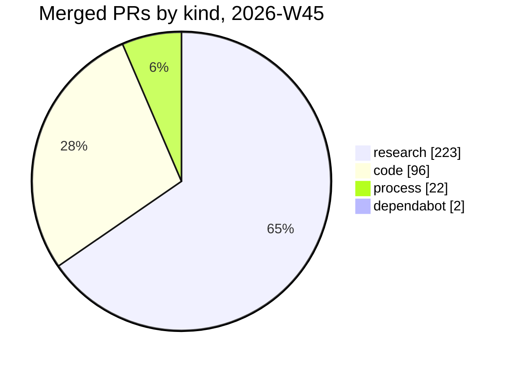

# Weekly newsletter — 2026-W45 (Nov 2–8)

**343 PRs merged, 0.52 confirmed defects per audited PR, and 5 asks for you this week.** This is the
first edition, so it has no earlier plan to check and no trend lines yet. Numbers come from
`scripts/newsletter.mjs --week 2026-W45`, read at 2026-11-09 00:06Z. The plan is #6872.

## Pictures first

This week's numbers alone. Trend lines start once the generator reads past editions back (#6872).

## Numbers

- **Merged PRs:** 343: 96 code, 223 research, 22 process, 2 dependabot, 0 other.
- **Defects per audited PR:** 0.52 (25 confirmed in 48 PRs, 6 audit batches, all on 11-02). That
  cost 10.65M tokens, or 426k per confirmed defect. 30 issues filed, on 22 PRs (#4153 audit
  records).
- **Failure to fix, main CI:** 1 episode. Detected in 0.22 min, verified in 277.98 min, filed-to-fix
  unknown. **Contracts:** 1 episode, verified in 9 min, detection unknown. **Audit findings:** 30
  episodes, every timing unknown.
- **CI verify, first try:** 0.98 (9 of 366 runs failed). Local is unknown. CI is a floor, because
  `ship.sh` verifies before it pushes.
- **Tokens per verified result:** post-merge audit 426k (25 verified). Full verify, workflow stages,
  fix a failure (2 verified) and communication: tokens unknown, because the meter holds no reading.
- **Weekly usage:** mode `normal`, 65% used with 80% of the window gone (gap -15), resets
  2026-11-10 05:00Z (read 11-08 19:27Z).
- **Fitness contracts (8):** 5 green. `bots-running` and `main-deploys` went red during the week and
  recovered. `alerts-reach-owner` was **still red at the close** (#6501). 6 issues were filed for
  reads that failed (#7110, #7109, #7107 Fly; #7079, #6997 GitHub; #6991 decision journal), all
  closed.
- **Loops:** 5 iterated, 5 moved. Backfill 37 → 36 (2 iterations, 2.16M tokens), bury 282 → 275
  (3, 4.32M), decompose 142 → 143 (3, 4.32M), dedupe 294 → 290 (2, 2.16M), instruction drift
  0 → 122 (1, tokens unknown). Decompose moved the wrong way.
- **Research tests:** 2020 (507 linked). Overall: 505 pass, 158 kill, 1306 open, pass rate 0.76.
  High impact: 48 / 16 / 97 (0.75). Medium: 62 / 23 / 222 (0.73).

**Decisions reaching Eric** (#6953 slice 4). Last week has no reading, because this is the first
edition.

| Measure | This week | Last week | Target |
|---|---|---|---|
| **Open asks that need him** | **5** (#6959, #5730, #5452, #7080, #7030) | no reading | 5 or fewer, all genuinely his |
| Asks no list can see | unknown | no reading | 0 |
| Asks whose artifact is missing or cannot merge as it stands | 0 | no reading | 0 |
| Share of closed `needs-eric` labels he answered | 0 (0 of 19) | no reading | 0.8 or more |
| Median hours from ask to his answer | unknown | no reading | under 24 |
| Median hours from assignment to his answer | unknown | no reading | under 48 (falsifier) |
| The same question filed under a new number | 11 (two chains, see Constraints) | no reading | 0 |
| Share of open asks with a prediction recorded | 0.33 (1 of 3) | no reading | 1 |
| Ledger match rate | 0.64 (9 of 14 decided rows) | no reading | rising |
| Ledger best streak | 2 | no reading | 3 (a class graduates) |
| Ledger classes ready to graduate | 0 | no reading | bot safety rules proposed |
| Days the oldest ask between watching and trading bots has waited | 23.8 (#5452, 3 open) | no reading | 7 or less |

**Playthroughs and reactions** (#7031 slice 3)
- **Known gaps:** 4 journey steps are still marked `known_gap`: eric 3 (`j2-s3`, `j3-s2`, `j4-s2`)
  and returning-trader 1 (`j4-s1`).
- **Member-facing changes:** 12 merged. Reactions: 0 from Eric and 0 from members. In-app filings
  this week: 0, against the 2 a week the member-facing slices wait on.
- **Open `needs-eric`:** 3, median age 21.3 days, oldest 23.8 days (#5452, #5730, #6959).

## Milestones

- **Stability plan #4612:** #4617 (gate memory in CI with a 512 MB budget run) and #4622 (bank the
  lessons from both OOMs) closed 11-06.
- **Convictions #5482:** #6598 closed 11-02. Both CRWV long-call fences were replayed as rules, and
  a pass key now reads `fence-studies.ts` (#6623, #6658).
- **Campaigns #6948:** #6949 closed 11-08 after slices 1–6 (#7002, #7023, #7043, #7044, #7084,
  #7101, #7104). #6950 (replay of the 11-05 drop and 11-06 bounce) closed 11-06.
- **Autonomous paper orders #6954:** every slice shipped 11-07 (#6962, #6995, #7001, #7003, #7004,
  #7005, #7006, #7016, #7025) and the plan closed.
- **Pre-merge reviewer #6870:** S1 and S2 merged (#6873, #6876, #6884). The replay now meets its bar
  at the floor: 10 of 20 at Important.
- **Board swimlanes #6871:** B1 and B2 shipped (#6874, #6877). PR-B, PR-C and PR-D opened (#7020,
  #7022, #7027). PR-A (#7030) is held for your tap.
- **Newsletter #6872:** N1 merged (#6875). This edition is N2's first test.
- **Quests #7028:** slices 1–4 (#7090, #7094, #7095, #7097). **Fast tracks #7034:** slices 1 and 3a
  (#7041, #7076). **Playthroughs #7031:** slices 1–3 (#7035, #7038, #7042). **Playbook chains
  #6959:** slices 1, 3a, 3b and 4 (#6994, #7098, #7099, #7100).
- **Process:** the agent org chart merged (#7037). The instruction-drift round landed 112 refuted
  edits (#7093).

## Last week's plan, checked

2026-W45 is the first edition, so there is no plan to check. Plan accuracy is unknown.

## Constraints

1. **The same CI failures keep coming back under new numbers.** 11 refiles this week across two
   Moneypenny Events failures: `route` (#6306 → #6640 → … → #6942) and `sync project status`
   (#6224 → #6746 → #6775). Each refile is a new card, and none of them fixes the cause. Options: **(a) Fold:** one standing issue per failing workflow, reopened instead
   of refiled. **(b) Route:** the refile names its predecessor and goes straight to `bug` +
   `fast-track`. **(c) Leave it:** the cards stay cheap noise.
2. **Two held PRs wait on you and now conflict.** #7080 (protected-path platter, 11-08) and #7030
   (board lanes, PR-A of #6871) both carry `hold-merge` and `conflict-flagged`. #6871's next step
   cannot start until #7030 merges. Options: **(a) Merge both** once a session clears the conflicts.
   **(b) Merge #7080 only** and send #7030 back for the board call. **(c) Hold both** for a
   second look.
3. **The alert-credential contract ended the week red.** `alerts-reach-owner` (#6501) was red at the
   close, and three Fly reads failed this week (#7107, #7109, #7110). Setting the credential is
   yours (its rung is `owner`). Options: **(a) Set it** through the dashboard. **(b) Accept red** and
   mark the contract as an owner-only wait. **(c) Fix the read first,** so the red means something.

## Next week

Horizon reads `unknown` for every line, because the board is not readable from this session.

1. **W45-1, trend lines (#6872).** The generator reads past editions' numbers blocks.
   *Done when:* WHEN the 2026-W46 edition is written, THEN its picture shows W45 → W46 for each
   metric, read from this file's numbers block.
2. **W45-2, advisory PR review (#6870 S3).** The advisory `pr review` job reads `REVIEW.md` from the
   base commit. *Done when:* WHEN a PR opens against main, THEN the `pr review` job posts its
   findings without blocking the merge, and its first week's precision is recorded on #6870.
3. **W45-3, landing page (#7077, under #6948).** `/app/` opens on the day's market news.
   *Done when:* WHEN a member opens `/app/`, THEN the day's market news shows, key facts first.
4. **W45-4, campaign encounters (#6952 slice 3).** Explore and find-names encounters come from a
   campaign's landscape. *Done when:* WHEN a member starts a campaign's explore mode, THEN
   encounters drawn from that campaign's landscape read appear.
5. **W45-5, quests on the landing page (#7028 slice 5).** Market quests sit under their story, and
   account quests sit in one part after the news. *Done when:* WHEN `/app/` renders with quests
   offered, THEN each quest shows in the part its source names.

### The week ahead in markets

Paper research calls only, never advice for real money. All five stances were set by the 11-08
pulse (#7048), the last one merged before the close.

| Date | Event | Impact | Stance |
|---|---|---|---|
| 11-09 | CBRS lock-up expiry, final step | high | stand-aside |
| 11-10 | CRWV Q3 print (after the close) | critical | flat |
| 11-10 | CPI | high | watch |
| 11-10 | US–China tariff truce expiry | high | no-trade |
| 11-12 | NBIS Q3 print (before the open) | critical | flat |

23 more events in the next seven days

- **High:** CBRS Q3 results (11-12, estimate): wait (#7049).
- **Medium (9):** 11-09 BXDC lock-up and 3-year note auction. 11-10 10-year note auction.
  11-12 EROCK Q3, PBLS Q3, October Treasury statement, 30-year bond auction and coupon announcement.
  11-13 PPI.
- **Low (13):** wholesale trade, BoJ summary of opinions, EIA STEO, Japan balance of payments, JGB
  30-year and 5-year auctions, S&P Global investment manager index, UK long gilt auction, Bund
  30-year auction, SIFMA bond market closure, existing home sales, UK Q3 GDP, Russell
  reconstitution preliminary list.

## Your part this week

The budget is 5. 8 steps are due, so 3 roll over to next week.

1. **Plan check:** steer next week's commitments above (#6872).
2. **Weekly token split:** choose how this week's tokens divide across the buckets (#6872).
3. **Memory review (`/dream`):** take or discard up to 5 proposals (#6470).
4. **Falsifiers due:** read the calls whose dated falsifier came due (#6872).
5. **Alignment:** one tap lets a matching decision class become decide-and-report
   (`docs/process/ALIGNMENT.md`).

Rolled over (3, first waiting 2026-W45): Showcase, Playbook library, Brand ideas.

**Decisions you hold now:** 5 open asks. The oldest is #5452 (co-game-master bots), which has
carried `needs-eric` for 23.8 days.

## Steering

No replies on #7024 yet, so nothing has been steered.

1. **What should next week weight?** **(a) Member surface:** finish the landing page and its quests
   (W45-3, W45-5). **(b) Steering tools:** the reviewer and trend lines (W45-1, W45-2). **(c) Even
   split,** as written.
2. **Is the research share of merges right?** Research was 223 of the 343 merged PRs. **(a) Keep it.** **(b) Batch pulses** into one PR a day. **(c) Cap research**
   under the token split.
3. **The playbook chain ask (#6959) waits on #4269.** **(a) Pull #4269 forward.** **(b) Keep chains
   shadow-only** and drop slice 2 for now. **(c) Decide later.**

<!-- newsletter-plan
{
  "week": "2026-W45",
  "commitments": [
    {
      "id": "W45-1",
      "text": "The generator reads past editions' numbers blocks for trend lines",
      "done": "WHEN the 2026-W46 edition is written, THEN its picture shows W45 to W46 for each metric, read from the W45 numbers block",
      "horizon": null,
      "issue": 6872
    },
    {
      "id": "W45-2",
      "text": "Ship the advisory pr review job reading REVIEW.md from the base commit",
      "done": "WHEN a PR opens against main, THEN the pr review job posts its findings without blocking the merge, and its first week's precision is recorded on #6870",
      "horizon": null,
      "issue": 6870
    },
    {
      "id": "W45-3",
      "text": "Land the landing page that opens on the day's market news",
      "done": "WHEN a member opens /app/, THEN the day's market news shows, key facts first",
      "horizon": null,
      "issue": 7077
    },
    {
      "id": "W45-4",
      "text": "Build explore and find-names encounters from a campaign's landscape",
      "done": "WHEN a member starts a campaign's explore mode, THEN encounters drawn from that campaign's landscape read appear",
      "horizon": null,
      "issue": 6952
    },
    {
      "id": "W45-5",
      "text": "Place quests on the landing page by their source",
      "done": "WHEN /app/ renders with quests offered, THEN each quest shows in the part its source names",
      "horizon": null,
      "issue": 7028
    }
  ],
  "asks": {
    "carried": ["Plan check", "Weekly token split", "Memory review (/dream)", "Falsifiers due", "Alignment"],
    "rolledOver": [
      { "loop": "Showcase", "since": "2026-W45" },
      { "loop": "Playbook library", "since": "2026-W45" },
      { "loop": "Brand ideas", "since": "2026-W45" }
    ]
  }
}
-->
<!-- newsletter-numbers {"metrics":{"mergedPrs":{"total":343,"code":96,"research":223,"process":22,"dependabot":2,"other":0,"otherPrs":[]},"defects":{"audits":6,"auditedPrs":48,"confirmed":25,"perPr":0.52,"tokens":10650000,"tokensPerConfirmed":426000,"pricedConfirmed":25,"unpriced":0,"unreadable":0,"batches":[{"batch":"C","at":"2026-11-02T14:30:06Z","prs":8,"confirmed":5,"tokens":1440000,"source":"receipt"},{"batch":"D","at":"2026-11-02T14:42:20Z","prs":8,"confirmed":2,"tokens":1660000,"source":"receipt"},{"batch":"B","at":"2026-11-02T14:49:28Z","prs":8,"confirmed":3,"tokens":1730000,"source":"table"},{"batch":"A","at":"2026-11-02T14:51:14Z","prs":8,"confirmed":1,"tokens":1980000,"source":"receipt"},{"batch":"E","at":"2026-11-02T15:35:23Z","prs":8,"confirmed":8,"tokens":1880000,"source":"table"},{"batch":"F","at":"2026-11-02T15:39:21Z","prs":8,"confirmed":6,"tokens":1960000,"source":"receipt"}],"filed":{"issues":30,"prsWithDefect":22}},"failureToFix":{"mainCi":{"episodes":1,"detectionLag":{"n":1,"unknown":0,"p50Min":0.22,"p90Min":0.22},"filedToFix":{"n":0,"unknown":1,"p50Min":null,"p90Min":null},"toVerified":{"n":1,"unknown":0,"p50Min":277.98,"p90Min":277.98}},"contracts":{"episodes":1,"detectionLag":{"n":0,"unknown":1,"p50Min":null,"p90Min":null},"filedToFix":{"n":0,"unknown":1,"p50Min":null,"p90Min":null},"toVerified":{"n":1,"unknown":0,"p50Min":9,"p90Min":9}},"audit":{"episodes":30,"detectionLag":{"n":0,"unknown":30,"p50Min":null,"p90Min":null},"filedToFix":{"n":0,"unknown":30,"p50Min":null,"p90Min":null},"toVerified":{"n":0,"unknown":30,"p50Min":null,"p90Min":null}}},"verifyFirstTry":{"local":null,"ci":{"runs":366,"failed":9,"rate":0.98},"note":"CI is a floor: ship.sh verifies before pushing"},"tokensPerVerified":[{"job":"post-merge audit","role":"post-merge audit","bucket":"reliability","runs":null,"tokens":10650000,"verified":25,"perVerified":426000,"floor":false,"source":"#4153 audit records"},{"job":"full verify","role":"full verify","bucket":"reliability","runs":null,"tokens":null,"verified":null,"perVerified":null,"floor":false,"source":"meter"},{"job":"workflow stages","role":"workflow stages","bucket":"unmapped","runs":null,"tokens":null,"verified":null,"perVerified":null,"floor":false,"source":"meter"},{"job":"fix a failure","role":"fix a failure","bucket":"reliability","runs":2,"tokens":null,"verified":2,"perVerified":null,"floor":false,"source":"meter"},{"job":"communication","role":"communication","bucket":"unmapped","runs":null,"tokens":null,"verified":null,"perVerified":null,"floor":false,"source":"meter"}],"usage":{"mode":"normal","used":65,"gone":80,"gap":-15,"resets":"2026-11-10T05:00:00.000Z","readAt":"2026-11-08T19:27:12.224Z","source":"lane:build-feedback"},"needsEric":{"count":3,"unreadAge":0,"medianDays":21.3,"oldestDays":23.8,"items":[{"number":5452,"days":23.8},{"number":5730,"days":21.3},{"number":6959,"days":0.8}]},"playthroughGaps":{"count":4,"byMember":{"eric":3,"returning-trader":1},"steps":["eric/j2-s3","eric/j3-s2","eric/j4-s2","returning-trader/j4-s1"]},"memberChanges":{"merged":12,"unread":0,"reactions":{"eric":0,"members":0},"memberFilings":0,"note":"reactions count changes, not taps: Eric's is a Revisit filing, a member's an in-app filing that names the PR. A floor until the app has a per-change reaction (#7029 slice 4)"},"fitness":{"contracts":8,"green":["bots-responsive","decision-cycle","live-bots-place","owner-assignment-path","memory-has-history"],"redDuringWeek":["bots-running","main-deploys","alerts-reach-owner"],"redAtEnd":["alerts-reach-owner"],"blindIssues":[7110,7109,7107,7079,6997,6991]},"loops":{"iterated":5,"moved":5,"loops":[{"loop":"governor-backfill","iterations":2,"from":37,"to":36,"tokensM":2.16},{"loop":"governor-bury","iterations":3,"from":282,"to":275,"tokensM":4.32},{"loop":"governor-decompose","iterations":3,"from":142,"to":143,"tokensM":4.32},{"loop":"governor-dedupe","iterations":2,"from":294,"to":290,"tokensM":2.16},{"loop":"instruction-drift","iterations":1,"from":0,"to":122,"tokensM":null}]},"research":{"tests":2020,"linked":507,"all":{"pass":505,"kill":158,"open":1306,"passRate":0.76},"high":{"pass":48,"kill":16,"open":97,"passRate":0.75},"medium":{"pass":62,"kill":23,"open":222,"passRate":0.73}},"decisions":{"measures":[{"id":"openAsks","label":"Open asks that need him","target":"5 or fewer, all genuinely his","value":5,"lastWeek":null,"detail":[6959,5730,5452,7080,7030]},{"id":"unseen","label":"Asks no list can see","target":"0","value":null,"lastWeek":null},{"id":"artifactMissing","label":"Asks whose artifact is missing or cannot merge as it stands","target":"0","value":0,"lastWeek":null,"detail":[]},{"id":"answeredShare","label":"Share of closed needs-eric labels he answered","target":"0.8 or more","value":0,"lastWeek":null,"detail":"0 of 19"},{"id":"hoursToAnswer","label":"Median hours from ask to his answer","target":"under 24","value":null,"lastWeek":null,"detail":[]},{"id":"hoursAssignToAnswer","label":"Median hours from assignment to his answer","target":"under 48 (falsifier)","value":null,"lastWeek":null},{"id":"refiled","label":"The same question filed under a new number","target":"0","value":11,"lastWeek":null,"detail":[{"number":6640,"sameAs":6306},{"number":6746,"sameAs":6224},{"number":6763,"sameAs":6640},{"number":6775,"sameAs":6746},{"number":6794,"sameAs":6763},{"number":6816,"sameAs":6794},{"number":6841,"sameAs":6816},{"number":6862,"sameAs":6841},{"number":6900,"sameAs":6862},{"number":6921,"sameAs":6900},{"number":6942,"sameAs":6921}]},{"id":"predictedShare","label":"Share of open asks with a prediction recorded","target":"1","value":0.33,"lastWeek":null,"detail":"1 of 3"},{"id":"ledgerMatchRate","label":"Ledger match rate","target":"rising","value":0.64,"lastWeek":null,"detail":"9 of 14 decided rows"},{"id":"ledgerBestStreak","label":"Ledger best streak","target":"3 (a class graduates)","value":2,"lastWeek":null},{"id":"ledgerReady","label":"Ledger classes ready to graduate","target":"bot safety rules proposed","value":0,"lastWeek":null,"detail":[]},{"id":"oldestBotAskDays","label":"Days the oldest ask between watching and trading bots has waited","target":"7 or less","value":23.8,"lastWeek":null,"detail":"#5452, 3 open"}],"unread":{"unseen":"unavailable: gh api search/issues?q=repo%3Aejclark%2Fskynet-capital%20is%3Aopen%20%22Needs%20from%20you%22%20in%3Acomments&per_page=100: gh: Query must include 'is:issue' or 'is:pull-request' (HTTP 422)"}}},"humanSteps":{"budget":5,"due":8,"asks":[{"loop":"Plan check","step":"Steer next week's commitments","cadence":"weekly","issue":"#6872","since":"2026-W45","waitedWeeks":0},{"loop":"Weekly token split","step":"Choose how this week's tokens divide across the buckets","cadence":"weekly","issue":"#6872","since":"2026-W45","waitedWeeks":0},{"loop":"Memory review (/dream)","step":"Take or discard up to 5 proposals","cadence":"weekly","issue":"#6470","since":"2026-W45","waitedWeeks":0},{"loop":"Falsifiers due","step":"Read calls whose dated falsifier came due","cadence":"weekly","issue":"#6872","since":"2026-W45","waitedWeeks":0},{"loop":"Alignment","step":"One tap to let a matching decision class become decide-and-report","cadence":"every two weeks","issue":"docs/process/ALIGNMENT.md","since":"2026-W45","waitedWeeks":0}],"rolledOver":[{"loop":"Showcase","since":"2026-W45"},{"loop":"Playbook library","since":"2026-W45"},{"loop":"Brand ideas","since":"2026-W45"}],"carriedIn":0,"unreadableCadence":[],"openAsks":{"count":5,"oldest":{"number":5452,"days":23.8}}}} -->
