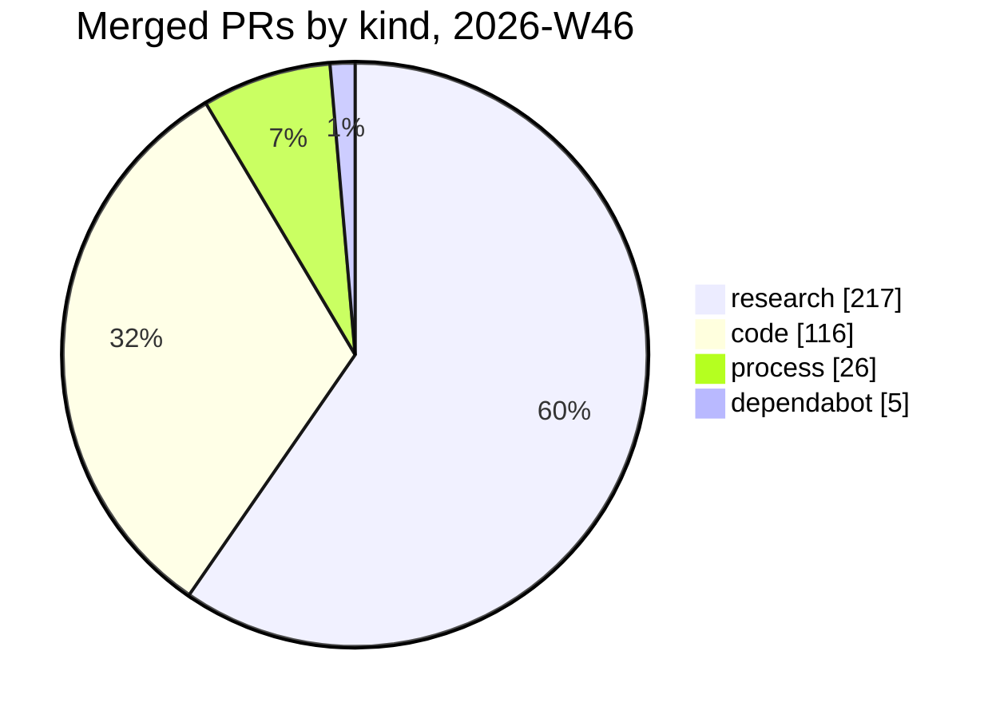

# Weekly newsletter — 2026-W46 (Nov 9–15)

**364 PRs merged, 3 of last week's 5 commitments done, and 7 decisions waiting on you, two over the
target of 5.** The post-merge audit did not run this week, so defects per PR are unknown. Numbers
come from `scripts/newsletter.mjs --week 2026-W46`, read at 2026-11-16 00:06Z. The plan is #6872.

## Pictures first

This week's numbers alone. Trend lines wait on the generator reading past editions back (W45-1,
slipped below).

## Numbers

- **Merged PRs:** 364: 116 code, 217 research, 26 process, 5 dependabot, 0 other.
- **Defects per audited PR:** unknown. No audit ran this week (0 batches, 0 issues filed), because
  the Routine that starts it waits on your word (#7311 slice 5, run sheet #7431). Falsifier
  (`docs/process/LEARNING-LOOP.md`): wrong if under 0.3 confirmed per audited PR across the next 30
  audited PRs, checked 2026-12-01.
- **Clear-path flip:** 1 readied of 3 judged (0.33). Falsifier: wrong if any hour in 11-11..17 had
  lane capacity and 0 pullable items, checked 2026-11-17 (#7311).
- **Failure to fix, main CI:** 2 episodes. Detection and filed-to-fix unknown, verified in 356.25
  min. **Contracts:** 0 episodes. **Audit findings:** 0 episodes.
- **CI verify, first try:** 0.93 (27 of 404 runs failed). Local is unknown. CI is a floor, because
  `ship.sh` verifies before it pushes.
- **Tokens per verified result:** unknown for every job. Post-merge audit and workflow stages ran 0
  times; fix a failure verified 2, tokens unknown; full verify and communication have no reading.
- **Weekly usage:** mode `normal`, 70% used with 77% of the window gone (gap -7), resets
  2026-11-17 05:00Z (read 11-15 14:00Z).
- **Fitness contracts (8):** 6 green. `main-deploys` went red during the week and recovered.
  `alerts-reach-owner` was **still red at the close** (#6501), the second week running. 12 issues
  were filed for reads that failed, all closed: 10 GitHub (#7486, #7427, #7411, #7373, #7367,
  #7348, #7298, #7268, #7200, #7164) and 2 Fly (#7222, #7218).
- **Loops:** 0 iterated, 0 moved. No governor cycle ran this week.
- **Research tests:** 2042 (507 linked). Overall: 555 pass, 178 kill, 1254 open, pass rate 0.76.
  High impact: 55 / 16 / 90 (0.77). Medium: 67 / 25 / 215 (0.73).

**Decisions reaching Eric** (#6953 slice 4). Last week reads "no reading": the generator does not
yet read the W45 numbers block (W45-1). W45's values are in `docs/newsletters/2026-W45.md`.

| Measure | This week | Last week | Target |
|---|---|---|---|
| **Open asks that need him** | **7** (#7548, #6959, #6886, #5730, #5452, #1211, #7424) | no reading | 5 or fewer, all genuinely his |
| Asks no list can see | unknown | no reading | 0 |
| Asks whose artifact is missing or cannot merge as it stands | 0 | no reading | 0 |
| Share of closed `needs-eric` labels he answered | 0 (0 of 6) | no reading | 0.8 or more |
| Median hours from ask to his answer | unknown | no reading | under 24 |
| Median hours from assignment to his answer | unknown | no reading | under 48 (falsifier) |
| The same question filed under a new number | 0 | no reading | 0 |
| Share of open asks with a prediction recorded | 0.33 (2 of 6) | no reading | 1 |
| Ledger match rate | 0.7 (21 of 30 decided rows) | no reading | rising |
| Ledger best streak | 6 | no reading | 3 (a class graduates) |
| Ledger classes ready to graduate | 1 (screen design, taste) | no reading | bot safety rules proposed |
| Days the oldest ask between watching and trading bots has waited | 30.8 (#5452, 4 open) | no reading | 7 or less |

**Playthroughs and reactions** (#7031 slice 3)
- **Known gaps:** 2 journey steps are still marked `known_gap`: eric 1 (`j2-s3`) and
  returning-trader 1 (`j4-s1`).
- **Member-facing changes:** 47 merged. Reactions: 0 from Eric and 0 from members. In-app filings
  this week: 12, against the 2 a week the member-facing slices wait on.
- **Open `needs-eric`:** 6, median age 7.35 days, oldest 30.8 days (#5452, #5730, #6959, #1211,
  #6886, #7548).

## Milestones

- **Campaigns #6948:** four sub-issues closed: #6952 campaign modes (11-09), #7077 the landing page
  (11-09), #7028 quests (11-10), #7034 fast tracks (11-11). #7018's design rounds 3–9 closed, every
  pick built (#7144, #7208, #7219, #7220, #7223, #7225).
- **Screenshots in Moneypenny's chat #6007:** all three slices shipped (#7432, #7435, #7437) and the
  plan closed.
- **Audit and flip on their own #7311:** slices 1–5 merged (#7378, #7379, #7429, #7430, #7431) and
  the plan closed. Only the Routine that starts them is left, and that is yours.
- **Board swimlanes #6871:** #7030 merged 11-10, and the lanes now read Fix first · Pull next ·
  Standard · Later. #7426 carries the lane descriptions. Only slice 6's browser steps remain.
- **Seats on the board #6886:** slices 1b and 2 merged (#7256, #7283). The IA lens caught both
  #895 defects in its trial.
- **Convictions #5482:** claim 2a failed and was adopted (#7258, #7271).
- **Fast tracks #7034:** the discovery lane you merged (#7211) is now scheduled.
- **Held platter #7080** merged 11-10, clearing last week's second constraint along with #7030.
- **Filed:** #7330, measuring each hand-off of attention between page and chat.

## Last week's plan, checked

**Plan accuracy: 60% (3 of 5 done).**

1. **W45-1, trend lines (#6872): slipped.** The generator still reads no past edition: this
   edition's `lastWeek` values are all null.
2. **W45-2, advisory PR review (#6870 S3): slipped.** No S3 PR merged this week. The state block
   still names S3 as the next pickup.
3. **W45-3, landing page (#7077): done.** #7077 closed 11-09.
4. **W45-4, campaign encounters (#6952 slice 3): done.** #7162 merged 11-09, and #6952 closed.
5. **W45-5, quests on the landing page (#7028 slice 5): done.** #7225 merged 11-09.

Both slips are process work. The three member-surface commitments all landed on the first day of
the week.

## Constraints

1. **Your decision queue is growing faster than it drains.** 7 open asks against a target of 5,
   none of the 6 `needs-eric` labels closed this week was closed by your answer, and #5452 has
   waited 30.8 days. The ledger has one class ready to graduate (screen design, best streak 6).
   Options: **(a) Graduate it:** one tap makes screen-design taste calls decide-and-report
   (`docs/process/ALIGNMENT.md`). **(b) One sitting:** clear the 7 asks in a single pass.
   **(c) Park the oldest two** (#5452, #5730) out of the count, on the record.
2. **The audit loop stopped because its clock is not set.** 0 audits ran, so the defect yield is
   unknown for the week, while code merges rose to 116. The run sheet (#7431) holds a
   daily-or-weekdays fork that is yours, because creating a Routine arms a schedule. Options:
   **(a) Daily.** **(b) Weekdays.** **(c) Leave it off** and audit by hand on surge.
3. **The fitness reads keep failing, and the alert contract is red for a second week.** 12 failed
   reads were filed and closed this week (10 GitHub, 2 Fly), and `alerts-reach-owner` (#6501) is
   still red. Options: **(a) Set the credential** (the owner rung). **(b) Fold the read failures**
   into one standing issue, so each new one reopens it. **(c) Fix the GitHub read** before
   trusting any red.

## Next week

Horizon reads `unknown` for every line, because the board is not readable from this session.

1. **W46-1, trend lines (#6872), carried.** *Done when:* WHEN the 2026-W47 edition is written,
   THEN each decision measure's last-week column is read from this file's numbers block.
2. **W46-2, advisory PR review (#6870 S3), carried.** *Done when:* WHEN a PR opens against main,
   THEN the `pr review` job posts its findings without blocking the merge, and its first week's
   precision is recorded on #6870.
3. **W46-3, profile as a character sheet (#7019, under #6948).** *Done when:* WHEN the
   character-sheet round closes, THEN its picked shape is written on #7019 and a build slice is
   filed.
4. **W46-4, seat lifecycle hooks (#6886 slice 4).** *Done when:* WHEN a `/charter` outcome lands,
   THEN that seat's row in `docs/agents/seats.json` updates in the same PR.
5. **W46-5, page-and-chat hand-offs (#7330 slice 1).** *Done when:* WHEN the check runs, THEN it
   scores all 12 moments and records the count.
6. **W46-6, convictions claim 1 (#5482).** *Done when:* WHEN 2026-11-20 arrives, THEN claim 1's
   full pass is run and any failed claim is opened as a held PR.

### The week ahead in markets

Paper research calls only, never advice for real money. Only two events in the coming seven days
are high or critical impact.

| Date | Event | Impact | Stance |
|---|---|---|---|
| 11-17 | Retail sales, October data (08:30 ET) | high | stand-aside (#7522, 11-13 pulse; screens through 11-15, #7591, left it unchanged) |
| 11-17 | NVDA Q3 print (after the close) | critical | stand-aside (#7234, 11-10 pulse) |

The NVDA doc is filed under 11-18, but NVIDIA's call notice moved the print to Tue 11-17; its own
stance section says so.

35 more events in the next seven days

- **Medium (7):** 11-17 Microsoft Ignite. 11-18 APEC leaders in Shenzhen, FOMC minutes, 20-year
  bond auction. 11-19 10-year TIPS auction, coupon announcement. 11-20 monthly options expiry.
- **Low (28):** 11-16 ASEAN summit, Empire State manufacturing, Japan Q3 GDP, JGB 10-year
  linker, professional forecasters survey. 11-17 import/export prices, industrial production,
  business inventories, NAHB index, UK labour market. 11-18 euro-area HICP final, housing starts,
  JGB 20-year, pending home sales, TIC, UK CPI, UK PPI, VIX expiration. 11-19 Q3 services,
  Philly Fed, Q3 e-commerce. 11-20 inflation term structure, Japan CPI, JGB 1–5-year liquidity
  auction, UK consumer confidence, UK public finances, UK retail sales, Michigan sentiment final.

## Your part this week

The budget is 5. 7 steps are due, so 2 roll over to next week. The first three waited a week.

1. **Showcase:** react to shipped member-facing changes, 47 this week (#5143).
2. **Playbook library:** pick which proposed playbooks to grade next (#6771).
3. **Brand ideas:** keep or drop candidate names (#6616).
4. **Plan check:** steer next week's commitments above (#6872).
5. **Weekly token split:** choose how this week's tokens divide across the buckets (#6872).

Rolled over (2, first waiting 2026-W46): Memory review (`/dream`), Falsifiers due.

**Decisions you hold now:** 7 open asks. The oldest is #5452 (co-game-master bots), which has
carried `needs-eric` for 30.8 days.

## Steering

No replies from you on #7024 since the last edition, so nothing has been steered.

1. **What should next week weight?** **(a) Process catch-up:** the two slipped commitments first
   (W46-1, W46-2). **(b) Member surface:** the character sheet (W46-3), riding this week's 12
   in-app filings. **(c) Even split,** as written.
2. **The member filings arrived: 12 against a bar of 2.** Reactions to the 47 changes are still 0.
   **(a) Keep going:** the filings are the reactions for now. **(b) Pull #7029 slice 4** forward, so
   a member can react to one change in a tap. **(c) Decide later.**
3. **Is the research share of merges right?** Research was 217 of the 364 merged PRs. **(a) Keep
   it.** **(b) Batch pulses** into one PR a day. **(c) Cap research** under the token split.

<!-- newsletter-plan
{
  "week": "2026-W46",
  "commitments": [
    {
      "id": "W46-1",
      "text": "The generator reads past editions' numbers blocks for trend lines (carried from W45-1)",
      "done": "WHEN the 2026-W47 edition is written, THEN each decision measure's last-week column is read from the W46 numbers block",
      "horizon": null,
      "issue": 6872
    },
    {
      "id": "W46-2",
      "text": "Ship the advisory pr review job reading REVIEW.md from the base commit (carried from W45-2)",
      "done": "WHEN a PR opens against main, THEN the pr review job posts its findings without blocking the merge, and its first week's precision is recorded on #6870",
      "horizon": null,
      "issue": 6870
    },
    {
      "id": "W46-3",
      "text": "Run the profile character-sheet design round",
      "done": "WHEN the character-sheet round closes, THEN its picked shape is written on #7019 and a build slice is filed",
      "horizon": null,
      "issue": 7019
    },
    {
      "id": "W46-4",
      "text": "Seat lifecycle hooks: charter outcomes update the seat registry",
      "done": "WHEN a /charter outcome lands, THEN that seat's row in docs/agents/seats.json updates in the same PR",
      "horizon": null,
      "issue": 6886
    },
    {
      "id": "W46-5",
      "text": "One check that scores all 12 page-and-chat hand-off moments",
      "done": "WHEN the check runs, THEN it scores all 12 moments and records the count",
      "horizon": null,
      "issue": 7330
    },
    {
      "id": "W46-6",
      "text": "Run convictions claim 1's full pass on 2026-11-20",
      "done": "WHEN 2026-11-20 arrives, THEN claim 1's full pass is run and any failed claim is opened as a held PR",
      "horizon": null,
      "issue": 5482
    }
  ],
  "asks": {
    "carried": ["Showcase", "Playbook library", "Brand ideas", "Plan check", "Weekly token split"],
    "rolledOver": [
      { "loop": "Memory review (/dream)", "since": "2026-W46" },
      { "loop": "Falsifiers due", "since": "2026-W46" }
    ]
  }
}
-->
<!-- newsletter-numbers {"metrics":{"mergedPrs":{"total":364,"code":116,"research":217,"process":26,"dependabot":5,"other":0,"otherPrs":[]},"defects":{"audits":0,"auditedPrs":null,"confirmed":null,"perPr":null,"tokens":null,"tokensPerConfirmed":null,"pricedConfirmed":null,"unpriced":0,"unreadable":0,"batches":[],"filed":{"issues":0,"prsWithDefect":0}},"flip":{"judged":3,"readied":1,"refused":2,"readiedShare":0.33},"failureToFix":{"mainCi":{"episodes":2,"detectionLag":{"n":0,"unknown":2,"p50Min":null,"p90Min":null},"filedToFix":{"n":0,"unknown":2,"p50Min":null,"p90Min":null},"toVerified":{"n":2,"unknown":0,"p50Min":356.25,"p90Min":356.25}},"contracts":{"episodes":0,"detectionLag":{"n":0,"unknown":0,"p50Min":null,"p90Min":null},"filedToFix":{"n":0,"unknown":0,"p50Min":null,"p90Min":null},"toVerified":{"n":0,"unknown":0,"p50Min":null,"p90Min":null}},"audit":{"episodes":0,"detectionLag":{"n":0,"unknown":0,"p50Min":null,"p90Min":null},"filedToFix":{"n":0,"unknown":0,"p50Min":null,"p90Min":null},"toVerified":{"n":0,"unknown":0,"p50Min":null,"p90Min":null}}},"verifyFirstTry":{"local":null,"ci":{"runs":404,"failed":27,"rate":0.93},"note":"CI is a floor: ship.sh verifies before pushing"},"tokensPerVerified":[{"job":"post-merge audit","role":"post-merge audit","bucket":"reliability","runs":0,"tokens":0,"verified":null,"perVerified":null,"floor":false,"source":"meter"},{"job":"full verify","role":"full verify","bucket":"reliability","runs":null,"tokens":null,"verified":null,"perVerified":null,"floor":false,"source":"meter"},{"job":"workflow stages","role":"workflow stages","bucket":"unmapped","runs":0,"tokens":0,"verified":null,"perVerified":null,"floor":false,"source":"meter"},{"job":"fix a failure","role":"fix a failure","bucket":"reliability","runs":2,"tokens":null,"verified":2,"perVerified":null,"floor":false,"source":"meter"},{"job":"communication","role":"communication","bucket":"unmapped","runs":null,"tokens":null,"verified":null,"perVerified":null,"floor":false,"source":"meter"}],"usage":{"mode":"normal","used":70,"gone":77,"gap":-7,"resets":"2026-11-17T05:00:00.000Z","readAt":"2026-11-15T14:00:13.365Z","source":"lane:build-feedback"},"needsEric":{"count":6,"unreadAge":0,"medianDays":7.35,"oldestDays":30.8,"items":[{"number":5452,"days":30.8},{"number":5730,"days":28.3},{"number":6959,"days":7.8},{"number":1211,"days":6.9},{"number":6886,"days":5.8},{"number":7548,"days":2.9}]},"playthroughGaps":{"count":2,"byMember":{"eric":1,"returning-trader":1},"steps":["eric/j2-s3","returning-trader/j4-s1"]},"memberChanges":{"merged":47,"unread":0,"reactions":{"eric":0,"members":0},"memberFilings":12,"note":"reactions count changes, not taps: Eric's is a Revisit filing, a member's an in-app filing that names the PR. A floor until the app has a per-change reaction (#7029 slice 4)"},"fitness":{"contracts":8,"green":["bots-running","bots-responsive","decision-cycle","live-bots-place","owner-assignment-path","memory-has-history"],"redDuringWeek":["main-deploys","alerts-reach-owner"],"redAtEnd":["alerts-reach-owner"],"blindIssues":[7486,7427,7411,7373,7367,7348,7298,7268,7222,7218,7200,7164]},"loops":{"iterated":0,"moved":0,"loops":[]},"research":{"tests":2042,"linked":507,"all":{"pass":555,"kill":178,"open":1254,"passRate":0.76},"high":{"pass":55,"kill":16,"open":90,"passRate":0.77},"medium":{"pass":67,"kill":25,"open":215,"passRate":0.73}},"decisions":{"measures":[{"id":"openAsks","label":"Open asks that need him","target":"5 or fewer, all genuinely his","value":7,"lastWeek":null,"detail":[7548,6959,6886,5730,5452,1211,7424]},{"id":"unseen","label":"Asks no list can see","target":"0","value":null,"lastWeek":null},{"id":"artifactMissing","label":"Asks whose artifact is missing or cannot merge as it stands","target":"0","value":0,"lastWeek":null,"detail":[]},{"id":"answeredShare","label":"Share of closed needs-eric labels he answered","target":"0.8 or more","value":0,"lastWeek":null,"detail":"0 of 6"},{"id":"hoursToAnswer","label":"Median hours from ask to his answer","target":"under 24","value":null,"lastWeek":null,"detail":[]},{"id":"hoursAssignToAnswer","label":"Median hours from assignment to his answer","target":"under 48 (falsifier)","value":null,"lastWeek":null},{"id":"refiled","label":"The same question filed under a new number","target":"0","value":0,"lastWeek":null,"detail":[]},{"id":"predictedShare","label":"Share of open asks with a prediction recorded","target":"1","value":0.33,"lastWeek":null,"detail":"2 of 6"},{"id":"ledgerMatchRate","label":"Ledger match rate","target":"rising","value":0.7,"lastWeek":null,"detail":"21 of 30 decided rows"},{"id":"ledgerBestStreak","label":"Ledger best streak","target":"3 (a class graduates)","value":6,"lastWeek":null},{"id":"ledgerReady","label":"Ledger classes ready to graduate","target":"bot safety rules proposed","value":1,"lastWeek":null,"detail":["screen design (taste)"]},{"id":"oldestBotAskDays","label":"Days the oldest ask between watching and trading bots has waited","target":"7 or less","value":30.8,"lastWeek":null,"detail":"#5452, 4 open"}],"unread":{"unseen":"unavailable: gh api search/issues?q=repo%3Aejclark%2Fskynet-capital%20is%3Aopen%20%22Needs%20from%20you%22%20in%3Acomments&per_page=100: gh: Query must include 'is:issue' or 'is:pull-request' (HTTP 422)"}}},"humanSteps":{"budget":5,"due":7,"asks":[{"loop":"Showcase","step":"React to shipped member-facing changes","cadence":"every two weeks","issue":"#5143","since":"2026-W45","waitedWeeks":1},{"loop":"Playbook library","step":"Pick which proposed playbooks to grade next","cadence":"monthly","issue":"#6771","since":"2026-W45","waitedWeeks":1},{"loop":"Brand ideas","step":"Keep or drop candidate names","cadence":"monthly","issue":"#6616","since":"2026-W45","waitedWeeks":1},{"loop":"Plan check","step":"Steer next week's commitments","cadence":"weekly","issue":"#6872","since":"2026-W46","waitedWeeks":0},{"loop":"Weekly token split","step":"Choose how this week's tokens divide across the buckets","cadence":"weekly","issue":"#6872","since":"2026-W46","waitedWeeks":0}],"rolledOver":[{"loop":"Memory review (/dream)","since":"2026-W46"},{"loop":"Falsifiers due","since":"2026-W46"}],"carriedIn":3,"unreadableCadence":[],"openAsks":{"count":7,"oldest":{"number":5452,"days":30.8}}}} -->
