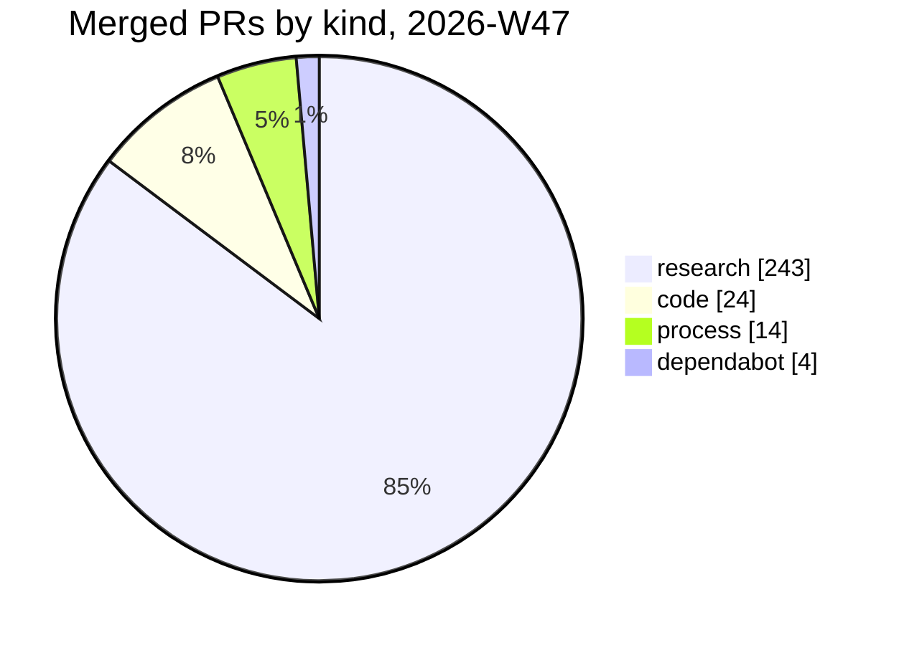

# Weekly newsletter — 2026-W47 (Nov 16–22)

**285 PRs merged, 0 of last week's 6 commitments done (1 partial), and 9 decisions waiting on you,
against a target of 5.** The weekly quota read 22% used with 79% of the window gone, so the slips
were not a token shortage. The post-merge audit did not run for a third week. Numbers come from
`scripts/newsletter.mjs --week 2026-W47`, read at 2026-11-23 00:06Z. The plan is #6872.

## Pictures first

This week's numbers alone. Trend lines still wait on the generator reading past editions back
(W46-1, slipped below).

## Numbers

- **Merged PRs:** 285: 24 code, 243 research, 14 process, 4 dependabot, 0 other.
- **Defects per audited PR:** unknown. No audit ran this week (0 batches, 0 issues filed). The
  Routine that starts it still waits on your word (#7311 slice 5, run sheet #7431). Falsifier
  (`docs/process/LEARNING-LOOP.md`): wrong if under 0.3 confirmed per audited PR across the next 30
  audited PRs.
- **Clear-path flip:** 2 readied of 10 judged (0.2). Falsifier: wrong if any hour in 11-11..17 had
  admissible lane capacity and 0 pullable items. Its check was due 2026-11-17, and the loop's row
  records no result yet (#7311).
- **Failure to fix, main CI:** 2 episodes. Detection p50 0.27 min (1 read, 1 unknown), filed to fix
  p50 21.33 min (1 read, 1 unknown), verified p50 25.42 min. **Contracts:** 0 episodes. **Audit
  findings:** 0 episodes.
- **CI verify, first try:** 0.99 (4 of 306 runs failed). Local is unknown. CI is a floor, because
  `ship.sh` verifies before it pushes.
- **Tokens per verified result:** unknown for every job. Post-merge audit and workflow stages ran 0
  times; fix a failure verified 2, tokens unknown; full verify and communication have no reading.
- **Weekly usage:** mode `normal`, 22% used with 79% of the window gone (gap -57), resets
  2026-11-24 05:00Z (read 11-22 17:47Z).
- **Fitness contracts (8):** 6 green. `main-deploys` went red during the week and recovered.
  `alerts-reach-owner` was **still red at the close** (#6501), the third week running. 8 issues
  were filed for reads that failed, all closed: 7 GitHub (#7938, #7897, #7862, #7810, #7772,
  #7708, #7664) and 1 Fly (#7965).
- **Loops:** 0 iterated, 0 moved.
- **Research tests:** 2057 (508 linked). Overall: 628 pass, 198 kill, 1168 open, pass rate 0.76.
  High impact: 60 / 16 / 85 (0.79). Medium: 77 / 29 / 199 (0.73).

**Decisions reaching Eric** (#6953 slice 4). Last week reads "no reading": the generator still does
not read the W46 numbers block (W46-1). W46's values are in `docs/newsletters/2026-W46.md`.

| Measure | This week | Last week | Target |
|---|---|---|---|
| **Open asks that need him** | **9** (#7673, #7671, #7670, #7669, #6959, #6886, #5730, #5452, #1211) | no reading | 5 or fewer, all genuinely his |
| Asks no list can see | unknown (the search read failed) | no reading | 0 |
| Asks whose artifact is missing or cannot merge as it stands | 0 | no reading | 0 |
| Share of closed `needs-eric` labels he answered | 0 (0 of 1) | no reading | 0.8 or more |
| Median hours from ask to his answer | unknown | no reading | under 24 |
| Median hours from assignment to his answer | unknown | no reading | under 48 (falsifier) |
| The same question filed under a new number | 0 | no reading | 0 |
| Share of open asks with a prediction recorded | 0.67 (6 of 9) | no reading | 1 |
| Ledger match rate | 0.7 (21 of 30 decided rows) | no reading | rising |
| Ledger best streak | 6 | no reading | 3 (a class graduates) |
| Ledger classes ready to graduate | 1 (screen design, taste) | no reading | bot safety rules proposed |
| Days the oldest ask between watching and trading bots has waited | 37.8 (#5452, 4 open) | no reading | 7 or less |

The ready class, screen design, graduated to decide-and-report on 11-22 by your merge of #7952.
The generator still counts it as ready, so expect that row to read 0 next week.

**Playthroughs and reactions** (#7031 slice 3)
- **Known gaps:** 2 journey steps are still marked `known_gap`: eric 1 (`j2-s3`) and
  returning-trader 1 (`j4-s1`), unchanged from last week.
- **Member-facing changes:** 8 merged. Reactions: 0 from Eric and 0 from members. In-app filings
  this week: 4, against the 2 a week the member-facing slices wait on.
- **Open `needs-eric`:** 9, median age 12.8 days, oldest 37.8 days (#5452, #5730, #6959, #1211,
  #6886, #7673, #7671, #7670, #7669).

## Milestones

No sub-issue closed this week.

- **Alignment:** screen-design taste calls graduated to decide-and-report (#7952, merged by you
  11-22). Rubber-stamp asks now fold into one merge and one decision touch (#7942), and an ask
  states its own class so the ledger stops guessing (#7947).
- **Convictions #5482:** claim 8 passed early, now that a price claim is scored as soon as the tape
  settles it (#7894). Claim 1 is blocked: Cboe refuses the option-chain fetch from CI runners, filed
  as #7896 (`bottleneck`).
- **Simulated members** now change their paper account, and the account grades them (#7672).
- **Trade form fixes:** the symbol commits before a tap's handlers run (#7961), a late blur no longer
  reopens the option chain (#7964), and a foreign account's stock card opens on its ticker, never
  sell (#7962).
- **Feedback:** a drafted note files only on "submit", never "send" (#7946); a member's follow-up is
  re-checked before a build reads it (#7548 fix).
- **Four new asks** reached you on 11-17, all from member feedback on trading from a phone: #7669,
  #7670, #7671, #7673.

## Last week's plan, checked

**Plan accuracy: 0% (0 of 6 done, 1 partial).**

1. **W46-1, trend lines (#6872): slipped,** the second week. This edition's `lastWeek` values are
   all null.
2. **W46-2, advisory PR review (#6870 S3): slipped,** the second week. No S3 PR merged; the
   issue's only activity was a defect closed as already fixed on main.
3. **W46-3, character-sheet round (#7019): slipped.** No activity on #7019 this week.
4. **W46-4, seat lifecycle hooks (#6886 slice 4): slipped.** No slice-4 PR merged.
5. **W46-5, page-and-chat hand-offs (#7330 slice 1): slipped.** No activity on #7330 this week.
6. **W46-6, convictions claim 1 (#5482): partial.** The pass ran on 11-21 and failed on the
   option-chain fetch (Cboe 403, Yahoo 429). Claim 1 stays pending behind #7896; claim 8 passed
   instead (#7894).

Most of the week's code went to the decision queue, the digest and trade-form fixes, not to the
planned slices. With 22% of the quota used, the lanes had room the plan did not claim.

## Constraints

1. **The plan does not steer what gets built.** 0 of 6 commitments landed while 22% of the weekly
   quota was used with 79% of the window gone. Two commitments have now slipped two weeks. Options:
   **(a) Mark the commitments `ready`** on their issues, so the lanes pull them. **(b) Cut to 3**
   commitments and carry the rest openly. **(c) Spend the spare quota** on them before the
   11-24 05:00Z reset (surge is yours alone).
2. **Your decision queue is still growing.** 9 open asks against a target of 5, up from 7. The one
   `needs-eric` label closed this week was not closed by your answer, and #5452 has waited 37.8
   days. Four of the nine (#7669, #7670, #7671, #7673) are member asks about trading from a phone,
   filed the same night. Options: **(a) One sitting** for the four phone asks together. **(b) Park
   the oldest two** (#5452, #5730) out of the count, on the record. **(c) Let the next ledger class
   graduate** when its streak reaches 3.
3. **Two safety nets stayed off.** `alerts-reach-owner` (#6501) is red for a third week, 8 failed
   reads were filed and closed, and the audit loop ran 0 times for a third week. Options:
   **(a) Set the alert credential** (the owner rung). **(b) Pick the audit Routine's clock** on
   #7431: daily or weekdays. **(c) Leave both** and accept the blind spots.

## Next week

Horizon reads `unknown` for every line, because the board is not readable from this session.

1. **W47-1, trend lines (#6872), carried a third time.** *Done when:* WHEN the 2026-W48 edition is
   written, THEN each decision measure's last-week column is read from this file's numbers block.
2. **W47-2, advisory PR review (#6870 S3), carried a third time.** *Done when:* WHEN a PR opens
   against main, THEN the `pr review` job posts its findings without blocking the merge, and its
   first week's precision is recorded on #6870.
3. **W47-3, a fresh option chain for the lanes (#7896).** *Done when:* WHEN an autonomous lane
   fetches an option chain, THEN it receives one, and claim 1's full pass on #5482 runs on it.
4. **W47-4, character-sheet round (#7019), carried.** *Done when:* WHEN the character-sheet round
   closes, THEN its picked shape is written on #7019 and a build slice is filed.
5. **W47-5, page-and-chat hand-offs (#7330 slice 1), carried.** *Done when:* WHEN the check runs,
   THEN it scores all 12 moments and records the count.

W46-4 (seat lifecycle hooks, #6886) drops out: #6886 carries `needs-eric`, so it waits on you.

### The week ahead in markets

Paper research calls only, never advice for real money. Two events in the coming seven days are
high impact, both Wednesday before Thanksgiving.

| Date | Event | Impact | Stance |
|---|---|---|---|
| 11-25 | GDP Q3, second estimate (08:30 ET) | high | stand-aside (#7895, 11-21 pulse) |
| 11-25 | PCE, October data (08:30 ET) | high | stand-aside (#7884, 11-21 pulse) |

26 more events in the next seven days

- **Medium (12):** 11-23 2-year note auction. 11-24 consumer confidence, 2-year FRN, 5-year note.
  11-25 Beige Book, durable goods, 7-year note. 11-27 advance economic indicators, China
  gallium/germanium/antimony suspension expiry. 11-28 FOMC blackout starts. 11-29 OPEC+ meeting.
- **Low (14):** 11-23 Japan market closure, S&P Global flash US PMI. 11-24 Case-Shiller, FHFA HPI,
  industrial production annual revision, Philly Fed non-manufacturing. 11-25 JGB 40-year, new home
  sales, Ofgem price cap, Philly Fed inflation expectations. 11-26 Thanksgiving closure. 11-27
  Tokyo CPI flash, JGB 5–11-year liquidity auction, SIFMA bond early close, half-day session.

## Your part this week

The budget is 5. 6 steps are due, so 1 rolls over to next week. The first two waited a week.

1. **Memory review (`/dream`):** take or discard up to 5 proposals (#6470).
2. **Falsifiers due:** read the calls whose dated falsifier came due (#6872).
3. **Plan check:** steer next week's commitments above (#6872).
4. **Weekly token split:** choose how this week's tokens divide across the buckets (#6872).
5. **Alignment:** one tap to let a matching decision class become decide-and-report
   (`docs/process/ALIGNMENT.md`).

Rolled over (1, first waiting 2026-W47): Showcase.

**Decisions you hold now:** 9 open asks. The oldest is #5452 (co-game-master bots), which has
carried `needs-eric` for 37.8 days.

## Steering

No replies from you on #7024 since the last edition, so nothing has been steered.

1. **How should the plan reach the lanes?** **(a) Ready-label** each commitment's next slice, so
   it is pulled like any other issue. **(b) Keep the plan advisory** and accept low accuracy.
   **(c) Drop the plan block** until the generator reads it back.
2. **The four phone-trading asks arrived together.** **(a) Answer them as one decision** about the
   phone trade screen. **(b) Hand them to a redesign round** of the trade form (`/redesign`).
   **(c) One at a time,** as filed.
3. **Is the research share of merges right?** Research was 243 of the 285 merged PRs, up from 217
   of 364. **(a) Keep it.** **(b) Batch pulses** into one PR a day. **(c) Cap research** under the
   token split.

<!-- newsletter-plan
{
  "week": "2026-W47",
  "commitments": [
    {
      "id": "W47-1",
      "text": "The generator reads past editions' numbers blocks for trend lines (carried from W46-1)",
      "done": "WHEN the 2026-W48 edition is written, THEN each decision measure's last-week column is read from the W47 numbers block",
      "horizon": null,
      "issue": 6872
    },
    {
      "id": "W47-2",
      "text": "Ship the advisory pr review job reading REVIEW.md from the base commit (carried from W46-2)",
      "done": "WHEN a PR opens against main, THEN the pr review job posts its findings without blocking the merge, and its first week's precision is recorded on #6870",
      "horizon": null,
      "issue": 6870
    },
    {
      "id": "W47-3",
      "text": "Give autonomous lanes a fresh option chain, so convictions claim 1 can be scored",
      "done": "WHEN an autonomous lane fetches an option chain, THEN it receives one, and claim 1's full pass on #5482 runs on it",
      "horizon": null,
      "issue": 7896
    },
    {
      "id": "W47-4",
      "text": "Run the profile character-sheet design round (carried from W46-3)",
      "done": "WHEN the character-sheet round closes, THEN its picked shape is written on #7019 and a build slice is filed",
      "horizon": null,
      "issue": 7019
    },
    {
      "id": "W47-5",
      "text": "One check that scores all 12 page-and-chat hand-off moments (carried from W46-5)",
      "done": "WHEN the check runs, THEN it scores all 12 moments and records the count",
      "horizon": null,
      "issue": 7330
    }
  ],
  "asks": {
    "carried": ["Memory review (/dream)", "Falsifiers due", "Plan check", "Weekly token split", "Alignment"],
    "rolledOver": [
      { "loop": "Showcase", "since": "2026-W47" }
    ]
  }
}
-->
<!-- newsletter-numbers {"metrics":{"mergedPrs":{"total":285,"code":24,"research":243,"process":14,"dependabot":4,"other":0,"otherPrs":[]},"defects":{"audits":0,"auditedPrs":null,"confirmed":null,"perPr":null,"tokens":null,"tokensPerConfirmed":null,"pricedConfirmed":null,"unpriced":0,"unreadable":0,"batches":[],"filed":{"issues":0,"prsWithDefect":0}},"flip":{"judged":10,"readied":2,"refused":8,"readiedShare":0.2},"failureToFix":{"mainCi":{"episodes":2,"detectionLag":{"n":1,"unknown":1,"p50Min":0.27,"p90Min":0.27},"filedToFix":{"n":1,"unknown":1,"p50Min":21.33,"p90Min":21.33},"toVerified":{"n":2,"unknown":0,"p50Min":25.42,"p90Min":25.42}},"contracts":{"episodes":0,"detectionLag":{"n":0,"unknown":0,"p50Min":null,"p90Min":null},"filedToFix":{"n":0,"unknown":0,"p50Min":null,"p90Min":null},"toVerified":{"n":0,"unknown":0,"p50Min":null,"p90Min":null}},"audit":{"episodes":0,"detectionLag":{"n":0,"unknown":0,"p50Min":null,"p90Min":null},"filedToFix":{"n":0,"unknown":0,"p50Min":null,"p90Min":null},"toVerified":{"n":0,"unknown":0,"p50Min":null,"p90Min":null}}},"verifyFirstTry":{"local":null,"ci":{"runs":306,"failed":4,"rate":0.99},"note":"CI is a floor: ship.sh verifies before pushing"},"tokensPerVerified":[{"job":"post-merge audit","role":"post-merge audit","bucket":"reliability","runs":0,"tokens":0,"verified":null,"perVerified":null,"floor":false,"source":"meter"},{"job":"full verify","role":"full verify","bucket":"reliability","runs":null,"tokens":null,"verified":null,"perVerified":null,"floor":false,"source":"meter"},{"job":"workflow stages","role":"workflow stages","bucket":"unmapped","runs":0,"tokens":0,"verified":null,"perVerified":null,"floor":false,"source":"meter"},{"job":"fix a failure","role":"fix a failure","bucket":"reliability","runs":2,"tokens":null,"verified":2,"perVerified":null,"floor":false,"source":"meter"},{"job":"communication","role":"communication","bucket":"unmapped","runs":null,"tokens":null,"verified":null,"perVerified":null,"floor":false,"source":"meter"}],"usage":{"mode":"normal","used":22,"gone":79,"gap":-57,"resets":"2026-11-24T05:00:00.000Z","readAt":"2026-11-22T17:47:02.067Z","source":"lane:build-feedback"},"needsEric":{"count":9,"unreadAge":0,"medianDays":12.8,"oldestDays":37.8,"items":[{"number":5452,"days":37.8},{"number":5730,"days":35.3},{"number":6959,"days":14.8},{"number":1211,"days":13.9},{"number":6886,"days":12.8},{"number":7673,"days":6},{"number":7671,"days":6},{"number":7670,"days":6},{"number":7669,"days":6}]},"playthroughGaps":{"count":2,"byMember":{"eric":1,"returning-trader":1},"steps":["eric/j2-s3","returning-trader/j4-s1"]},"memberChanges":{"merged":8,"unread":0,"reactions":{"eric":0,"members":0},"memberFilings":4,"note":"reactions count changes, not taps: Eric's is a Revisit filing, a member's an in-app filing that names the PR. A floor until the app has a per-change reaction (#7029 slice 4)"},"fitness":{"contracts":8,"green":["bots-running","bots-responsive","decision-cycle","live-bots-place","owner-assignment-path","memory-has-history"],"redDuringWeek":["main-deploys","alerts-reach-owner"],"redAtEnd":["alerts-reach-owner"],"blindIssues":[7965,7938,7897,7862,7810,7772,7708,7664]},"loops":{"iterated":0,"moved":0,"loops":[]},"research":{"tests":2057,"linked":508,"all":{"pass":628,"kill":198,"open":1168,"passRate":0.76},"high":{"pass":60,"kill":16,"open":85,"passRate":0.79},"medium":{"pass":77,"kill":29,"open":199,"passRate":0.73}},"decisions":{"measures":[{"id":"openAsks","label":"Open asks that need him","target":"5 or fewer, all genuinely his","value":9,"lastWeek":null,"detail":[7673,7671,7670,7669,6959,6886,5730,5452,1211]},{"id":"unseen","label":"Asks no list can see","target":"0","value":null,"lastWeek":null},{"id":"artifactMissing","label":"Asks whose artifact is missing or cannot merge as it stands","target":"0","value":0,"lastWeek":null,"detail":[]},{"id":"answeredShare","label":"Share of closed needs-eric labels he answered","target":"0.8 or more","value":0,"lastWeek":null,"detail":"0 of 1"},{"id":"hoursToAnswer","label":"Median hours from ask to his answer","target":"under 24","value":null,"lastWeek":null,"detail":[]},{"id":"hoursAssignToAnswer","label":"Median hours from assignment to his answer","target":"under 48 (falsifier)","value":null,"lastWeek":null},{"id":"refiled","label":"The same question filed under a new number","target":"0","value":0,"lastWeek":null,"detail":[]},{"id":"predictedShare","label":"Share of open asks with a prediction recorded","target":"1","value":0.67,"lastWeek":null,"detail":"6 of 9"},{"id":"ledgerMatchRate","label":"Ledger match rate","target":"rising","value":0.7,"lastWeek":null,"detail":"21 of 30 decided rows"},{"id":"ledgerBestStreak","label":"Ledger best streak","target":"3 (a class graduates)","value":6,"lastWeek":null},{"id":"ledgerReady","label":"Ledger classes ready to graduate","target":"bot safety rules proposed","value":1,"lastWeek":null,"detail":["screen design (taste)"]},{"id":"oldestBotAskDays","label":"Days the oldest ask between watching and trading bots has waited","target":"7 or less","value":37.8,"lastWeek":null,"detail":"#5452, 4 open"}],"unread":{"unseen":"unavailable: gh api search/issues?q=repo%3Aejclark%2Fskynet-capital%20is%3Aopen%20%22Needs%20from%20you%22%20in%3Acomments&per_page=100: gh: Query must include 'is:issue' or 'is:pull-request' (HTTP 422)"}}},"humanSteps":{"budget":5,"due":6,"asks":[{"loop":"Memory review (/dream)","step":"Take or discard up to 5 proposals","cadence":"weekly","issue":"#6470","since":"2026-W46","waitedWeeks":1},{"loop":"Falsifiers due","step":"Read calls whose dated falsifier came due","cadence":"weekly","issue":"#6872","since":"2026-W46","waitedWeeks":1},{"loop":"Plan check","step":"Steer next week's commitments","cadence":"weekly","issue":"#6872","since":"2026-W47","waitedWeeks":0},{"loop":"Weekly token split","step":"Choose how this week's tokens divide across the buckets","cadence":"weekly","issue":"#6872","since":"2026-W47","waitedWeeks":0},{"loop":"Alignment","step":"One tap to let a matching decision class become decide-and-report","cadence":"every two weeks","issue":"docs/process/ALIGNMENT.md","since":"2026-W47","waitedWeeks":0}],"rolledOver":[{"loop":"Showcase","since":"2026-W47"}],"carriedIn":2,"unreadableCadence":[],"openAsks":{"count":9,"oldest":{"number":5452,"days":37.8}}}} -->
