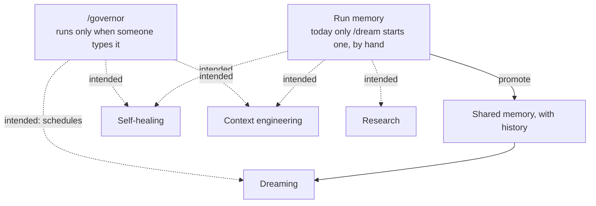
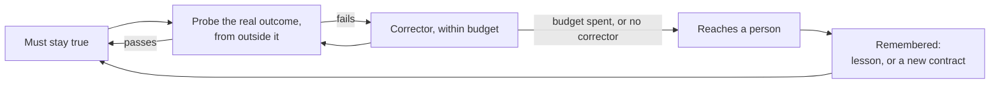

# Agentic pillars — the layers that let us build systems at scale

Eric, 2026-11-01: "Composing these layers are what enable us build up systems that deliver at
scale." A pillar is a capability the system keeps improving: dreaming, context engineering, loop
engineering, self-healing, memory management, research. Each one is built from the same four parts,
so they stack the same way. Plan: #6470.

_How the pillars are meant to stack. Solid lines run today; dashed lines are intended and not built.
No lane calls run memory: only `/dream` starts a run, and a person starts `/dream`. Nothing triggers
`/governor` on its own (#4527). The meter, `npm run meter`, is read by hand._

## Fitness contracts — what the layers are for

Eric, 2026-11-01: fitness functions define "the test that needs to pass", and when they don't, AI must
detect, correct and maintain; "fitness tests define self healing systems." So a fitness contract is the
top of every pillar. Run memory is how a correction retries, dreaming is how a new contract gets found,
and a charter's objective trigger is a failing contract. `scripts/fitness.mjs` holds them.

_The contract: each arrow is a place the bots outage broke._

| Part | The failure that taught it |
|---|---|
| **An outcome, not a proxy** | a green deploy step reported "current" over a stopped fleet for days |
| **Probed from outside** | a check inside the process dies with the process |
| **A corrector, or it is only an alarm** | a machine needing one start stayed down for lack of anyone to start it |
| **A budget** | catch-up redeployed every 15 minutes, 91 times, onto a machine that could not start |
| **It reaches someone** | the market-hours stall alert detected correctly from 10-18 and reached nobody, because its mail credential was never set |
| **Unknown is not a pass** | an erosion check read a skipped run as proof the failure had stopped |

**The measure of the measures is detection lag** ([`COACHES.md`](../COACHES.md)): time from when a failure
could be noticed to when it was. The roster in `COACHES.md` watches the code; these watch the running
system. A gate blocks a merge and a contract keeps production true, so a contract never blocks anyone's
PR. A contract that never fires gets retired, as harnesses decay too. `npm run meter -- --failure-to-fix`
reads it per failure and by source, with what follows it: filed to fix merged, and failure to verified.
Main CI and audit findings have a reading. A contract's lag reads unknown, because the read that fails is
the read that files, and when the failure began is stored nowhere.

**The first run, 2026-11-01:** bots running, bots responsive, main deploys and memory history passed.
Alerts reaching the owner failed. Startup size read unknown until its budget merges.

## The shape of a pillar

| Part | What it is | Why this form |
|---|---|---|
| **Something that measures it** | a fitness contract, gate or number | no number means no way to tell whether it helped |
| **A procedure** | a skill, loaded only when needed | deep detail without a standing context cost |
| **A conductor** | a scripted workflow | the plan lives in code, so conductors compose predictably |
| **A worker agent** | a chartered `.claude/agents/*.md` | only where `/charter` passes it |

This is the coach, drill and athlete unit of [`COACHES.md`](../COACHES.md), with the conductor added.
Close the loop before adding an actor (`CLAUDE.md`, the orchestration north star). A workflow's
`agent()` already gives a sub-agent isolated context and its own model, so an agent file adds value
only when more than one conductor needs the same worker.

## Where each pillar stands

| Pillar | Measures | Procedure | Conductor | Closes which stage |
|---|---|---|---|---|
| **Loop engineering** | attempts, time to verified (`scripts/agent-meter.mjs`) | `scripts/run-memory.mjs` | none yet: only `/dream` starts a run, by hand | decide, verify |
| **Memory management** | lost writes, collisions | `run-memory promote`, `scripts/hooks/memory-history.mjs` | part of dreaming | remember |
| **Dreaming** | proposals taken, repeat problems found | `/dream` | `.claude/workflows/dream.js` | sense, remember |
| **Context engineering** | startup by source, `CLAUDE.md` budget (`scripts/config-audit.mjs`) | [`WORKING-AGREEMENTS.md`](WORKING-AGREEMENTS.md), path-scoped rules | one-off runs | act |
| **Self-healing** | machine state, stops in 6 hours | `scripts/bots-start-stopped.sh`, `scripts/bots-revive.sh` | `pipeline.yml`, `bots-catchup.yml`, the repair lane | act, verify |
| **Research** | sources turned into findings | `/intake`, `/teardown`, `/research` | `.claude/workflows/grind.js` for batches, the event lane | sense |

## Charter verdicts, 2026-11-01

Six pillars went through `/charter` with the evidence from their own build, and all six conductor
agents stay rejected, because a conductor here is a script. Rejecting is the expected outcome, and each
rejection names what would reopen it. **Built since, neither one a pillar's conductor:** `worker`, the
file-and-shell stage agent these scripts share, and `evals-expert`, on request
([`COACHES.md`](../COACHES.md) → *Roster pass, 2026-11-01*).

| Candidate agent | Verdict | The script that conducts it today | Why | Reopen when |
|---|---|---|---|---|
| Loop engineer | Reject | none of its own: `.claude/workflows/grind.js`, `dream.js`, `post-merge-audit.js` and `clear-path-flip.js` are what the other pillars use | a library every agent uses, with no input or output of its own | never as an agent |
| Memory keeper | Reject | part of `.claude/workflows/dream.js`, plus `scripts/run-memory.mjs` and `scripts/hooks/memory-history.mjs` | a tool and a hook; 0 collisions in 20 writes across 32 sessions | a lock failure, or a commit naming the wrong session (under load the hook lost provenance, never content, so a lost write cannot show up) |
| Dreamer | Reject for now | `.claude/workflows/dream.js` | it already isolates its reads with sub-agents, and one run does not earn a standing role | a second conductor needs the same transcript analysis |
| Context curator | Reject for now | `.claude/workflows/grind.js` over `docs/grind/instruction-drift.instructions.md`; `scripts/config-audit.mjs` holds the size budget | the size gate can name a target, but the file is under budget with nothing to work, and `reviewer` holds the pre-merge read | the budget trips twice in a month |
| Self-healer | Reject, existing owners | `.github/workflows/bots-catchup.yml` runs `scripts/bots-start-stopped.sh` on a 15-minute schedule; `moneypenny-repair.yml` runs `scripts/moneypenny/repair.mjs` on a failed workflow | no single owner: the scripted start handles a stopped machine, and the repair lane handles a failed run but holds no Fly token, so it cannot act on a machine. In `scripts/fitness.mjs`, `bots-running` and `main-deploys` reach a fix with nobody asking, and no contract has a fix a lane can merge alone | a stop class recurs that scripted steps can't resolve |
| Research intake | Reject, existing owner | the research dispatch in `moneypenny-events.yml`; `.claude/workflows/symbol-sweep.js` and `grind.js` for batches | a procedure, with no isolation benefit worth an agent; the event lane covers its domain, and `render-alchemist` waits on the bench for a 3D reference | links arrive in batches that outgrow a session |

**Fitness contracts change what would reopen these.** `/charter` refuses an autonomous agent with no objective gate to name its target, and a failing contract with no corrector is exactly that gate. The trigger for a pillar's agent is therefore written down: it fails repeatedly, and scripted correction has run out of budget.

**This is a hypothesis with a falsifier.** Eric's instinct was one orchestration agent per pillar. If by
2026-12-31 a pillar's work repeatedly stalls for want of a standing owner, or two conductors have
copied the same worker prompt, this table is wrong for that pillar.

## Adding a pillar

1. Name the number that would show it working, and measure the before.
2. Write the procedure as a skill, with deep reference in files it links.
3. Script the conductor once the steps are stable; a conductor may call one other workflow.
4. Run the real failure that motivated it through the pillar as its first test.
5. Run `/charter` only then, with that evidence.
