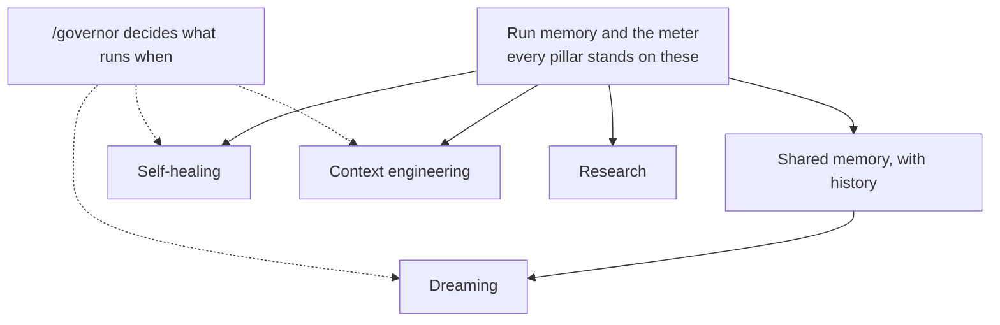

# Agentic pillars — the layers that let us build systems at scale

Eric, 2026-11-01: "Composing these layers are what enable us build up systems that deliver at
scale." A pillar is a capability the system keeps improving: dreaming, context engineering, loop
engineering, self-healing, memory management, research. Each one is built from the same four parts,
so they stack the same way. Plan: #6470.

_How the pillars stack: each uses the layers beneath it, and the head coach schedules them._

## The shape of a pillar

| Part | What it is | Why this form |
|---|---|---|
| **Something that measures it** | a number, gate or log | no number means no way to tell whether it helped |
| **A procedure** | a skill, loaded only when needed | deep detail without a standing context cost |
| **A conductor** | a scripted workflow | the plan lives in code, so conductors compose predictably |
| **A worker agent** | a chartered `.claude/agents/*.md` | only where `/charter` passes it |

This is the coach, drill and athlete unit of [`COACHES.md`](../COACHES.md), with the conductor added.
Close the loop before adding an actor (`CLAUDE.md`, the orchestration north star). A workflow's
`agent()` already gives a sub-agent isolated context and its own model, so an agent file adds value
only when more than one conductor needs the same worker.

## Where each pillar stands

| Pillar | Measures | Procedure | Conductor | Closes which stage |
|---|---|---|---|---|
| **Loop engineering** | attempts, time to verified (`scripts/agent-meter.mjs`) | `scripts/run-memory.mjs` | used by the others | decide, verify |
| **Memory management** | lost writes, collisions | `run-memory promote`, `scripts/hooks/memory-history.mjs` | part of dreaming | remember |
| **Dreaming** | proposals taken, repeat problems found | `/dream` | `.claude/workflows/dream.js` | sense, remember |
| **Context engineering** | startup by source, `CLAUDE.md` budget (`scripts/config-audit.mjs`) | [`WORKING-AGREEMENTS.md`](WORKING-AGREEMENTS.md), path-scoped rules | one-off runs | act |
| **Self-healing** | machine state, stops in 6 hours | `scripts/bots-start-stopped.sh`, `scripts/bots-revive.sh` | `pipeline.yml`, `bots-catchup.yml`, the repair lane | act, verify |
| **Research** | sources turned into findings | `/intake`, `/teardown`, `/research` | `.claude/workflows/grind.js` for batches, the event lane | sense |

## Charter verdicts, 2026-11-01

Six pillars went through `/charter` with the evidence from their own build. **Build list: none yet.**
Rejecting is the expected outcome, and each rejection names what would reopen it.

| Candidate agent | Verdict | Why | Reopen when |
|---|---|---|---|
| Loop engineer | Reject | a library every agent uses, with no input or output of its own | never as an agent |
| Memory keeper | Reject | a tool and a hook; 0 collisions in 20 writes across 32 sessions | a lost write shows up in the history |
| Dreamer | Reject for now | `dream.js` already isolates its reads with sub-agents, and one run does not earn a standing role | a second conductor needs the same transcript analysis |
| Context curator | Reject for now | the size gate can name a target, but the file is under budget with nothing to work | the budget trips twice in a month |
| Self-healer | Reject, existing owner | Moneypenny's repair lane owns this ([`MONEYPENNY.md`](../MONEYPENNY.md)), though the lane has no Fly token today | a stop class recurs that scripted steps can't resolve |
| Research intake | Reject, existing owner | a procedure, with no isolation benefit worth an agent; `render-alchemist` and the event lane cover their own domains | links arrive in batches that outgrow a session |

**This is a hypothesis with a falsifier.** Eric's instinct was one orchestration agent per pillar. If by
2026-12-31 a pillar's work repeatedly stalls for want of a standing owner, or two conductors have
copied the same worker prompt, this table is wrong for that pillar.

## Adding a pillar

1. Name the number that would show it working, and measure the before.
2. Write the procedure as a skill, with deep reference in files it links.
3. Script the conductor once the steps are stable; a conductor may call one other workflow.
4. Run the real failure that motivated it through the pillar as its first test.
5. Run `/charter` only then, with that evidence.
