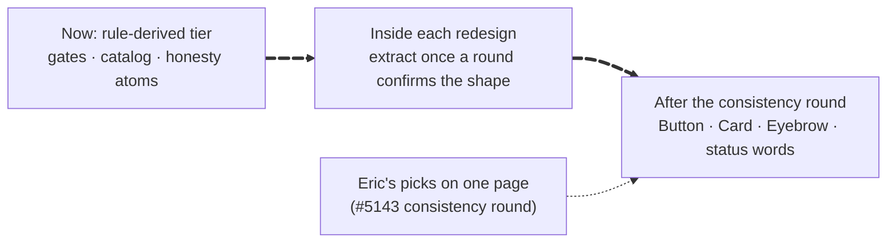

# Research: is a component library worth building, and through which door?

**Question (Eric, 2026-10-14):** would curating a component library (CL) that absorbs our shared
IA and design pay for itself? His expected outcomes: **(H1)** faster iterations at a lower token
cost; **(H2)** less time and fewer tokens spent iterating on earlier iterations; **(H3)** fewer
iterations, because decided-and-tested patterns are ready to propose on demand; **(H4)** more
consistent design, with fewer designs needed to fix inconsistencies. His gut says yes. If the study
strongly agreed, he wanted the build started, ideally through the redesign loop
([`process/REDESIGN.md`](../process/REDESIGN.md)).

**Date:** 2026-10-14 · **At:** `origin/main` f0efa235 · **Plan:** #5365 · **Method:** below the fold. In short, two
censuses (the code and the git history), six per-surface audits, external evidence, and a fit
check against the redesign loop. Each hypothesis was then argued by a blue team (for) and a red
team (against) and judged by a third agent.

## The call

**In one line:** build a **thin, owned layer of atoms and formatters** (the small parts every
screen draws: chips, labels, notes, number formats). Its payoff is **consistency and getting each
fix everywhere at once**. It is **not** a lever on redesign-round cost or round count. Those are
set by how sessions are run (#5250) and by decisions about the screen's job, its words and its
reading order (the #5160 retro).

_Caption: the order the library gets built in. Parts whose shape a house rule already fixes come
first; parts whose shape is still being redesigned wait for a round to confirm them._

| # | Claim | Call | Conf. | Why | Proves it wrong |
|---|---|---|---|---|---|
| H1a | Cheaper, faster **redesign rounds** | **don't**: not a lever | high | About 70% of a round's tokens are session shape (re-read context 31%, fixed 19%, cache writes 18%, cold resumes 11%, #5250). Drawing is ≤2.5M of the 17.7M median. | By 2026-11-14, ≥4 paired stage-3 rounds built from app components cost ≥20% fewer median tokens than HTML-frame rounds, with session shape held fixed |
| H1b | Cheaper **UI builds** | **measure first** | low | The only number is one vendor benchmark (Storybook MCP −27% tokens), and it credits the index, not the library. Nothing here measures per-build tokens. | By 2026-11-14, the next 3 builds that use an extracted part show no saving beyond ±10% against 3 comparable prior builds |
| H2 | Less rework: fix once, everywhere | **validated, narrowed**: only when the fix is the part's default and agents are routed to it | medium | Scroll reset took 17 days to reach every surface until one helper and a gate shipped (#4965). The shared section switch still left 4 of 5 callers unfolded because the fold is opt-in. 28 files hand-roll a control that `toggle.tsx` already provides. | By 2026-11-30, a same-fix-per-surface incident recurs in a covered family, or hand-rolled toggle copies rise above 28 |
| H3 | Fewer iterations thanks to paved paths | **don't, as worded** | medium | The #5160 retro ties all 6 avoidable rounds to vocabulary, the screen's job and reading order. Only 11 of 95 commons findings are rooted in a component. | By 2026-11-14, ≥25% of round-causing turns across ≥5 retro'd sessions are component-rooted |
| H4a | Consistency goes up | **validated for atoms** | high | 47 of the 52 visible, unjustified inconsistencies sit in copied atoms. Several break hard rules: LIVE drawn as HUMAN's green chip (`decisions-section.tsx:202`), errors shown by hue alone. | By 2026-11-30, a re-audit of covered families shows less than a 50% drop in their items |
| H4b | Fewer designs needed overall | **don't** | medium | About 88% of what drives rounds is wording (23), IA (16) and judgement, not parts. | By 2026-12-15, the next 5 sessions after the atoms land average ≥30% fewer rounds to a filed build |
| SEQ | Library first, redesigns as its test | **validated, split by volatility** | medium | Process-first applies to the gates, the catalog and the rule-derived atoms. Metz's caution against the wrong abstraction applies to layout-bearing parts the 19 sessions are still drawing (8 are at round 0). | By 2026-11-14, ≥3 redesign PRs change a first-tier atom's API, or ≥5 builds file and none restructures a panel, row or shell shape |
| — | A full library wave now (Button, Card, Eyebrow, Chip base, status words across 60+ files) | **don't** | high | These parts carry open taste forks (radius, compact size, label spec, status hues). Parallel cross-app waves already clobbered each other's screenshots (LESSONS 2026-10-10). | By 2026-10-31, the forks have been picked in the #5143 consistency round, so these become ready slices |
| — | Every part ships with a catalog entry and a reuse guard | **validated** | medium | ENGINEERING.md claimed a shared library for weeks while `app/src` imported nothing from it. GitClear and Storybook both put the gain in **routing** agents to parts, not in parts existing. | By 2026-11-14, build PRs still add hand-rolled copies of a catalogued family |

**Your gut, re-read.** It was right that this is worth doing as an ongoing investment, but for
quality, honesty and fix-once reasons. The token and round savings it expected are not in the
evidence. They get a dated test (below) rather than a build-out.

<strong>The evidence, in numbers</strong>

### What the code says (`app/src`, 16.7k CSS lines, 32.8k TSX lines)

| Measure | Today |
|---|---|
| Colour declarations on tokens | 1,723 of 1,735 (99%) |
| Spacing / font-size on tokens | 89 of 1,263 / 105 of 740 |
| Raw literals that already equal a token | 318 font sizes, ~420 spacings |
| Radius token | **none**: 252 raw values, 18 distinct |
| CSS rule lines duplicating another file's rule | ~11% (1,565 / 14,451, lower bound) |
| Distinct class families: buttons · chips · cards · stat strips · toggles | 18 · 25 · 27 · 24 · 22 |
| Number formatters | 64 definitions in 49 files; `pct` alone 12, each different |
| Shell modules imported by exactly one file | 128 of 209 (61%) |
| Shared `Toggle` importers vs files hand-rolling the same control | 3 vs 28 |
| What the duplication gate sees | root `src/**/*.ts` only, not `app/` |

### What the six surfaces show

76 cross-surface inconsistencies, 52 member-visible with no different job to justify them (4 at
severity ≥3). Each surface's audit concluded the same: the **data-heavy parts are already shared
React components** (positions table, symbol field, section switch, page frame); the **small parts
have no component layer at all** and live as CSS classes in other surfaces' stylesheets (`.btn`
in `gate.css`, `.chip` and `.note` in `board.css`). Severity-3 examples: the Orders pane's frame
CSS was deleted in #3467 while its 4 consumers stayed, so three of four sections render unstyled;
one filing status is drawn in opposite hues on two screens; the "decide by" calendar glyph means
different things on R&D and Profile.

### What the history says

- **Consistency rework is small.** 13 of 396 `app/src` commits (3.3%) were real cross-surface
  unifications.
- **What it costs is lag, not volume.** The same fix travels screen by screen: scroll reset,
  the section switch's "More" fold, and row-becomes-card on a phone, which was built twice.
- **The redesign loop has run 19 sessions and about 37 design rounds.** The median round costs
  $7.02 (17.7M tokens), and a screen costs $18.26 to reach a filed build.
- **Components are not what drives those rounds.** Of 95 commons findings, 5 are tagged
  `component`, about 11 are component-rooted in all, 23 are wording and 16 are IA moves.
- **Two of the six upstream rows in the IA ledger are shared shell parts:** U3, the section
  switch (hits 5 screens, #5206), and U6, the frame (#5207).

### What practitioners report

- **Gains:** Sparkbox/Carbon −47% build time (n=8). Figma: designers up to 34% faster.
  Storybook MCP: 27% fewer agent tokens, credited to the manifest. GitClear: duplicated blocks
  ~8× in AI-heavy code, which is the drift a library has to steer against.
- **Costs:** Metz's wrong abstraction, the maintenance tax (Shopify Polaris's two-year legacy
  components), and small-team overkill.
- **The minimum shape practitioners recommend for one owner plus agents:** tokens enforced by a
  linter, a few primitives extracted after the rule of three, a machine-readable index, and a
  guard that routes agents to that index. No docs site, no versioning.

<strong>The plan: what is built, in what order, and when it stops</strong>

**Tier 1, before the next redesign round** (rule-derived, no taste call, one small PR each):
- **C1:** restore the Orders pane frame. A bug, filed `fast-track` as #5364.
- **G2:** point the duplication, clone and dead-code scans at `app/src`.
- **G1:** an advisory CSS-literal ratchet.
- **I1:** `app/src/ui` and its generated catalog, plus a correction to ENGINEERING.md.
- **KindChip / EnvPill:** SIM/LIVE moves to its own neutral pill.
- **C2:** delete the dead NetWorth components.

**Tier 2, inside redesigns** (a commons `request` to the owning session; each lands when that
surface's build files, never as an app-wide wave):
- QueryState / InlineResult
- FilterChip with ✓ (#5161)
- Disclosure
- EventGlyph (#5158)
- SegmentedControl (once #5174 scopes it)
- The number module's skeleton and U+2212 minus, as a #5204 slice
- Dates (#5203)

**Tier 3, after Eric's consistency round** (one rendered page of every fork in #5143):
- Button sizes
- Card / Panel and radius
- Eyebrow / SectionHead
- Chip base
- Status words and hues
- LockedDoor
- Section-switch overflow, which #5206 owns

**Process hooks:**
- A "promote to `app/src/ui` + catalog" row in REDESIGN.md's learn-forward step, routed through
  the curator.
- `.github/prompts/design-build.md` repointed at `app/src` and the catalog. The file is
  envelope-protected, so the change boards the platter.

**Stop rule.** Pivot back to redesign work at the first of these:
- (a) the last 3 library PRs close fewer than 2 ledger items **and** move no census number by
  ≥10%;
- (b) only taste-forked items remain;
- (c) a primitive needs a visual-regression fix-up, which is the wrong-abstraction signal;
- (d) 20 library PRs or 2026-10-21.

**Baseline for every slice to report against:** the 52-item ledger, duplicate CSS lines 11%,
raw font-size 635, raw spacing 1,148, raw radius 252, `pct` definitions 12, formatter
definitions 64.

**The token test, read 2026-11-14:**
- **Rounds:** in the next two sessions that reach stage 3, draw one section twice, once composed
  from `app/src` on a scratch branch and once as HTML frames. Hold session shape fixed.
- **Builds:** log tokens for the next 3 builds that use an extracted part, against 3 comparable
  prior builds.
- **Rework:** `git log -G` on covered families through 2026-11-30.

<strong>Method and limits</strong>

- **Censuses.** The code census parsed every CSS file with postcss and counted imports
  statically; its duplicate matching is exact, so 11% is a lower bound. The history census
  counted git subjects with hand checks: about a quarter of keyword hits were real.
- **Surface audits.** Six auditors (trade, accounts, activity, research, member pages, shell)
  each read about 30 files and confirmed every "elsewhere" citation by grep. Audits are code
  reads, not rendered frames, so a few visual claims are inferred from CSS.
- **External evidence** came from search excerpts; two primary pages failed to load, so those
  numbers are cited, not verified. None of the studies measures a single-owner, AI-authored
  codebase.
- **Adjudication.** A blue team and a red team argued each hypothesis independently. A judge
  wrote the sheet above, re-checking key citations against f0efa235.
- **Re-runnable.** Raw outputs were session scratch; the G1/G2 scans make the census numbers
  CI-measured from here on.

