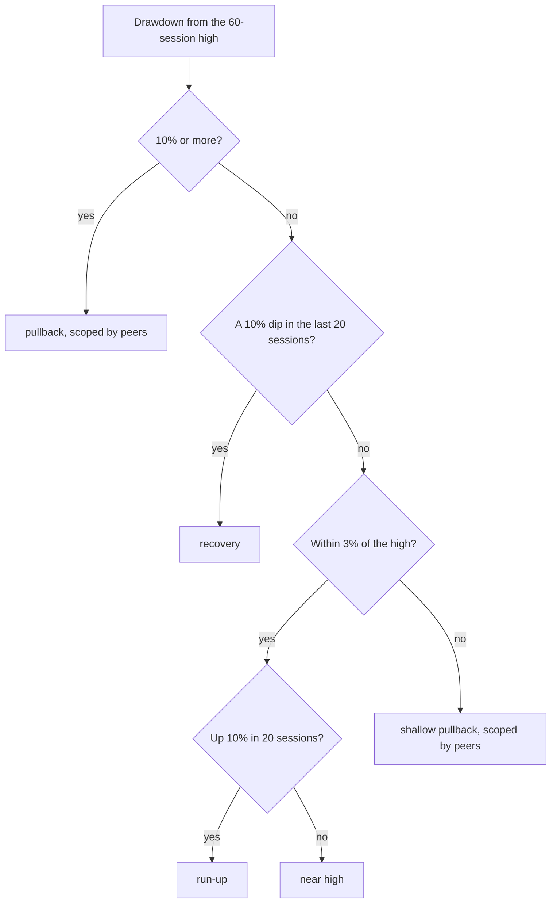

# The swing, read from today's weather: CRWV is mid-pullback, NVDA is at the edge of one

**Kind:** event study (price + today's chain) · **Date:** 2026-10-16 · **Symbols:** CRWV, NVDA · **Impact:** high
**Last assessed:** 2026-10-16

**Question (Eric, 2026-10-16, on [#5482](https://github.com/ejclark/skynet-capital/issues/5482)):**
_"The real questions are geared around determining how much more pullback there may be, gauging
where the bottom is, and timeline to swing back up."_ Read today's conditions (the weather), not a
fixed calendar rule (the almanac). This is #5482 slice 1, "the swing study": a floor band (where a
cash-secured put strike would sit) and a recovery band (what long-call expiry it implies).

Reproduce: `node scripts/research/cycle-phase.mjs CRWV,NVDA --episodes`. Paper only; educational.

## The call

| Ticker · question | Call | Confidence | Why | Proves it wrong |
|---|---|---|---|---|
| CRWV · phase and floor | **Pullback (sector-wide). The floor is probably still below: $48–$52.** | low | 37 past episodes in this weather fell a further 17% (median); lows came ~23 sessions in | Lowest close 10-16 → **2027-01-19** outside $41.0–$60.9 (the 10th–90th band) |
| CRWV · sell a put before the print | **Stand aside.** If sold anyway: $52 or lower, 11-06 | low | $54 put priced at 20% odds; analogs finished under it 16–24%. Fair, not rich | The $54 11-06 put and the next 2 pre-print Δ0.20 puts all expire worthless (first: **2026-11-06**) |
| CRWV · long call | **Don't buy one expiring before the print.** Any call: expiry after **2027-02-01** | low | Analogs got back to the entry in 14 / 37 / 72 sessions; 35% had not by 63 | CRWV closes ≥ $63.15 by **2026-11-05** and holds it through 11-20 |
| NVDA · phase and floor | **Shallow pullback (sector-wide). Floor ~$201 (median), $182 (p25)** | low | 54 own-history episodes; the band matches any NVDA day. Today's weather adds nothing | Lowest close 10-16 → **2027-01-19** under $153.6 or above $216.2 (outside the 10th–90th band) |
| NVDA · sell a put before the print | **Stand aside; record the cell** | low | $200 put ended in the money in 9% of analogs vs 20% priced; 18–21% in every neighbouring cell | The same cell, re-run after **2027-01-19**, keeps ≤ 10% at ≥ 60 episodes |
| NVDA · long call | **No phase signal. S1-NVDA keeps its own calendar.** Any call: expiry **2027-01-15** or later | low | Back to entry in 5 / 16 / 62 sessions; 76% by 63, the same as any NVDA day | NVDA still below $216.63 on **2027-01-15** |
| Both · the detector | **Use it as the swing model's input; size nothing on it yet** | medium | Bands are calibration claims resting on ≤ 52 independent sell-offs | Of the first 8 readings, fewer than 2 land in their 25th–75th further-low band, or more than 3 fall outside the 10th–90th (first: **2027-01-19**) |

**TL;DR.** CRWV's bottom is probably lower ($48–$52) and after the 11-09 print. NVDA's history
shows nothing unusual about today. Neither pre-print put is rich.

**Signals & conditions:**

- **Buy signal:** no — neither band licenses a new long before the print.
- CRWV put: wait for the post-print re-run; strike $52 or lower.
- CRWV call: needs an expiry after 2027-02-01; the 11-06 expiry is too short.
- NVDA: one bad session (a close under $215.32) moves it to a 10% pullback; re-read then.

---

## 1. Today's readings (10-16, mid-session)

The bars were fetched at 15:27 UTC (11:27 ET), so "close" is the price at that time. The chain
was read at 15:31 UTC (Cboe, delayed).

| | CRWV | NVDA |
|---|---|---|
| Phase | **pullback (sector-wide)** | **shallow pullback (sector-wide)** |
| Price · 60-session high | 63.15 · 107.73 (46 sessions ago) | 216.63 · 239.24 (8 sessions ago) |
| Drawdown · bucket | −41.4% · 30–45% | −9.5% · 3–10% |
| Peers 10%+ off their highs | 4 of 5 (NVDA −9%, NBIS −38%, MU −18%, AVGO −21%, AMD −16%) | 5 of 5 (CRWV −41%, NBIS −38%, MU −18%, AVGO −21%, AMD −16%) |
| VIX | 16.11 (calm) | 16.11 (calm) |
| Realized vol, 60 sessions | 104% | 37% |
| Last print · next | 2026-08-11 (47 sessions ago) · 11-09 window start (16 sessions) | 2026-08-26 (36 ago) · 11-17 window start (22 sessions) |
| Last expiry before the print | 11-06 (15 sessions) | 11-13 (20 sessions) |
| 30-day implied vol vs CRWV's / NVDA's next-30-day realized | 93.9%, above 63% of outcomes, +0.1 pts over the mean: **thin (low)** | 35.0%, above 32%, −2.6 pts: **stand aside (low)** |
| Pre-print puts | Δ0.20 $54 bid 1.79 (−14.5%) · Δ0.30 $58 bid 2.95 (−8.1%) | Δ0.20 $200 bid 2.46 (−7.7%) · Δ0.30 $205 bid 3.50 (−5.4%) |

**The weather is an AI-sector selloff, not market fear.** Every tracked AI name except NVDA is 16–41%
under its high while the VIX sits at 16. That matters for the one hopeful split in the house record:
NVDA dips with VIX ≥ 25 finished up 17 of 25 times (`dip-entries-nvda-crwv.md`, row 6). Today is the
other side of that split.

## 2. The bands

Each row is a set of past sessions in the same conditions. Each episode counts once (the median over
its sessions). "Clusters" merge episodes on different names in the same sell-off; that is the honest
n. Further low = the lowest close in the next 63 sessions against the entry close. Back to entry =
sessions from entry until a close at or above it, after the low.

### CRWV (headline: pooled basket, all three conditions)

| Sample · conditions | Sessions · episodes · clusters | Further low p25 / median / p75 (vol-scaled median) | Low at (median) | Back to entry p25 / median / p75 | Entry by 63 · old high by 126 | Close at 11-06 p10 / p20 / median | $54 put in the money (scaled) |
|---|---|---|---|---|---|---|---|
| CRWV own · all three | 31 · 2 · 2 | −28.0 / −26.4 / −24.7% (−30.5%) | 9 | 19 / 19 / 25 | 2 of 2 · 0 of 2 | −15.9 / −14.2 / −9.1% | 0 of 2 |
| CRWV own · any day | 308 sessions | −42.8 / −28.7 / −15.9% | 37 | 22 / 55 / >126 | 58% · 24% | −24.4 / −17.6 / −1.8% | 28% |
| **Pooled · all three** | 370 · 37 · **25** | **−24.0 / −16.9 / −8.1%** (−24.4%) | **23** | **14 / 37 / 72** | **65% · 30%** | −19.0 / −8.8 / +0.9% | **16% (24%)** |
| Pooled · drawdown + peers | 1,271 · 80 · 33 | −22.8 / −11.2 / −3.7% (−17.6%) | 14 | 2 / 21 / 70 | 69% · 41% | −10.7 / −5.5 / +5.6% | 9% (11%) |
| Pooled · drawdown only | 1,472 · 79 · 32 | −22.8 / −13.0 / −3.5% (−20.1%) | 16 | 3 / 24 / 72 | 70% · 38% | −11.1 / −5.1 / +5.8% | 8% (9%) |
| Pooled · any day | 21,224 sessions | −19.3 / −9.2 / −3.0% (−21.7%) | 20 | 8 / 32 / 73 | 71% · 69% | −12.1 / −6.9 / +1.8% | 7% (22%) |

- **The weather moves CRWV's band.** 27 of the 37 pooled episodes fell further than an ordinary
  day's median (−9.2%); by chance that happens with P 0.004. Most of it is the volatility that comes
  with a 30–45% drawdown: scaled to today's vol, the gap is −24.4% vs −21.7%.
- **The floor band, in dollars:** median $52.48 (raw) to $47.74 (vol-scaled); CRWV's own 2 episodes
  $46.48. The 10th–90th band is $40.98–$60.88.
- **The low tends to come after the print.** The median analog bottomed 23 sessions in (11-18); the
  print window opens 11-09, session 16.
- **The CRWV-LONG-CALL conviction check (2027-01-29, #5484)** sits between the median (12-09) and the
  75th percentile (02-01) of back-to-entry. By that date about 30% of analogs had still not recovered.

### NVDA (headline: NVDA's own history, all three conditions)

| Sample · conditions | Sessions · episodes · clusters | Further low p25 / median / p75 | Low at (median) | Back to entry p25 / median / p75 | Entry by 63 · old high by 126 | Close at 11-13 p10 / p20 / median | $200 put in the money |
|---|---|---|---|---|---|---|---|
| **NVDA own · all three** | 434 · 54 · **52** | **−16.2 / −7.2 / −1.9%** | **12** | **5 / 16 / 62** | **76% · 81%** | −9.4 / −4.4 / +4.2% | **9%** |
| NVDA own · drawdown + peers | 660 · 61 · 59 | −16.4 / −7.5 / −2.0% | 13 | 5 / 20 / 57 | 79% · 89% | −11.0 / −4.9 / +4.6% | 13% |
| NVDA own · any day | 5,419 sessions | −16.6 / −7.3 / −2.3% | 16 | 6 / 26 / 62 | 76% · 78% | −12.5 / −6.5 / +3.1% | 18% |
| NVDA own · all three, one bucket deeper (10–20%) | 352 · 39 · 38 | −13.8 / −6.3 / −2.1% | 14 | 5 / 23 / 65 | 74% · 74% | −12.1 / −7.6 / +5.7% | 21% |
| Pooled · all three | 1,236 · 158 · 49 | −19.3 / −7.5 / −1.8% | 13 | 5 / 25 / 64 | 73% · 75% | −13.2 / −7.5 / +3.0% | 19% |

- **Today's weather adds nothing for NVDA.** Every NVDA row matches its any-day row within noise.
- **The $200 put cell (9% vs 20% priced) is the study's one seller's edge, and it is fragile.**
  About 5 of 54 episodes. If the true rate were 20%, P(≤ 5) is 0.028, but the study read about 40
  cells. The next bucket (one close under $215.32 away) shows 21%, any NVDA day 18%, the pool 19%.
  Record it; don't trade it.
- **Floor band in dollars:** median $201.0, 25th percentile $181.5, 10th–90th $153.6–$216.2.

## 3. Method

_The price phase. A print overlay is added: pre-print (≤ 10 sessions to the next print) or
post-print drift (≤ 10 sessions since the last)._

- **Peers scope:** sector-wide when at least half of the peers with data that session are 10%+ off
  their own high (and at least 2 have data). Peers: NVDA, CRWV, NBIS, MU, AVGO, AMD, minus the name.
  Before 2009 only MU and AMD (and NVDA) have data, so early flags rest on two peers.
- **The match:** same drawdown bucket (0–3, 3–10, 10–20, 20–30, 30–45, 45%+), same peers scope, same
  VIX bucket (< 20, 20–25, ≥ 25). Each condition is then relaxed in turn and printed.
- **Samples:** each name from 2005 (CRWV from 2025-04-28, NBIS from 2024-11-18, AVGO from
  2009-09-03), and the pooled basket of all six. A session needs 63 sessions after it to count.
- **Independence:** sessions within 20 of each other on one name are one episode; episodes across
  names within 30 calendar days are one cluster. For a common state (NVDA's 3–10% with drawdown
  only) the clusters chain into a few long blocks, so the cluster count there is a floor.
- **Headline rule:** own history at the most specific level with ≥ 8 episodes, else the pool at the
  most specific level with ≥ 8 clusters.
- **Vol-scaling:** a pooled outcome divided by its entry's 60-session realized vol, times today's.
  A check on 4,222 basket sessions: by realized-vol fifth, median further low ran −5.0, −6.9,
  −10.0, −15.1, −12.2%; scaled, −0.19, −0.19, −0.24, −0.28, −0.16. Scaling is flatter than raw,
  but it overstates the highest-vol fifth, and CRWV (104%) sits above it. Read the true band as
  between raw and scaled.
- **Prints:** EDGAR 8-K Item 2.02 dates; the next print is the window start in
  `src/domain/earnings-calendar.ts` (CRWV 11-09, NVDA 11-17). NBIS files 6-Ks, so it has no print
  clock; it only serves as a peer and a sample.
- **Options:** today only. `premium-fit.mjs`'s fit test, and `putAtDelta` on the last expiry before
  the print. A put is "in the money" if the close at that expiry, relative to entry, sits at or under
  the strike's distance from today's price.

## 4. Limits

- **Closes, not intraday lows,** and no option-price history: implied vol is a reading, never a
  historical condition.
- **CRWV's own history is 2 episodes.** Its headline is borrowed from the basket, and the basket's
  analogs are mostly 2005–2019 AMD, MU and NVDA, a different market.
- **The reading is mid-session.** CRWV had moved −9.4% on the day by 11:27 ET; a re-run after the
  close may land in another bucket.
- **Comparisons:** about 40 band cells were read across two names. Two P values are quoted; neither
  is adjusted.

## 5. Builder appendix

- `scripts/research/cycle-phase.mjs`: loads data, reads today, matches history, picks the headline;
  `--peers A,B`, `--no-chain`, `--episodes`, `--json=PATH`, `--next-print SYM:YYYY-MM-DD`.
- `scripts/research/cycle-phase-math.mjs`: the phase rules and outcome reducers, pure; specified in
  `tests/research/cycle-phase-math.spec.ts`. A recovery not seen is `Infinity`, never dropped.
- `scripts/research/cycle-phase-report.mjs`: formatting only.
- Session dates in the sheet count NYSE holidays: 15 sessions = 11-06, 23 = 11-18, 37 = 12-09,
  62 = 2027-01-15, 63 = 2027-01-19, 72 = 2027-02-01.
- Feeds #5482 slice 1's conviction doc (`docs/research/convictions/ai-dip-2026-10.md`, next) and
  #5483 slice 1's backtest, which shares this swing data.
