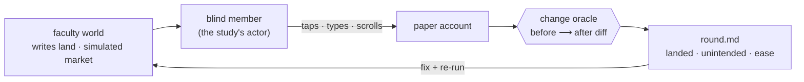

# The faculty — simulated members try to CHANGE their account, and the account says whether they did

_The change-study twin of the member study (`docs/members/study/README.md`). The catalog it runs is
[`docs/members/change-scenarios.md`](../../docs/members/change-scenarios.md)._



- **Why it exists.** Journeys check a member can *reach* a screen and the study checks they can
  *read* it. Neither could check a member can *change* their account, because offline writes were
  no-ops and the open boot refuses trading. Before this, no test at any level pressed Submit and
  read the order back.
- **What it grades.** The account, never the member's claim: the orders and positions before the
  first tap and after the last, against the scenario's `end` spec. Any **unintended** write (an
  order nobody asked for, a working order cancelled unasked, a position that moved) fails the
  session and is listed whatever the verdict. Those are the safety numbers.
- **Two floors.** `e2e/changes.spec.ts` plays the optimal path of the core changes in CI with no
  model, and `round.mjs` sends blind members through the catalog.

<details><summary><strong>Run it</strong></summary>

```sh
npm run build --prefix app                                   # the shell the server serves
npx tsx scripts/faculty/drive.mjs --scenario scripts/faculty/scenarios/EQ-01.json \
  --out <fresh dir> [--viewport phone|desktop] [--actor sealed|scripted:<actions.json>] [--port 8800]
npx tsx scripts/faculty/round.mjs --scenarios scripts/faculty/scenarios --out <fresh dir> \
  [--only EQ-01,OM-02] [--concurrency 3]                     # → <out>/round.md
npx playwright test --project changes                        # the model-free floor (CI runs it)
```

- `--actor sealed` is the study's blind member (`docs/members/study/roles/actor.md`, a fresh
  `claude -p` that sees only the card, the task and the frame); it needs the standalone `claude`
  signed in. `scripted:<file>` replays a fixed finger. `scripts/faculty/proof/` is the harness proof.
- Each session boots its own faculty server (`world.mjs`) on `--port` (+1 for the bridge), so a
  round runs sessions side by side and nobody's order leaks into the next run.
- Cost, measured on the first run (2026-11-16): ~40s a blind turn, 10–20 turns a session, so ~10
  minutes a session; three at once on a 4-CPU box.

</details>

<details><summary><strong>The world</strong> (<code>world.mjs</code>)</summary>

- The journeys' session boot (crawl@example.test owns Eric's account; friend@example.test is an
  invited member who owns XLE and the Day Trader) plus `SKYNET_OFFLINE_WRITES=apply`:
  - `src/adapters/writable-fixture-trading-transport.ts`: orders, replaces, cancels and closes
    land in an in-memory paper account, with Alpaca's own refusals (403 for buying power, 422 for
    a malformed order) and fills published to the board.
  - `src/adapters/synthetic-market-transport.ts`: quotes, chains and contracts priced from one
    mark per underlying (`FACULTY_MARKS`) with the house Black-Scholes, so option scenarios have a
    chain.
- Eric's book: $40,000 cash, EEM 950, AAPL 100, 2 × NVDA Dec $180 calls (up ~70%), and one working
  order (BUY 10 MSFT LIMIT $400 GTC).
- **The clock is the wall clock.** After hours the market is closed and orders queue (`working`),
  the way a paper account answers an evening order. Scenarios therefore never name a date, and
  their `end` accepts `["working","filled"]`.

</details>

<details><summary><strong>A scenario file</strong> and the <code>end</code> grammar</summary>

```jsonc
{ "id": "OM-02", "member": "returning-trader", "viewport": "phone", "start": "/app", "optimal": 7,
  "scenario": "second person, the member's reason and goal — never a route, never a control label",
  "end": {
    "orders":   [{ "symbol": "AAPL", "side": "sell", "quantity": 100, "orderType": "market",
                   "state": ["working", "filled"] }],          // each matches exactly one NEW order
    "cancelled": ["faculty-msft-limit"],                        // ended cancelled (or replaced)
    "replaced":  [{ "id": "faculty-msft-limit", "limitPrice": [404, 406] }],
    "positions": { "AAPL": 0 },                                 // quantity after
    "refusal": true,                                            // success = nothing landed
    "noOtherWrites": true                                       // the default
  } }
```

Options match on `underlying`, `optionType`, `strike` and `expiryDays` (`[lo, hi]` days from the
run). A `[lo, hi]` pair is a range, a list of strings is any-of, and anything else must be equal.
`oracle.mjs`'s header is the contract; `tests/scripts/faculty-oracle.spec.ts` specs it.

</details>

## What it found (dated, newest last)

- 2026-11-16 · **the first scripted run lost the quantity.** Tapping the Shares label right after
  typing a symbol focused nothing. The `mousedown` blurred the symbol field, its in-flow suggestion
  list folded and the quote line arrived, the form moved, and `mouseup` landed on the input, so the
  browser sent `click` to their common parent. The fix defers the blur's effects until the tap's
  `click` (`app/src/shell/symbol-field.tsx`). It is pinned in `e2e/changes.spec.ts` at phone width.
- 2026-11-16 · **the first blind member placed the order (13 turns, ease 5/7)** and named three
  costs: the ticket starts below the fold on a phone, the form seeds Limit at the mid so a market
  order needs a switch, and the Review button scrolled in under Moneypenny's dock. The dock now
  publishes its height as the page's `scroll-padding-bottom`, so a focused control stops clear of it.
- 2026-11-16 · **the static census behind the catalog** (5 readers) found that Modify ran none of the
  desk's checks, the ticket only knows "to open", and several review states had no way back. Each
  is in the catalog's *Gaps* with its file and line.
- 2026-11-17 · **round 1 (22 sessions): 10 landed as recorded, 9 of 16 once the instrument's own
  faults were set aside.** Every give-up was a member who could see what they wanted and could not
  reach or finish it: a working order invisible on a phone, typing that appended to a seeded amount,
  no count on an option close, "per share" never said, and a card that said "nothing sells from
  here". Nine causes were fixed, and three placement decisions went to Eric (#7669, #7670, #7671).
- 2026-11-17 · **the instrument had faults too, and now detects them itself.** The actor could press
  only Enter and Escape (now Backspace and Tab as well, with a count). An edit to the role prompt
  mid-round told members about keys the loaded recorder refused (a round now copies its role at
  start). A rebuild of `app/dist` mid-round served stale chunks (a session now records the build it
  ran on). `regrade.mjs` re-scores any round from its recorded accounts and sets aside a session the
  instrument broke. Rule: **never rebuild the app or edit a role while a round runs.**
- 2026-11-17 · **round 2 (23 sessions): 18 of 21 counted landed, none with an unintended write.** The
  three left were phone sessions in the Orders and Watchlist sections: round 1's "More ▾" fix was half
  done, because its list was clipped by the scrolling row. That is fixed. The CI playthrough that pins
  it asserts the item is whole on screen, since Playwright's click scrolls inside a clipping row, which
  a member cannot do. Lesson: **a CI playthrough must assert what a person sees before it acts.**
